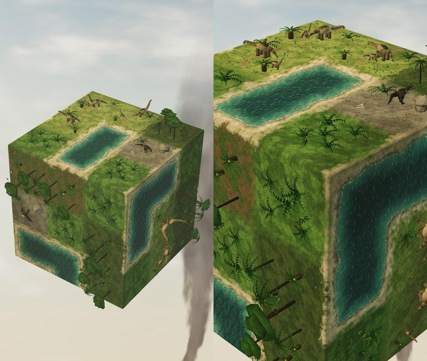
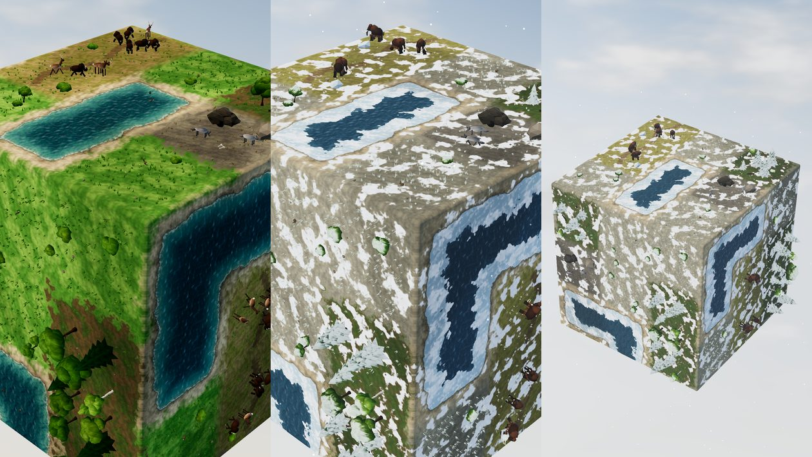
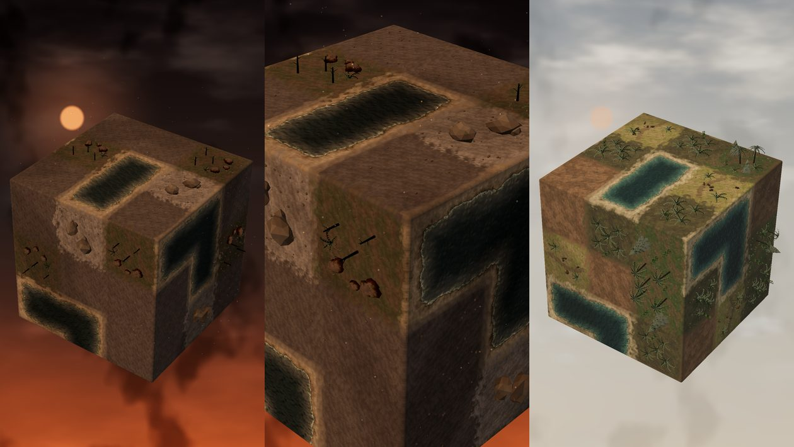
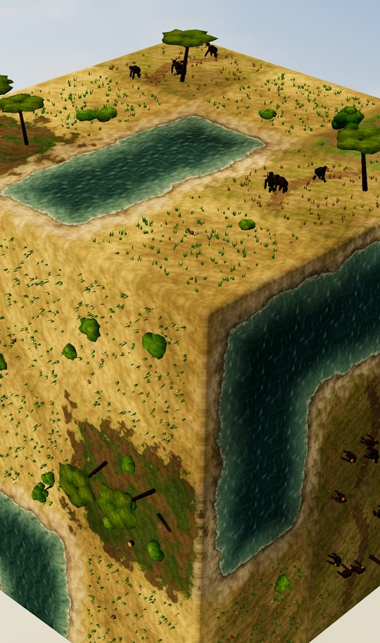
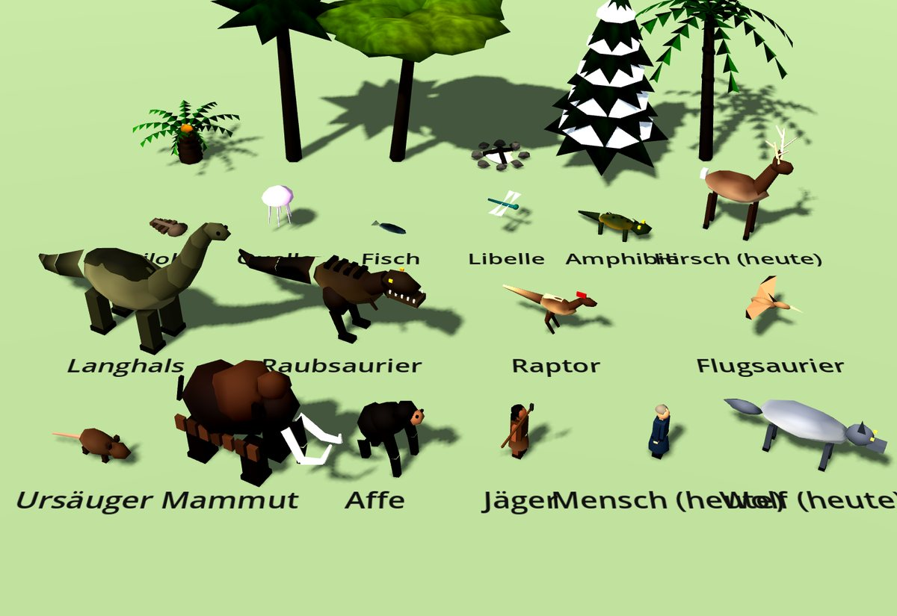
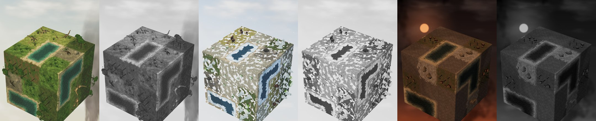

# gdpd – Grafik der Erdgeschichte: Zeitalter, Tiere, Pflanzen, Ereignisse

Stand: 10. November 2026 (Rev. 1). Grundlage ist Philipps Entscheidung vom 10. November (`NAECHSTE_SCHRITTE.md`):
**nicht an die Bibel halten, keine 7 Schöpfungstage.** Die Kampagne folgt nur der Erdgeschichte in Zeitaltern, mit
vielen Leveln und einem neuen Level pro echtem Tag, offen erweiterbar („dann kommen noch Dinos usw. vor den Affen …
mach es sehr ausführlich“).

Dieses Dokument ersetzt in `GDPD_SCHOEPFUNG_GRAFIK.md` alles, was an den 7 Akten hängt: Abschnitt 2.2 (Stufen je Akt),
3 (Looks je Akt), 8 (Sonnenseite als Akt 4) und die Akt-Kacheln in 9. Alles andere gilt dort unverändert weiter:
Zeitalter-System (`Eras`, `World.set_era`, `Look.set_era`), Lava, Wasser-Familie mit `w_life`, Wasser dreht mit,
Zusammenwachsen, Verlust-Hinweis, Gefahren mit Vorzeichen, ruhige Felder ohne Symbole (Build 12), Leistungsgrenzen.
Es gelten weiter die Grundregeln aus `GDPD_GRAFIK.md`: **realistisches Miniatur-Diorama, Lesbarkeit zuerst, eine
Würfelseite ist eine Landschaft (nahtloser Boden-Shader mit 8 Nachbarn), Wasser ist ein zusammenhängender Körper,
gesättigte Farbe ist ein Spielsignal.**

Die Regeln (welche Art wann wächst, Ids, Level-Tabelle) gehören in die Regel-Spec. Dieses Dokument legt fest, **wie**
die Zeitalter und ihre Lebewesen aussehen, und schlägt vor, welche Gestalt eine Art in welchem Zeitalter bekommt.
Es nennt nie Level-Nummern, damit es zu jeder Länge der Kampagne passt.

Inhalt: 0 Prototypen · 1 Leitlinien · 2 Zeitalter-System (Erweiterungen) · 3 Looks je Zeitalter · 4 Arten als Gestalt
des Zeitalters · 5 Tiere · 6 Pflanzen und Dinge · 7 Zusammenwachsen (Herden, Schwärme, Rudel) · 8 Ereignisse
(Meteor, Eiszeit, Feuer, Vulkan) · 9 Übergänge und „nicht spoilern“ · 10 Trailer · 11 Leistung · 12 Umsetzung ·
13 Reihenfolge und Prüfungen · 14 Offene Fragen

---

## 0. Prototypen (Scratchpad, echtes Projekt als Kopie, lokales Godot 4.3, `opengl3`, 1080×2340)

Die drei riskantesten Looks sind in einer Kopie des Projekts gebaut und mit den echten Bausteinen gerendert (`World`,
`FieldView`, `Models`, `Look`, `Eras`, `ground.gdshader`, echtes Licht, Post-Ebene, Himmel). Im Spiel selbst ist
nichts geändert. Quellen in `docs/grafik/erdgeschichte/prototyp/`:

- `erdgeschichte_look.diff`: Änderungen an `models.gd`, `field_view.gd`, `world.gd`, `look.gd`, `eras.gd` und an den
  Shadern `ground`, `foliage`, `backdrop`, `creature`. Gegen den heutigen Stand geprüft (`patch -p1 --dry-run` sauber).
- `erd_models.gd` (neu, `class_name ErdModels`): alle neuen Tiere und Pflanzen.
- `erd.gd`, `erd.tscn`, `render.sh`: Look-Dev-Szene (`--mode=saurier|asche|erholung|eiszeit|eiszeit_aus|savanne|sheet`,
  `--view=weit|nah|see`); `tris.gd` zählt die Dreiecke je Modell.

### 0.1 Saurierzeit (Risiko: Saurier im Handy-Maßstab)

- **Langhälse sind lesbar, wenn sie hell sind.** Im ersten Versuch waren sie grau-oliv auf olivem Boden: dunkle
  Flecken, der Hals ging unter. Mit warmem Sandgrau (`#a39274`, Rücken 42 % dunkler, Bauch heller) auf sattem Grün
  liest sich die Silhouette (Hals + Schwanz = Kreuz von oben, „Brontosaurus“ von der Seite) schon im ganzen Würfel.
- **Größe:** Ein ausgewachsener Langhals ist 0,26 × 0,18 (Inhalts-Einheiten) × Agenten-Maßstab 1,3, also etwa
  **ein Drittel der Kachelbreite** – fünfmal so lang wie ein Hirsch. Mehr passt nicht: Schon so ragt der Schwanz beim
  Wenden über die Fuge. Darum **ein großes Tier und ein Junges (0,65)** je Feld statt einer Herde aus Gleichgroßen.
  Mutter und Junges erzählen „Herde“ besser als vier gleich große Tiere und sparen Platz.
- **Raubsaurier dunkel auf dunklem Fels** (Regel der Raubtiere aus `GDPD_SCHOEPFUNG_GRAFIK.md` 4.4): dunkelbraun,
  großer Kopf mit hellen Zähnen, gelbes Auge, Maßstab 1,35. Er liest sich gegen die hellen Langhälse sofort als „anders
  und gefährlich“, auch in Graustufen.
- **Boden in der Saurierzeit satt grün** (Farn `#3a5222`, Tiere `#5d6c2c`, Wald `#2c3c1a`): Der Urwald-Humus aus Akt 3
  der Schöpfung war zu braun; die Saurierzeit soll üppig und feucht wirken.
- **Araukarie:** Gezackte Kegel (wie Fichten) wurden von oben zu dunklen Sternen. Richtig sind zwei flache, helle
  Kronen-Etagen (von oben eine Scheibe, von der Seite ein „T“).
- **Vulkan-Dunst:** eine dünne Rauchfahne am Horizont (`plume`) und leichter Dunst (`haze` 0,25), sonst blauer Himmel.

### 0.2 Eiszeit (Risiko: Schnee und Eis im nahtlosen Boden-Shader)

- **Schnee ist eine Welt-Größe**, kein Zustand je Feld: `blanket` (Farbe + Anteil) gilt für alle Boden-Materialien
  gleich. Er hängt nur am Rauschen in Würfel-Koordinaten und an `wd` (Abstand zum Ufer). Dadurch läuft er von selbst
  nahtlos über Fugen und Würfelkanten, ohne neue Nachbar-Daten.
- **Fehler im ersten Versuch:** Jahreszeit „Winter“ (Schnee 45 %) plus Decke 0,55 gab einen fast weißen Würfel mit
  Tarnmuster-Flecken; Wiese, Erde und Wald waren nicht mehr zu unterscheiden. Richtig: **nur eine** Schneequelle
  (`blanket` 0,4, Jahreszeit Sommer-Werte), **große, ruhige Verwehungen** (85 % tiefes Rauschen, 15 % feines nur am
  Rand), Schnee auch auf der gerundeten Würfelkante (sonst ein braunes Gitter an allen Fugen).
- **Die Art bleibt über die Palette lesbar:** In der Eiszeit überschreibt `Eras.ground` die Bodenfarben (Wiese →
  Tundra `#76784e`, Erde → Frostboden). Was zwischen den Verwehungen liegt, sagt die Art; der Inhalt (Mammut, Fichte)
  sagt sie noch deutlicher.
- **Eis wächst vom Ufer her** (`ice` 0 … 1): Eisrand mit Rissen und Schneestaub, helle Kante zum offenen Wasser,
  in der Mitte dunkles, offenes Wasser. Gleich auf beiden Seiten jeder Fuge, weil es nur aus `wd` und dem Würfel-Rauschen
  rechnet. Auf Eis keine Wellen-Normale, kein Glitzern, kein Fresnel. Bei `ice` 1 bleiben Rinnen offen (der See soll
  als Wasser erkennbar bleiben).
- **Schnee auf Bäumen** im Laub-Shader (`blanket`, nach oben zeigende Flächen im Feld-Raum): keine eigenen Modelle
  nötig. Die Probe mit eigenen weißen Kappen (`snow_spruce`) sah aus wie Plastik und wackelt nicht mit dem Wind.
- **Mammuts lesen sich am besten von allen neuen Tieren**: dunkler Umriss mit zwei hellen Bögen auf Weiß.
- Wölfe (hellgrau) gehen auf Schnee unter: In der Eiszeit braucht das Raubtier ein dunkles Fell (5.3).

### 0.3 Nach dem Meteor (Risiko: dunkler Himmel ohne unlesbaren Würfel)

- **Aschewinter:** Himmel oben fast schwarz, unten Glut von Bränden am Horizont (`lowglow` 0,4), dichte Asche-Wolken,
  eine matte, orangefarbene **Staub-Sonne** (`dust_sun`: Scheibe ohne Strahlen), fallende graue Ascheflocken und ein
  paar Funken. Licht gedämpft, aber Sonne ≥ 0,82, Umgebung ≥ 1,0, Sättigung 0,78: Der Würfel bleibt lesbar.
- **Asche ist ein Schleier, kein Fleckenteppich.** Der erste Versuch nahm dieselben Verwehungen wie Schnee: Das ergab
  ein Kuh-Muster, die Arten waren weg. Richtig: `blanket_veil` 1 = gleichmäßige, halb deckende Schicht (Anteil 0,42,
  nur ±12 % Schwankung) in kühlem Grau `#77736e`. Erde wird in diesem Zeitalter Asche-Boden (`#504b47`).
- **Fehler gefunden:** Werte der Decke müssen auch in **neu angelegte** Boden-Materialien (`Look.ground_material`),
  nicht nur in vorhandene; sonst trägt jedes nach dem Zeitalterwechsel gebaute Feld die falsche Decke.
- **Erholung:** grauer, sich aufhellender Himmel, blasse Sonne, Ascherest 0,22, und das Grün kommt als Erstes mit
  **Farnen** zurück (die „Farn-Spitze“ nach dem Einschlag), dazu kleine Ursäuger zwischen den Farnen.
- Totes Wasser im Aschewinter ist noch etwas zu dunkel (liest sich am Rand als Loch): `deep` ≥ `#3e4a48` (2.2).

### 0.4 Savanne und Tiere im Vergleich

 

Savanne (Affen): goldenes Gras, Akazien mit Schirmkrone, dunkle Affen-Gruppe. Das Sheet zeigt alle neuen Tiere im
Spiel-Maßstab neben Hirsch, Mensch und Wolf von heute (oben Pflanzen: Palmfarn, Araukarie, Akazie, Lagerfeuer,
verschneite Fichte, Baumfarn). Das Grasbüschel-`cover` ist in der Savanne noch grün: dort `dry` setzen.

### 0.5 Handy-Maßstab (360 px Breite, Farbe und Graustufen)

Bei 360 px Breite (etwa der Eindruck auf dem Handy aus Armlänge) und in Graustufen: Langhälse hell mit Hals erkennbar,
Raubsaurier dunkel auf Fels, Mammuts dunkel auf Weiß, Eis gegen offenes Wasser klar. Schwach: in der Eiszeit trennt
nur die Bodenfarbe Wiese und Erde (zu prüfen am Handy, 14), im Aschewinter ist der Kontrast insgesamt flach (gewollt,
aber die Gefahren-Ränder müssen dort heller sein).

### 0.6 Gemessen (llvmpipe, ganzer Würfel belegt, Qualität hoch)

| Szene | Draw-Calls | Primitive |
|---|---|---|
| Saurierzeit, ganzer Würfel / nah | 234 / 195 | 102 k / 81 k |
| Eiszeit, ganzer Würfel / nah (gleiches Brett ohne Eiszeit, nah) | 233 / 194 (218) | 100 k / 80 k (92 k) |
| Aschewinter / Erholung | 153 / 233 | 48 k / 81 k |
| Savanne nah | 212 | 91 k |

Alle Zeitalter liegen unter dem Ziel (≤ 350 Draw-Calls, ≤ 250 k Primitive) und im Rahmen der Schöpfung (156–224
Draw-Calls). Schnee und Eis kosten **keine** Draw-Calls (nur Shader-Zweige, die bei 0 übersprungen werden); die
Schneeflocken sind ein CPUParticles3D (1 Draw-Call).

Dreiecke je Modell (`tris.gd`): Langhals 418, Raubsaurier 579, Raptor 198, Flugsaurier 174, Mammut 624, Affe 310,
Jäger 288, Ursäuger 209, Trilobit 140, Qualle 116, Libelle 100, Amphibie 215; zum Vergleich Hirsch 288, Wisent 294,
Mensch 270. Pflanzen: Palmfarn 420, Araukarie 238, Akazie 448, Lagerfeuer 285 (Eiche 702, Fichte 152).

### 0.7 Nebenbei gefunden

- Im Hochformat sieht die Kamera nur den mittleren Streifen der Himmels-Ebene (`uv.x` ≈ 0,39 … 0,61). Der
  Sonnen-Lichthof des heutigen Himmels (`sun_uv` = 0,22, nie gesetzt) liegt dadurch **immer außerhalb des Bildes**.
  Alles, was am Himmel stehen soll (Staub-Sonne, Rauchfahne, Mond), braucht `uv.x` in diesem Streifen.

---

## 1. Leitlinien für die Erdgeschichte

1. **Zeitalter statt Akte.** Es gibt keine Tage 1–7, keine Akt-Namen, keine Schöpfungs-Wörter. Die Welt hat zu jeder
   Zeit genau ein Zeitalter (`Eras`). Ein Zeitalter dauert mehrere Level; Level folgen ohne Bruch, die Welt wird
   weitergetragen („Neuer Morgen“).
2. **Ein Zeitalter erkennt man am Himmel, bevor man ein Tier sieht.** Jedes Zeitalter hat eine eigene Mischung aus
   Himmel, Licht, Dunst, Wasserfarbe und Boden-Paletten (3). Zwei aufeinanderfolgende Zeitalter unterscheiden sich
   in mindestens zwei davon deutlich.
3. **Arten bleiben, ihre Gestalt wechselt.** Eine Art (Regel) hat in jedem Zeitalter die passende Gestalt: „Tiere“ sind
   in der Saurierzeit Langhälse, in der Eiszeit Mammuts, in der Savanne Antilopen und Affen. So bleiben Regeln, Symbole
   und Farben gleich, und die Welt erzählt trotzdem Erdgeschichte (4).
4. **Die Lesbarkeits-Regeln bleiben:** Pflanzenfresser hell und warm auf Grün bzw. dunkel auf Schnee, Raubtiere dunkel auf dunklem Fels,
   wenige große Räuber, mehrere Pflanzenfresser; jede Art hat **ein** Merkmal, das bei 120 px Kachelbreite in unter
   einer halben Sekunde wirkt, auch in Graustufen.
5. **Riesen sind groß, aber bleiben im Feld.** Ein Saurier ist höchstens ein Drittel der Kachelbreite lang; Größe
   zeigt sich durch Mutter und Junges und durch den Vergleich mit Farnen und Bäumen, nicht durch Überragen der Fugen.
6. **Leben entsteht sichtbar durch Spielen.** Was neu ist, erscheint erst, wenn es im Spiel entsteht (zuerst leise,
   dann deutlich), nie vorher als Deko.
7. **Katastrophen sind Bilder, keine Strafen.** Meteor und Eiszeit verändern die ganze Welt sichtbar, aber Felder,
   Ziele und Gefahren bleiben lesbar (Licht-Untergrenzen, 3.2).
8. **Nicht spoilern.** Kein Himmel, Tier, Modell oder Name eines kommenden Zeitalters taucht vorher auf (9).
9. **Tiere leben.** Jedes Tier hat eine ruhige Leerlauf-Bewegung (atmen, Kopf, Schwanz, Flügel), grast, trinkt,
   flieht vor Gefahr und kommt zurück (Wunsch „Ernte und sichtbare Menschen“ in `NAECHSTE_SCHRITTE.md`).

---

## 2. Zeitalter-System: was dazukommt

`Eras.ERAS` bleibt der eine Datensatz; ein Eintrag bekommt diese neuen Felder (alle optional, Vorgabe 0):

| Feld | Wirkung | Ort |
|---|---|---|
| `blanket` (0 … 1), `blanket_c` | Decke auf allen Oberseiten: Schnee (Eiszeit) oder Asche (nach dem Meteor) | `ground.gdshader`, `foliage.gdshader` |
| `blanket_veil` (0/1) | 0 = Verwehungen in großen Flecken (Schnee), 1 = gleichmäßiger Schleier (Asche) | `ground.gdshader` |
| `ice` (0 … 1) | Eis auf allen Wasserfeldern, vom Ufer her; ab 0,92 zugefroren mit offenen Rinnen | `ground.gdshader` |
| `models.<zweig>` | Gestalt-Zweige: `dino`, `ice`, `ape`, `ash`, `recover`, später `cambrian`, `carbon`, `mammal`, `humans` | `FieldView._b_*` |
| Stimmung: `plume` | Rauchfahne eines fernen Vulkans am Horizont | `backdrop.gdshader` |
| Stimmung: `dust_sun` | matte Sonnenscheibe hinter Staub (nach dem Meteor, Eiszeit-Dunst) | `backdrop.gdshader` |
| `ambient.fall` | fallende Teilchen: `snow` (160, weiß) oder `ash` (180, grau) | `World._update_ambient` |
| `ambient.flyers` | Libellen, Flugsaurier, Vögel über passenden Feldern (MultiMesh je Feld) | `FieldView` |

- **Ein Wert für die ganze Welt** ist hier Absicht: Schnee, Asche und Eis sind Zustand des Zeitalters, nicht eines
  Felds. Dadurch sind sie ohne neue Nachbar-Daten nahtlos. Was je Art verschieden sein muss (Tundra statt Wiese),
  kommt über `Eras.ground` (Paletten), die schon heute über `nb_a`/`nb_b` an den Fugen gemischt werden.
- **Zeitalter mischen** (`World.set_era_mix(a, b, t)`, heute nur Dunst → Blau): wird allgemein. `blanket`, `ice`,
  `plume`, `dust_sun` werden linear mitgemischt. Damit laufen Eiszeit-Einbruch (8.2) und Erholung (8.1) als
  Fortschritt innerhalb eines Zeitalters, wie heute „der Himmel wird blau“.
- **Modell-Zweige** gehen in `Look.model_key()` ein (Back-Cache), wie heute `primeval`, `wild`, `ducks`.

---

## 3. Looks je Zeitalter

Die Reihenfolge folgt dem Vorschlag in der Entscheidung; die Regel-Spec legt fest, wie viele Level jedes Zeitalter
hat. Name in Klammern = Schlüssel in `Eras` (vorhandene: `glut`, `glut_kuehl`, `dunst`, `blau`, `tag`, `menschen`,
`abend`, `vollendet`, `nacht`, `winter`). Farben sind Startwerte für die Look-Entwicklung.

### 3.1 Übersicht

| Zeitalter (Schlüssel) | Himmel | Licht | Dunst / Teilchen | Wasser (tief / flach) | Land |
|---|---|---|---|---|---|
| Urerde (`glut`, `glut_kuehl`) | schwarz-rot, glühende Wolkenunterseiten, Asche | orange 0,95, Glühen 0,9 | Funken 60, Asche 0,5 | totes Urmeer `#1c2a33` / `#3d4c55` | Basalt, Lava, Urboden |
| Urozean (`dunst`) | ocker-grauer Dunst, Regen-Wolken | weich, kaum Schatten | Dunst 0,7 | grau-oliv `#1f3034` / `#475a5a` | heller Fels, Urboden |
| Erstes Leben (`blau` gemischt mit `dunst`) | wird mit den Algen blau (Sauerstoff) | wird zu `tag` | Dunst sinkt | Ursuppe → Einzeller → Algen (`w_life`) | Urboden, erstes Moos |
| Kambrium (`kambrium`, neu) | klar, kühles Blau, hohe Schleierwolken | klar, leicht kühl | – | klares Türkis `#0f3a44` / `#3a8a86`, Quallen und Trilobiten | kahler Fels und Urboden, Moos nur am Ufer |
| Fische (`meer`, neu) | klar, Haufenwolken | `tag` | – | tiefes Blaugrün, Schwärme, Panzerfisch | Moos, erste Farne am Ufer |
| Landgang (`landgang`, neu) | feucht, leicht dunstig | warm | Dunst 0,15 | grünlich am Ufer (Algen) | Farne, Schachtelhalme, Ufer-Schlamm |
| Wälder / Karbon (`karbon`, neu) | schwül, grünlich-gelber Dunst, tiefe Wolken | warm-grün, Schatten weich | Dunst 0,35, Nebel 0,006, Pollen | dunkles Sumpf-Wasser `#16302a` / `#3e5a3a` | Urwald aus Baumfarnen und Schuppenbäumen, Libellen |
| Saurierzeit (`saurier`) | blau, Haufenwolken, Rauchfahne am Horizont | warm 1,25, Sättigung 1,08 | Dunst 0,25, `plume` 1 | `#14383a` / `#3f7a66` | satt grün: Farne, Palmfarne, Araukarien |
| Meteor (Ereignis, 8.1) → Aschewinter (`asche`) | oben schwarz, unten Brand-Glut, Staub-Sonne | gedämpft (Sonne 0,82, Umgebung 1,0) | Asche fällt (180), Funken 24, Asche-Schleier 0,42 | aschgrau `#3e4a48` / `#6a6c64` | Asche-Boden, tote Stämme, Krater |
| Erholung (`erholung`) | grau, hellt sich auf, blasse Sonne | wird wärmer | Asche-Rest 0,22 → 0 | klärt sich zu Blaugrün | Farn-Teppich, dann Gras |
| Säugetiere (`saeuger`, neu) | warm, klar, hoch | `tag`, golden | Pollen, Vögel | `tag` | Laubwald, Wiese, Ursäuger und Urpferde |
| Eiszeit (`eiszeit`) | kühles Blau, helle, flache Wolken | Sonne flach 22°, kühles Füll-Licht | Schneefall (160), Schnee-Decke 0,4 | `#1c3a4a` / `#5a8090`, Eis 0,55 | Tundra, Frostboden, verschneite Fichten, Mammuts |
| Affen / Savanne (`savanne`) | weites Blau, wenige Wolken | warm 1,3, golden | Pollen, Hitzeflimmern (nur hoch) | `tag` | goldenes Gras, Akazien, Wasserloch |
| Frühmenschen & Feuer (`feuer`, neu) | Savanne am Abend; nachts Sterne | `abend`; Nacht: Lagerfeuer-Glut | Funken über dem Feuer | `tag` | Savanne, Lagerplatz, Fellzelte |
| Jäger und Sammler (`jaeger`, neu) | Eiszeit-Steppe, klar | kühl-golden | wenig Schnee (Decke 0,15) | wenig Eis (0,2) | Steppe, Mammuts, Jäger mit Speeren |
| Ackerbau & Dörfer (`menschen`) | heute | heute | heute | heute | Saat, Acker, Hütten, Dörfer |
| Glaube (`glaube`, neu) | heute, abends violett-goldener Rand | `abend` | Glaubens-Lichter | heute | Kirchen/Steinkreise |
| Städte (`abend`) | heute | heute | heute | heute | Städte |
| Industrie (`abend` + Smog) | wird mit jeder Fabrik grauer (0,15 je Feld, heute) | heute | Smog | heute | Industrie |
| Gleichgewicht (`vollendet`) | goldene Stunde | heute | heute | heute | alles lebt leise |

Danach geht die Kampagne offen weiter (neue Zeitalter wie „Inseln“, „Wüste“, „Zukunft“ als eigene `Eras`-Einträge).

### 3.2 Untergrenzen für jedes Zeitalter (gegen unlesbare Katastrophen)

- Sonne ≥ 0,8, Füll-Licht ≥ 0,6, Umgebung ≥ 0,85 (wie die Nacht-Grenzen aus der Schöpfung), Sättigung ≥ 0,75.
- Totes oder trübes Wasser nie dunkler als `#2a3438` (tief), sonst wirkt es wie ein Loch.
- Decke (Schnee/Asche) höchstens 0,45 als Verwehung bzw. 0,45 als Schleier; nie auf Wasser (Eis zählt als Land),
  Lava oder Pflaster (dort höchstens die Hälfte).
- Gefahren-Ränder (`set_mark("danger")`) in Aschewinter und Eiszeit +30 % Leuchtkraft, damit sie nicht im Grau bzw.
  Weiß untergehen.

### 3.3 Einzelheiten der neuen Zeitalter

**Kambrium.** Das Wasser wird zum ersten Mal **klar** (helles Türkis, Grund schimmert im Flachen), damit man Leben
darin sieht. Land bleibt kahl: Fels, Urboden, ein Moos-Saum nur am Ufer. Im Wasser leise: **Quallen** treiben als
halbdurchsichtige, leicht leuchtende Glocken knapp unter der Oberfläche (pumpen alle 2 s), **Trilobiten** krabbeln als
dunkle Ovale im Flachen am Ufer. Beides ist leise wie die Einzeller; laut ist nur der Moment des Entstehens (der See
leuchtet einmal auf, wie heute beim `thrive`).

**Fische.** Wie heute (Schwärme mit Silberblitzen), dazu in großen Fisch-Gruppen ein **Panzerfisch**: ein großer,
dunkler Schatten mit hellem Kopfschild, der langsam unter dem Schwarm zieht (Gruppen-Merkmal, 7).

**Landgang.** Ufer werden schlammig-grün (Ufer-Palette mit Algen-Saum), Farne und Schachtelhalme stehen am Wasser.
Die **Amphibie** (groß, olivgrün, gelber Bauch, gespreizte Beine) ersetzt den heutigen kleinen Molch: Beim Ereignis
`spawn` kriecht sie aus dem Wasser, auf dem Land liegt sie gern halb im Ufer.

**Karbon (Wälder).** Schwül und grün: grünlich-gelber Dunst, tiefe Wolken, weiches Licht, dunkles Sumpfwasser mit
Algen-Saum. Urwald aus Baumfarnen, Schachtelhalmen und **Schuppenbäumen** (hohe, schlanke Stämme mit Rautenmuster und
kleinem Schopf; neues Modell `lepido`). Über Wald und Farn stehen **Riesenlibellen** in der Luft (schwirren,
verharren, schießen weiter). Erstmals viel Grün: Das ist die Belohnung nach den kahlen Zeitaltern.

**Saurierzeit** (Prototyp 0.1). Palmfarne, Araukarien, Baumfarne, satter Farn-Boden; Langhälse, Raubsaurier, Raptoren,
Flugsaurier. Ferne Rauchfahne als Erinnerung an die vulkanische Welt; bei einem Vulkan-Ereignis wird sie dicker.

**Aschewinter und Erholung** (Prototyp 0.3, Ablauf 8.1).

**Säugetiere.** Die Welt wird „heutig“: Laubwald, Wiese mit Blumen, warmes Licht. Tiere sind zuerst Ursäuger, dann
Urpferde/Hirsche und Wisente (heutige Modelle). Kein Saurier mehr, auch nicht als Knochen (außer als seltener Fund auf
Fels: ein großes, helles Skelett – erzählt die Geschichte ohne Text).

**Eiszeit** (Prototyp 0.2). Kaltes, klares Licht von schräg unten, lange Schatten, Schneefall. Wiese → Tundra,
Erde → Frostboden, Wald → verschneite Fichten und Kiefern (keine Laubbäume), Tiere → Mammuts, Raubtiere →
Höhlenlöwen (5.3). Wasser friert vom Ufer her zu.

**Savanne / Affen.** Goldenes Gras (Palette und `cover` mit `dry`), Akazien, ein Wasserloch mit Tierspuren. Tiere →
Antilopen (Hirsch-Modell, heller, mit Hörnern) und eine Affen-Gruppe am Waldrand (5.4).

**Frühmenschen und Feuer.** Wie die Savanne, aber der Tag endet: Level dieses Zeitalters laufen in `abend`, und das
neue Bild ist die **Nacht mit Lagerfeuern** (8.3). Menschen sitzen ums Feuer, Funken steigen, der Boden glüht orange.

**Jäger und Sammler.** Kühle Steppe am Ende der Eiszeit: wenig Schnee (0,15), Eis nur am Rand (0,2), Mammut-Herden
und Jäger mit Speeren, Fellzelte (heutiges Modell `tent` mit Fellfarbe) am Lagerfeuer.

**Ackerbau bis Gleichgewicht.** Wie heute (`menschen`, `abend`, `vollendet`, Smog). Neu nur **Glaube** als eigenes
Zeitalter: Steinkreise und erste Tempel (Kirche erst in den Städten), abends ein violett-goldener Himmelsrand.

---

## 4. Arten als Gestalt des Zeitalters

Vorschlag für die Regel-Spec: Die bekannten Arten bekommen je Zeitalter eine eigene Gestalt; neue Arten nur dort, wo
eine neue **Regel** nötig ist. Ids und Regeln legt die Regel-Spec fest; hier nur das Aussehen. „—“ heißt: die Art
kommt in diesem Zeitalter nicht vor.

| Art (heutige Id) | Kambrium / Fische | Landgang / Karbon | Saurierzeit | Aschewinter / Erholung | Säugetiere | Eiszeit / Jäger | Savanne / Feuer |
|---|---|---|---|---|---|---|---|
| Wasser-Familie (15, 18–21) | Quallen, Trilobiten, Schwärme | Algen-Saum, Schwärme | Schwärme | grau, dann klar | heute | Eis vom Ufer | Wasserloch |
| Moos (22) / Farn (23) | Moos am Ufer | Farne, Schachtelhalme | Farne, Palmfarne | erste Farne (Erholung) | Wiese | Tundra-Polster | trockenes Gras |
| Wald (2) | — | Urwald, Schuppenbäume | Araukarien, Palmfarne, Baumfarne | tote Stämme | Laubwald | verschneite Fichten | Akazien-Hain |
| Tiere (5) | — | Amphibien | Langhals + Junges | Ursäuger | Urpferde, Hirsche | Mammuts | Antilopen, Affen |
| Raubtiere (25) | — | große Amphibie am Ufer | Raubsaurier oder 3 Raptoren | — | Wölfe | Höhlenlöwe | Hyänen/Löwen (später) |
| Vögel (24) | — | Riesenlibellen | Flugsaurier | — | Vögel | Schneevögel (weiß) | Geier, Vögel |
| Hütte (6) | — | — | — | — | — | Fellzelt am Feuer | Lagerplatz mit Feuer |

Neue Arten, wenn die Regel-Spec sie braucht (Vorschlag, Aussehen siehe 5): **Affen** (eigene Art zwischen Tieren und
Menschen), **Feuer/Lager** (Frühmenschen), **Mammut** nur dann eigenständig, wenn es in derselben Welt neben
anderen Tieren stehen muss. Sonst gilt: eine Art, mehrere Gestalten.

- **Wechsel der Gestalt** passiert nur beim Zeitalterwechsel (Level-Start mit Übergang, 9) oder sichtbar als
  Ereignis (Meteor). Nie mitten in einem Level ohne Ereignis.
- Gestalt-Zweige sitzen in den vorhandenen Buildern (`_b_animals`, `_b_pred`, `_b_forest`, `_b_nests`, `_b_water`)
  hinter `Look.era_flag(...)`, wie im Prototyp.

---

## 5. Tiere

Alle Tiere wie heute: **ein Mesh mit Vertexfarben**, Bewegung im `creature.gdshader` über Teile (UV.x: 0 Rumpf,
1/2 Beine im Gegentakt, 3 Kopf bzw. Hals, 4 Oberkörper, 5/6 Arme oder Flügel, 7 hängender Schwanz). **Neu: Teil 8,
waagrechter Schwanz** – eine Welle läuft zur Spitze, der Ausschlag wächst mit dem Abstand vom Becken (Saurier,
Raptoren, Ursäuger, Amphibien). Blick nach +x, Maße in Feld-Inhalts-Einheiten (Feld ≈ 0,62; Hirsch ≈ 0,05 lang).
Fliegende und schwimmende Tiere sind **MultiMesh je Feld** (ein Draw-Call), Bewegung in Feld-Koordinaten bzw.
Wellen-Koordinaten (dreht mit der Scheibe).

### 5.1 Meer und Ufer

| Tier | Gestalt | Farbe | Größe (× Maßstab) | Leerlauf | Technik |
|---|---|---|---|---|---|
| **Qualle** | Glocke + 6 Fäden | blassrosa, halbdurchsichtig (α 0,55), leise Emission 0,3 | Ø 0,025 (×1,6) | pumpt alle 2 s (Glocke staucht, steigt), treibt mit den Wellen | MultiMesh 4–6 je Feld, Wellen-Koordinaten, `y` = −0,002 |
| **Trilobit** | flaches Oval, 5 Segmente, Kopfschild | grau-braun | 0,025 (×1,6) | krabbelt langsam im Flachen, hält an | MultiMesh 3–5 je Feld, nur im Flachen (`wd` > −0,08), unter der Oberfläche getönt |
| **Fisch** | heute | heute | heute | Schwarm | heute |
| **Panzerfisch** | großer Fisch mit hellem Kopfschild | dunkel, Schild `#c8b898` | 0,06 (×1,6) | zieht langsam unter dem Schwarm | 1 Instanz im Fisch-MultiMesh der Gruppe (7) |
| **Amphibie** | breiter Kopf, gespreizte Beine, Schwanz (Teil 8) | olivgrün, gelber Bauch, dunkle Rückenpunkte | 0,06 (×1,3) | liegt, hebt den Kopf, kriecht ins Wasser | Agent, Ziel-Punkte am Ufer |

- **Unter Wasser leise:** Quallen und Trilobiten bekommen ein eigenes Material „unter Wasser“: Farbe zu 45 % zur
  Wasserfarbe des Zeitalters gemischt, Alpha 0,55–0,7, kein Schatten. So liegen sie *im* See und nicht darauf.
- Lebewesen im Wasser erscheinen nur auf zugewandten Seiten (LOD wie heute).

### 5.2 Luft

| Tier | Gestalt | Farbe | Größe | Bewegung | Technik |
|---|---|---|---|---|---|
| **Riesenlibelle** | dünner Leib, 4 gläserne Flügel | blaugrün, Flügel hell | Spannweite 0,04 (×1,4) | schwirrt (Flügel ±80 % in 25 Hz → Schimmer), verharrt 1–2 s, schießt 0,1 weiter | MultiMesh 2–3 je Wald-/Farnfeld (Karbon), Höhe 0,08–0,14 |
| **Flugsaurier** | Hautflügel, Kopf mit Kamm, langer Schnabel | hellbraun, dunkler Flügelrand | Spannweite 0,07 (×1,2), doppelt so groß wie ein Vogel | kreist langsam, Flügelschlag selten (gleitet), Höhe 0,36–0,45 | MultiMesh je Vogel-Feld (heute `_make_birds`, Mesh `ptero`), 3 statt 4 |
| **Vogel** | heute | heute | heute | heute | heute |
| **Schneevogel** (Eiszeit) | Vogel-Mesh | weiß mit dunklen Spitzen | heute | heute | Farbe je Zeitalter |

### 5.3 Land: Saurier, Mammut, Raubtiere

| Tier | Gestalt (Merkmal) | Farbe | Größe | Leerlauf / Verhalten |
|---|---|---|---|---|
| **Langhals** | Säulenbeine, langer Hals (Teil 3), langer Schwanz (Teil 8) | warmes Sandgrau `#a39274`, Rücken dunkel, Bauch hell | 0,26 lang, 0,18 hoch (×1,3); Junges ×0,65 | frisst: senkt den ganzen Hals zu den Farnen (graze), Schwanz pendelt langsam; geht sehr langsam (Schrittrate 4) |
| **Raubsaurier** | zweibeinig, waagrecht, **großer Kopf mit hellen Zähnen**, Ärmchen | dunkelbraun `#5a4a36`, Rücken-Streifen, gelbes Auge | 0,2 lang, 0,1 hoch (×1,35) | steht still und wiegt den Kopf, wenige Schritte, brüllt bei der Rudel-Warnung (Kopf hoch, Maul auf) |
| **Raptor** (Rudel zu dritt) | schlank, zweibeinig, Kopfkamm rot, gerader Schwanz | rostbraun mit hellen Streifen | 0,08 lang (×1,6) | schnell (Rate 15), umkreisen sich, ducken sich bei Warnung |
| **Mammut** | hoher Buckel, Rüssel, **weiße gebogene Stoßzähne**, Fransen am Bauch | dunkles Rotbraun, heller Saum | 0,1 lang, 0,09 hoch (×1,25) | Rüssel schwingt (Kopf-Teil), wühlt im Schnee (graze), langsamer Gang (Rate 5) |
| **Höhlenlöwe** (Eiszeit-Raubtier) | Wolf-Körper länger, kräftiger Kopf, keine Mähne | dunkles Ocker `#6a5232` mit dunklem Rücken | wie Wolf (×1,6) | liegt auf dem Fels, hebt den Kopf |
| **Ursäuger** | spitzmausartig, langer dünner Schwanz | braun, heller Schwanz | 0,03 (×2,0) | huscht (Rate 22), stoppt, richtet sich auf |
| **Antilope** (Savanne) | Hirsch-Modell, schlanker, gerade Hörner | hell-ocker, weißer Bauch | wie Hirsch | grast, springt bei Gefahr |

- **Saurier gegen Mammut gegen Wisent** kommen nie im selben Zeitalter vor; die Unterscheidung muss nur innerhalb
  eines Zeitalters halten (Pflanzenfresser hell, Raubtier dunkel).
- **Fressen sichtbar machen** (Verbinden „Futter“): Der Langhals frisst in Richtung des Pflanzen-Nachbarn (Hals zur
  Fuge, wie heute die Herden), das Mammut wühlt zum Tundra-Nachbarn. Ohne Futter: grau getönt (`tint`), Hals hängt.
- **Rudel-Warnung** wie heute (`pack_warn`): Raptoren ducken sich zur Herde, der Raubsaurier hebt brüllend den Kopf,
  die Langhälse rücken zusammen und das Junge geht zwischen die Großen.
- **Kein Blut.** Jagd endet wie heute mit Staubwölkchen und „−1“.

### 5.4 Affen und Menschen

| Figur | Gestalt | Farbe | Größe | Verhalten |
|---|---|---|---|---|
| **Affe** | geht auf den Knöcheln, lange Arme (Teil 5/6), helles Gesicht | schwarzbraun `#3a2c22`, Gesicht `#b08a6a` | 0,045 hoch (×1,5) | Gruppe: sitzen im Kreis, lausen sich (Arme), einer klettert auf die Akazie, einer richtet sich kurz auf |
| **Frühmensch / Jäger** | wie `_person`, Fellkleid mit hellem Saum, langes dunkles Haar, Speer (Teil 6) | Fell `#7a5a3c` | 0,055 (wie heute) | sitzt am Feuer, trägt Holz, zieht mit Speer zur Mammut-Fuge (Jagd als Bedürfnis-Bild) |
| **Mensch** (ab Ackerbau) | heute | heute | heute | heute |

- Affen und Frühmenschen haben **dieselbe Größe wie Menschen** (Lesbarkeit: aufrecht = Mensch, gebückt mit langen
  Armen = Affe). Der Übergang Affe → Mensch ist das Merkmal „aufrecht“.
- Frauen/Männer, Kinder: über die heutigen Varianten (Größe ×0,7 für Kinder) – keine eigenen Modelle.

---

## 6. Pflanzen und Dinge

| Modell | Zeitalter | Gestalt (Merkmal) | Dreiecke |
|---|---|---|---|
| `fern`, `tree_fern`, `horsetail` | Landgang, Karbon, Saurierzeit, Erholung | heute | 276 / 282 / – |
| **`lepido`** (Schuppenbaum, neu) | Karbon | hoher, schlanker Stamm mit Rautenmuster (Vertexfarbe), kleiner Schopf, gegabelt | ≈ 200 |
| **`cycad`** (Palmfarn) | Saurierzeit | dicker Schuppenstumpf, Krone aus steifen Wedeln, gelber Zapfen | 420 |
| **`araucaria`** | Saurierzeit | kahler Stamm, zwei flache helle Kronen-Etagen (Schirm) | 238 |
| **`acacia`** | Savanne, Feuer | schräger Stamm, breite flache Schirmkrone | 448 |
| **`campfire`** | Feuer, Jäger, Hütten | Steinring, gekreuzte Scheite, Glut (`warm`), dazu `Models.flame` | 285 |
| Fichte/Kiefer mit Schnee | Eiszeit, Jäger | heutige Modelle, Schnee aus dem Laub-Shader (`blanket`) | heute |
| **`skeleton`** (neu, selten) | ab Säugetiere, auf Fels | großes helles Saurier-Skelett, flach | ≈ 250 |
| **`fur_tent`** (Variante von `tent`) | Jäger, Feuer | Fellbahnen statt Stoff, Stangen oben | heute |
| **`stone_circle`** (neu) | Glaube | 7 aufrechte Steine im Kreis | ≈ 200 |
| tote Stämme | Aschewinter | heute (`dead`, `stump`) | heute |

Pflanzen sind wie heute gebacken (ein Draw-Call je Feld und Material), Laub über `foliage.gdshader` (Wind, Jahreszeit,
Schnee).

---

## 7. Zusammenwachsen: Herden, Schwärme, Rudel, Flüge

Regel wie in `GDPD_SCHOEPFUNG_GRAFIK.md` 5 (gleiche Art, auch über Kanten; Besitz-Regel für Fugen-Teile; Agenten
dürfen über gleiche Fugen gehen, `hand_over`). Für die neuen Tiere:

| Gruppe | 2 Felder | ab 3 Feldern | Merkmal der Gruppe |
|---|---|---|---|
| **Langhälse** | Junge laufen zwischen den Großen über die Fuge | ein **Leittier** (×1,5) geht langsam entlang der Gruppe, die anderen folgen in Reihe | Reihe aus Hälsen |
| **Raptoren** | beide Trupps jagen gemeinsam | Rudel kreist als ein Ring um den Schwerpunkt | Kreis |
| **Raubsaurier** | bleiben getrennt (Einzelgänger) | – | – |
| **Flugsaurier / Vögel / Libellen** | eine gemeinsame Kreisbahn um den Gruppen-Schwerpunkt (wie Fische heute) | Bahn größer, 1 Tier mehr | ein Schwarm am Himmel |
| **Quallen / Trilobiten** | treiben über die Fuge (Wellen-Koordinaten einer Seite) | dichter in der Gruppen-Mitte | – |
| **Fische** | ein Schwarm (heute) | Panzerfisch unter dem Schwarm | großer Schatten |
| **Mammuts** | ziehen in einer Reihe über die Fuge | Leitkuh vorn, Junges in der Mitte | Zug im Schnee (Spur: dunkle Trittlinie im Schnee, `blanket` lokal −30 % entlang des Wegs, nur Optik) |
| **Affen** | eine Gruppe, die sich in der Mitte trifft | Kreis zum Lausen, einer klettert | Kreis |
| **Frühmenschen/Jäger** | **ein gemeinsames Feuer** auf der Fuge (Feld mit kleinster Id setzt es) | Feuer in der Gruppen-Mitte, alle sitzen darum | ein Feuer je Gruppe |
| Wald / Farn / Savannen-Gras | heute (Fugen-Bäume) | Großbaum in der Mitte: Araukarie, Schuppenbaum, Akazie | ein Wald |

- Gruppen-Stärke („×2“, „×3“) zeigt sich weiter nur oben im HUD bzw. als kurzer Lichtpuls; auf den Feldern keine
  Symbole (Build 12).
- Mammut-Spuren im Schnee und das gemeinsame Feuer sind die zwei neuen „sieht größer und wertvoller aus“-Bilder.

---

## 8. Ereignisse

### 8.1 Der Meteor und die Folgen (Prototyp 0.3)

Der Meteor ist das größte Bild der Kampagne. Ablauf als Ereignis (Regel liefert `meteor` und danach den
Zeitalterwechsel; Zeiten für die Kamera):

1. **Vorzeichen (eine Runde vorher, wenn die Regel es so will):** ein heller Punkt am Himmel wächst, zieht einen
   kurzen Schweif. Im Hochformat muss er in `uv.x` 0,4 … 0,6 liegen (0.7).
2. **Einschlag (1,2 s):** Schweif von oben über den Würfel, weißer Bildblitz (0,8), Kamera bebt, Druckwelle als heller
   Ring über die Seite, Krater (heutiges Modell) mit Glut, Glutbrocken fliegen (CPUParticles, 12).
3. **Brand (1,5 s):** Himmel blendet in 1,5 s zu `asche` (Unterseite rot, `lowglow`), Wälder werden tote Stämme,
   Saurier fallen um (Agent kippt um 90° über 0,6 s und sinkt ein), Funken steigen.
4. **Aschewinter (Zeitalter `asche`):** Ascheflocken fallen, Staub-Sonne, Asche-Schleier 0,42. Gameplay läuft weiter;
   die Arten sind über Paletten und Inhalt lesbar.
5. **Erholung (`erholung`, gemischt nach Fortschritt):** Jede neue Pflanze lässt die Asche um 0,05 sinken und den
   Himmel aufhellen (wie heute „Himmel wird blau“ mit `set_era_mix`, nur aufwärts). Zuerst Farne, dann Ursäuger, dann
   Wiese. Am Ende des Zeitalters ist die Asche weg.

Im Trailer gibt es diese Folge schon als Platzhalter (10); das Spiel nutzt dieselben Bausteine.

### 8.2 Die Eiszeit bricht herein (Prototyp 0.2)

Kein Schnitt, sondern ein Übergang über das erste Level der Eiszeit: `blanket` 0 → 0,4, `ice` 0 → 0,55, Licht kühler,
Schneefall setzt ein. Ausgelöst vom Zeitalterwechsel und (wenn die Regel es vorsieht) beschleunigt durch das
Spielen: Jede neue Tundra lässt den Schnee sichtbar ein Stück wachsen (0,8 s Überblendung, ein kühler Puls am
Horizont). Am Ende der Eiszeit (Jäger und Sammler) rückwärts: Eis schmilzt vom Ufer weg, Schnee zieht sich in
Verwehungen zurück.

- **Eis und Regeln:** Eis ist nur Optik. Zählt Wasser in einem Level als „gefroren“ (z. B. keine Fische), muss die
  Regel das sagen; dann zeigt `ice` 1 genau diese Felder (Feld-Uniform statt Welt-Wert, gemischt wie `nb_life`).

### 8.3 Feuer und die Nacht der Frühmenschen

- **Lagerfeuer:** Modell `campfire` + `Models.flame` (heute) + **Boden-Glut**: ein flaches Quad mit weichem Punkt
  (`Look.mote`, additiv, orange, Ø 0,3) auf dem Boden, flackert 0,85 … 1,0. Kein `OmniLight3D` (Kosten, Schatten).
  Nachts `warm` ×2,5 (heute `Look.set_night`), Funken (CPUParticles 12) steigen.
- **Nacht** (`feuer`-Zeitalter, nach dem Tag): Stimmung `nacht` mit wärmerem Füll-Licht; Felder bleiben lesbar
  (Grenzen 3.2). Die Lagerfeuer sind die hellsten Punkte im Bild – sie zeigen, wo Menschen leben.
- **Feuer als Werkzeug** (wenn die Regel es einführt): ein Funke springt vom Lagerfeuer auf trockenes Gras; das ist
  der heutige Brand (`burn`), nur mit diesem Auslöser.

### 8.4 Vulkane und Blitze

- In Urerde und Urozean wie heute (Lava, Kegel als Ereignis). In der Saurierzeit nur als Hintergrund (`plume`);
  zündet die Regel einen Ausbruch, wird die Fahne dicker und die Unterseite der Wolken rot (`lowglow` kurz 0,3).
- Blitz bei trockenem Wald (heute) gilt auch im Karbon: Dort ist der Wald nie trocken, wenn Sumpf-Wasser daneben liegt
  – das Bild „Wasser schützt“ wird im Karbon besonders deutlich.

---

## 9. Übergänge und „nicht spoilern“

- **Zeitalter-Übergang** (ersetzt den Akt-Übergang): 3–4 s ohne Text beim Start des ersten Levels eines neuen
  Zeitalters. Kamera zieht etwas zurück, der Himmel blendet über (2 s), die Gestalten der Arten wechseln mit einer
  kurzen Welle über den Würfel (Feld für Feld, 0,05 s Versatz; jedes Feld wächst neu mit `_grow_in`), danach die
  Ziel-Karte. Der Name des Zeitalters erscheint erst **nach** dem Übergang als kleine Zeile („Saurierzeit“).
- **Innerhalb eines Zeitalters** führt „Neuer Morgen“ die Welt weiter wie heute.
- **Übersicht:** Erreichte Zeitalter als Kacheln mit einem Schnappschuss der eigenen Welt und dem Namen; das nächste
  nur als Schloss bzw. „?“ (kein Himmel, kein Tier, kein Name). Die Zeitleiste zeigt nur, wie weit man ist, nicht, was
  kommt.
- **Laden, Benachrichtigungen, Welt des Tages:** nichts aus einem Zeitalter, das man noch nicht erreicht hat (auch
  keine Gott-Teile wie „Saurier-Hut“, bevor die Saurier da waren).
- **Trailer und Store-Bilder** sind die einzige Ausnahme (Werbung, außerhalb des Spiels).

---

## 10. Trailer: Platzhalter ersetzen

`trailer/trailer.gd` baut heute eigene Formen aus Kugeln und Zylindern: `_sauropod()` (Zeile ≈ 1230, gespawnt in
`_spawn_dinos`, Maßstab 1,9), `_ape()` (≈ 1360, `_spawn_apes`, Maßstab 2,2), dazu Fall-Animation `_dinos_fall` und
Gang über Knoten (`legs`, `neck`, `tail`). Ersetzen durch die echten Modelle:

- `MeshInstance3D` mit `Models.creature_mesh("sauro", i)` bzw. `("ape", i)` und `Models.creature_material(phase)`;
  Gehen über die Shader-Werte `walk`, Fressen über `graze`, statt der Knoten-Gelenke. Die Meta-Daten `legs`/`neck`/
  `tail` und `_dino_mat` entfallen.
- Maßstab im Trailer (Nahaufnahme, Kamera folgt `_dino_center`): Langhals ×3,0 statt der heutigen 1,9 auf den
  Kugel-Saurier (das echte Modell ist kleiner gebaut: 0,26 statt ≈ 0,42 Länge).
- `_dinos_fall` bleibt: Knoten kippen und sinken; dazu `tint` 0,6 (grau) beim Fallen.
- Danach im Trailer auch die echten Flugsaurier über einem Vogel-Feld und Raubsaurier (ein Bild mehr in „Zeit der
  Riesen“), und das Meteor-Bild mit Staub-Sonne und Asche aus 8.1.
- Neu rendern wie in `trailer/README.txt`; der Hinweis „Saurier, Affen … nur im Trailer“ entfällt dort.

---

## 11. Leistungsbudget

Es gilt `GDPD_GRAFIK.md` 10 (Mittelklasse-Handy: ≤ 350 Draw-Calls, ≤ 250 k Primitive, 60 fps ruhig). Zusätze:

| Baustein | Kosten | Grenze / Qualitätsstufe |
|---|---|---|
| Schnee-/Asche-Decke | 1 Zweig im Boden- und Laub-Shader, 0 Abfragen mehr (Rauschen ist schon da) | – |
| Eis | +1 Zell-Abfrage (`tri_cell`, 3 Zugriffe) nur auf Wasser bei `ice` > 0 | niedrig: ohne Risse |
| Himmel: Rauchfahne, Staub-Sonne | +1 Textur-Abfrage (Fahne) | niedrig: Fahne ohne Rauschen |
| Fallende Teilchen (Schnee, Asche) | 1 CPUParticles3D, 160 / 180 | mittel: halb, niedrig: 40 |
| Funken am Lagerfeuer | 1 CPUParticles3D je Feuer, 12 | niedrig: aus |
| Boden-Glut am Feuer | 1 Quad je Feuer | – |
| Große Tiere (Langhals, Raubsaurier, Mammut) | 1 Draw-Call + Schatten je Tier, 420–620 Dreiecke | ≤ 2 große Tiere je Feld; Schatten nur bei „hoch“ |
| Kleine Tiere (Raptoren, Affen, Ursäuger) | Agenten wie heute | ≤ 5 je Feld; alle Agenten ≤ 40 aktiv (niedrig ≤ 15) |
| Flieger (Libellen, Flugsaurier) | 1 MultiMesh je Feld | niedrig: 2 Tiere |
| Wassertiere (Quallen, Trilobiten) | 1 MultiMesh je Feld und Tierart | niedrig: aus (nur der Leuchtpuls beim Entstehen) |
| Gestalt-Zweige | gebacken, Cache-Schlüssel mit Zweig | – |

Gemessen (0.6): 153–234 Draw-Calls, 48–102 k Primitive für ganze Würfel; Schnee, Eis und Asche ohne zusätzliche
Draw-Calls. Am echten Handy zu messen: Eis-Zweig auf vollen Wasser-Seiten, 180 Asche-Teilchen, Saurier-Schatten.
Agenten nur auf zugewandten Seiten (heutige LOD `_detail`).

---

## 12. Umsetzung: was wohin gehört

| Thema | Datei | Funktion / Stelle | Prototyp |
|---|---|---|---|
| Neue Tiere | neu `scripts/erd_models.gd` (`ErdModels`) oder direkt in `models.gd` | `creature(kind, variant, m)`: `sauro`, `trex`, `raptor`, `ptero`, `mammoth`, `ape`, `hunter`, `shrew`, `trilobite`, `jelly`, `dragonfly`, `amph`; Haken in `Models.creature_mesh` | ja |
| Neue Pflanzen | `erd_models.gd` / `models.gd` | `model(name, …)`: `cycad`, `araucaria`, `acacia`, `campfire`; später `lepido`, `skeleton`, `stone_circle`, `fur_tent`; Haken in `Models.get_model` | ja (ohne `lepido` …) |
| Waagrechter Schwanz | `shaders/creature.gdshader` | Teil 8 | ja |
| Gestalt-Zweige | `scripts/field_view.gd` | `_b_animals` (`dino`, `ice`, `ape`, `recover`), `_b_pred` (`dino`), `_b_forest` (`dino`, `ice`, `ape`), `_make_birds` (`ptero`); `AGENT_SPEED`/`AGENT_RATE` für die neuen Tiere | ja |
| Wassertiere | `field_view.gd` (`_make_jelly`, `_make_trilo` wie `_make_fish`), Material „unter Wasser“ | – | Modelle ja |
| Zeitalter-Einträge | `scripts/eras.gd` | neue Einträge (3.1), Paletten `TUNDRA`, `FROST`, `SAVANNA`, `ASHSOIL`, Saurier-Grün; `of()` und `act_of()` durch Zeitalter-Tabelle der Kampagne ersetzen | `saurier`, `asche`, `erholung`, `eiszeit`, `savanne` |
| Stimmungen | `scripts/world.gd` | `MOODS`: `saurier`, `asche`, `erholung`, `eiszeit`, `savanne` (+ `kambrium`, `karbon`, `feuer` …); `_apply_mood` setzt `plume`, `dust_sun` | ja |
| Decke, Eis | `scripts/look.gd` | `blanket`, `blanket_veil`, `ice` in `set_era`, `ground_material`, `foliage` | ja |
| Decke, Eis | `shaders/ground.gdshader` | `blanket`, `blanket_veil`, `ice`, `icem` (keine Wellen/Glanz auf Eis) | ja |
| Schnee auf Laub | `shaders/foliage.gdshader` | `blanket`, `up_n` aus der Feld-Normalen | ja |
| Himmel | `shaders/backdrop.gdshader` | `plume`, `plume_x`, `dust_sun`, `dust_uv`, `dust_sun_c` | ja |
| Fallende Teilchen | `world.gd` | `_update_ambient`: `fall` (Schnee/Asche) | in `erd.gd` |
| Meteor-Ablauf | `world.gd` | `meteor_strike()` (Schweif, Blitz, Ring, Krater, Umfallen), danach `set_era("asche")` | – (Trailer hat Teile) |
| Erholung, Eiszeit-Einbruch | `world.gd` | `set_era_mix` allgemein (mischt auch `blanket`, `ice`, `plume`, `dust_sun`) | – |
| Lagerfeuer | `field_view.gd` | Builder für Lager/Hütte im `feuer`-Zeitalter, Boden-Glut-Quad, Funken | Modell ja |
| Zusammenwachsen neu | `field_view.gd`, `world.gd` | Leittier, gemeinsame Flugbahn, gemeinsames Feuer, Mammut-Spur | – |
| Übergang | `world.gd`, `day_ui.gd` | `era_transition()` statt `act_transition()` | – |
| Sheet je Zeitalter | `tests/test_models.gd` | `--era=` mit den neuen Einträgen; neue Tiere in `specs` | Sheet in `erd.gd` |
| Trailer | `trailer/trailer.gd` | `_sauropod`, `_ape` → echte Meshes (10) | – |

### 12.1 Stand der Umsetzung (10. November, im Spiel)

- **Zeitalter:** `Eras` hat alle Voreinstellungen aus 3.1 (`kambrium`, `meer`, `landgang`, `karbon`, `saurier`, `asche`,
  `erholung`, `saeuger`, `eiszeit`, `savanne`, `feuer`, `jaeger`, `glaube`), `World.MOODS` die Stimmungen dazu (alle
  über den Untergrenzen 3.2). `World.set_era` nimmt `Campaign.era(n)` / `GameState.era9()` direkt („look“/„era“,
  `sky_blue`, `dust_clear` (Asche → Erholung), `smog`, `impact`/`impact_done`); ohne bekannten Look bleibt das laufende
  Zeitalter.
- **Decke, Eis, Gletscher:** `Look.set_blanket` (auch auf später gebauten Böden und auf dem Laub); Schnee-Wehen in
  Würfel-Koordinaten (tiefe Frequenz, ein Muster über alle Fugen statt Tarnflecken); Asche als Schleier; Eis vom Ufer
  her; die Art Eis ist ein Gletscher-Boden (`glacier`, an Fugen gemischt wie Lava: mehrere Eisfelder sind eine Fläche
  mit durchlaufenden Spalten) plus Eisblöcke.
- **Kambrium:** Quallen und Trilobiten lassen das Wasser klar (ein See mit dem Wasser daneben); das Leben zeigen die
  Tiere (MultiMesh, pulsieren bzw. krabbeln) und ein leiser Schimmer nur im Inneren des Felds (`w_fauna`, an der Fuge 0).
- **Arten 27–39** mit eigenen Bildern (`FieldView._b_*`), die bekannten Arten mit Gestalten je Zeitalter (4).
  Modelle in `scripts/erd_models.gd` (`ErdModels`), alle im Budget (`tests/test_models.gd`).
- **Ereignisse:** Meteor am Himmel (`World.set_meteor`), Einschlag (`World.meteor_strike`), Gletscher-Warnung,
  Zufrieren, Tauen, Zeitalter-Welle (`World.era_transition`, `act_transition` ruft sie).
- **Prüfen:** `tests/era_lookdev.tscn` (Bild je Zeitalter, Messung), Tour `--only=erde_look` (CHECK `era_models`,
  `era_blanket`, `ice_seam`, `era_transition`, `meteor_era`, `perf`). Gemessen (llvmpipe, ganzer Würfel):
  113–288 Draw-Calls, 30–152 k Primitive je Zeitalter.
- **Trailer:** Langhälse, Flugsaurier und Affen sind die echten Modelle; die Schnitte laufen über `Campaign.old_to_new`
  auf die Erdgeschichte (Riesen: Level 28, Säugetiere: 36, Affen: 43).
- **Offen:** Leittier der Langhals-Herde und Mammut-Spuren (7), Hunger-Hals (5.3), Höhlenlöwe auf dem Fels liegend,
  Symbole (SVG) der Arten 27–39 (bis dahin Ersatz-Symbole aus `FieldView.ICON_FALLBACK`).

---

## 13. Reihenfolge und Prüfungen

1. **Decke, Eis, Himmel** (Shader + `Look` + `Eras`-Felder): `erdgeschichte_look.diff` ohne die Tiere übernehmen.
   Prüfung: `test_models --era=eiszeit` und `--era=asche` (Sheet ansehen, Graustufen); neuer Tour-Check
   `CHECK era_blanket` (alle Boden-Materialien tragen denselben `blanket`, auch neu gebaute Felder) und
   `CHECK ice_seam` (zwei Wasserfelder an einer Fuge: gleiche Eis-Maske auf beiden Seiten, Toleranz 1e-3).
2. **Neue Tiere und Pflanzen** (`ErdModels`, Teil 8 im Shader). Prüfung: `test_models` baut jedes neue Tier und jede
   Pflanze einmal; „OK test_models“.
3. **Gestalt-Zweige** in den Buildern für Saurierzeit, Eiszeit, Savanne, Erholung. Prüfung: Tour-Bilder je Zeitalter
   (`e_saurier`, `e_eiszeit`, `e_asche`, `e_savanne`), `CHECK era_models <name>` (z. B. in der Saurierzeit ist kein
   Agent `bison`, mindestens ein `sauro`).
4. **Neue Zeitalter-Einträge** für Kambrium, Fische, Landgang, Karbon, Säugetiere, Feuer, Jäger, Glaube, mit
   Wassertieren und Libellen.
5. **Meteor-Ablauf und Erholung**, **Eiszeit-Einbruch**, **Lagerfeuer-Nacht**. Prüfung: Tour-Bild mitten im Einschlag,
   `CHECK meteor_era` (nach dem Einschlag ist das Zeitalter `asche`, Licht über den Untergrenzen 3.2).
6. **Zusammenwachsen** der neuen Gruppen (7).
7. **Übergang** und Übersicht ohne Spoiler (`CHECK no_spoiler_era`: gesperrte Kacheln ohne Zeitalter-Namen und -Bild).
8. **Trailer** auf echte Modelle umstellen und neu rendern.
9. **Leistung:** `CHECK perf era=<name> draw=<n> prims=<n>` je Zeitalter in der Tour; Messung am Handy.

Jeder Schritt einzeln: `test_rules` „ 0 Fehler“, `test_models` „OK test_models“, Smoke, Tour, Bilder ansehen. Neue
`CHECK`-Namen kommen in die Liste in `.github/workflows/gdpd.yml`, sobald es sie im Code gibt.

---

## 14. Offene Fragen und Risiken

- **Welche Arten sind Gestalten, welche neu?** Der Vorschlag in 4 kommt mit den heutigen Arten aus, bis auf Affen und
  Feuer/Lager. Die Regel-Spec entscheidet; das Aussehen passt zu beiden Wegen.
- **Eiszeit am Handy:** Bei 360 px trennt nur die Bodenfarbe Tundra und Frostboden. Reicht das nicht, bekommt die
  Tundra niedrige, gelbliche Grasbüschel (`cover` mit `dry`) über dem Schnee als zweites Merkmal.
- **Aschewinter am Handy:** gewollt düster; am Gerät prüfen, ob Gefahren-Ränder und „−1“ gut sichtbar bleiben
  (Rückfall: Asche-Schleier 0,3, Umgebung 1,05).
- **Saurier-Größe:** ein Drittel der Kachel ist die Obergrenze. Wirken sie am Handy noch zu klein, lieber nur **ein**
  großes Tier je Feld (×1,5) als größere Tiere, die über die Fuge ragen.
- **Viele Zeitalter, viele Modelle:** Jedes Zeitalter braucht mindestens eine neue Gestalt, sonst wirkt „sehr
  ausführlich“ leer. Die Liste in 5/6 deckt die vorgeschlagenen Zeitalter ab; spätere Zeitalter (offen erweiterbar)
  brauchen je 1–2 neue Modelle.
- **Sonnen-Lichthof außerhalb des Bildes** (0.7): betrifft auch den heutigen Himmel; beim Umbau `sun_uv` in den
  sichtbaren Streifen legen und prüfen, ob der Abend-Himmel dadurch schöner wird.
