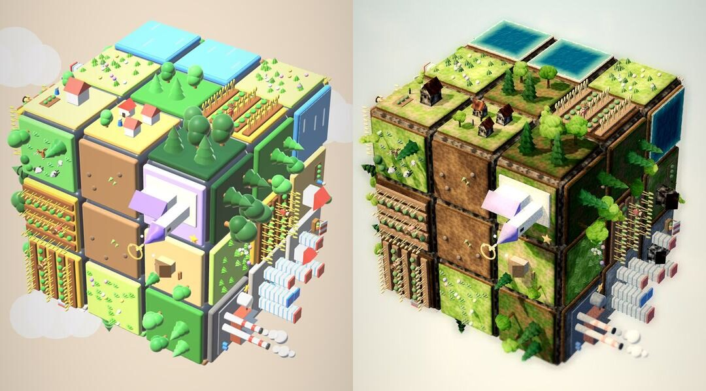
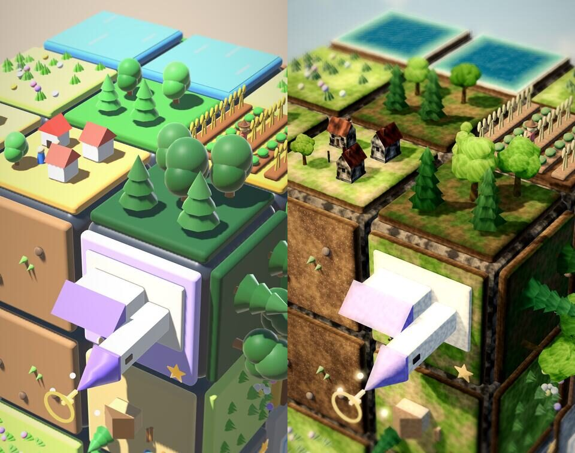

# gdpd – Grafik: Art Direction und Umsetzungsplan

Stand: 6. November 2026. Grundlage: Feedback von Philipp

- „Grafik sollte nicht so verspielt und unrealistisch aussehen.“
- nach der neuen Version: „Schaut gut aus. Die Grafik muss noch dynamischer und schöner werden.“

Ziel: Der Würfel wird zu einem **hochwertigen, realistischen Miniatur-Diorama**. Gemeint ist eine echte
Modellbau-Welt im Tilt-Shift-Foto, mit dem Feinschliff von Dorfromantik und Townscaper, aber
**näher an der Wirklichkeit**. Er bleibt auf dem Handy lesbar und läuft mit `gl_compatibility` flüssig.

Dieses Dokument enthält die Art Direction (Abschnitte 1–7) und den Umsetzungsplan in zwei Teilen:
**A) Look-Dev** (world.gd, Shader, neue Material-Skripte) und **B) Modelle und Leben**
(models.gd, field_view.gd). Danach folgen Leistungsbudget, Prüfungen und Reihenfolge (Abschnitte 10–12).

---

## 0. Prototyp: vorher / nachher

Ich habe einen Wegwerf-Prototyp gebaut. Er besteht aus einer Kopie des Projekts im Scratchpad, einem
Look-Dev-Skript und neuen Shadern. Gerendert wurde mit dem lokalen Godot 4.3 (`--rendering-driver opengl3`,
1080×2340, Mesa llvmpipe). Der Würfel ist mit den echten `FieldView`/`Models`-Bausteinen gebaut (alle 16 Arten).
Links ist der heutige Look, rechts der Prototyp.

Nah (Zoom 0,5, Tilt-Shift sichtbar):

Was der Prototyp schon zeigt (alles läuft in `gl_compatibility` ohne Fehler):

| Baustein | Datei (Referenz in `docs/grafik/prototyp/`) | Wirkung |
|---|---|---|
| Boden je Art: Erde mit Kieseln, Gras mit Farbflecken, Waldboden, Pflaster, Sand | `ground.gdshader` | kein Plastik mehr, Flächen wirken „echt“ |
| Kachel-Seiten als Erdschichten (Grasnarbe, Humus, Lehm) | `ground.gdshader` | Diorama-Schnitt statt Spielstein |
| Würfelkörper als dunkler Fels | `bedrock.gdshader` | Fugen bleiben lesbar, wirken wie Felsspalten |
| Wasser mit laufenden Wellen-Normalen, Fresnel, Funkeln und Uferschaum | `water.gdshader` | lebt, ohne Tiefenpuffer |
| Bäume in drei Arten (Eiche/Linde, Birke, Fichte), je **ein** Mesh, Wind per Vertexfarbe | `flora.gd`, `foliage.gdshader` | weniger Draw-Calls, Wind möglich |
| Häuser mit Sockel, Putz, Ziegel- bzw. Schieferdach mit Überstand, Fenstern, Tür und Kamin | `flora.gd` (`house_mesh`) | glaubwürdige Proportionen |
| Menschen schlanker, gedeckte Kleidung | `flora.gd` (`person_mesh`) | weniger Spielfigur |
| Himmel als Hintergrund-Ebene mit Dunst und ziehenden Schleierwolken | `backdrop.gdshader` | ersetzt die Kugel-Wolken |
| Post: Tilt-Shift, weiches Glühen, warme Lichter und kühle Schatten, Vignette | `post.gdshader` | „Foto“ statt Render |
| Farb-Umrechnung aller alten Materialien (weniger Sättigung, Grün Richtung Oliv) | `models_hooks.diff` | Übergang, bis alles neu gebaut ist |

Gemessen im Prototyp (eine Ansicht, alle 54 Felder belegt, mit Schattenpass):

| | Draw-Calls | Primitive | Video-RAM |
|---|---|---|---|
| heute | **1915** | 463 k | 106 MB |
| Prototyp (nur Bäume und Häuser zusammengefasst) | 1646 | 412 k | 126 MB |

**Wichtigster Befund zur Leistung:** Schon heute sind es fast 2000 Draw-Calls. Jede Kugel, jeder Kegel und jede
Box ist eine eigene `MeshInstance3D`. Das ist das größte Risiko auf Mittelklasse-Handys. Abschnitt 9 beschreibt
den „Feld-Baker“: alles Statische eines Felds wird zu 1–3 Meshes, Ziel sind höchstens 350 Draw-Calls.

**Was der Prototyp falsch macht (Lehren):**

- Das triplanare Detail-Rauschen auf allen alten Materialien ist zu stark (0,74–1,0). Häuser sehen dadurch
  marmoriert und schmutzig aus. Für Gebäude soll es 0,9–1,0 sein, für Boden und Fels darf es stärker sein.
- Die Arten sind schlechter zu unterscheiden als heute: Wiese, Wald und Dorf sind jetzt alle „grün“.
  **Das ist für das Spiel kritisch („Bring 3 gleiche in eine Reihe“)**. Daraus folgt die Lesbarkeits-Regel
  in Abschnitt 2.3.
- Kirche, Weizenähren, Rauch, Grasbüschel und Regenbogen sind noch die alten Spielzeug-Formen.
  Sie wirken neben den neuen Bäumen und Häusern fremd. Sie stehen in Teil B.
- Der Uferschaum glüht an den Rändern etwas. Er braucht ein schmaleres Band und weniger Helligkeit, er darf nie über 1,0.
- Seitenflächen im Gegenlicht werden schnell sehr dunkel. Dagegen helfen mehr Füll- und Himmelslicht
  (Werte in Abschnitt 4).

Prototyp selbst ausführen: Die Quellen liegen in `docs/grafik/prototyp/`. Kopiere sie in eine Projektkopie
nach `res://lookdev/`, wende `models_hooks.diff` auf `scripts/models.gd` der Kopie an, importiere das Projekt
und rufe dann `render.sh after <bild.jpg> [zoom] [frames]` auf. Das Skript macht nichts im echten Projekt.

---

## 1. Leitbild

**„Eine echte kleine Welt, die man in der Hand dreht.“**

Vier Grundsätze, in dieser Rangfolge:

1. **Lesbarkeit zuerst.** Jede Art muss auf dem Handy bei etwa 120 px Kachelbreite in unter einer halben Sekunde
   erkennbar sein. Realismus darf das nie kosten.
2. **Echte Materialien statt Plastik.** Erde ist krümelig, Gras ist fleckig, Holz ist Holz, Dächer sind Ziegel.
   Es gibt keine runden Spielzeugkanten (Radius ≤ 0,012 statt 0,035) und keine reinen Bonbonfarben.
3. **Licht erzählt.** Warmes Sonnenlicht und kühler Himmel. Die Stimmung wechselt mit Tag, Wetter und
   Ereignis (Regen, Smog, Krieg, Vollendet).
4. **Alles lebt leise.** Wind in Bäumen, Wellen, Rauch, Tiere und Menschen bewegen sich ständig, aber ruhig.
   Große Bewegung gibt es nur bei Spielereignissen (Verschmelzen, Wachsen, Katastrophe).

Referenzen für die Stimmung: Tilt-Shift-Fotos von Modellbahn-Anlagen (Faller/Noch-Landschaften),
*Tiny Glade* (Licht, weiche Natur), *Dorfromantik* (Lesbarkeit der Kachel-Arten), *Townscaper* (Feinschliff),
*Islanders* (ruhige Bewegung).

Nicht mehr: Regenbögen als Bögen, leuchtende Bonbon-Blumen, Kugel-Wolken, Kugel-Rauch, kreisende Funkeln,
lila Plastikkirche, Spielfiguren-Menschen.
Spielhinweise wie Ziel-Ringe, Wunsch-Blasen, Sterne und Abzeichen bleiben grafisch. Sie sind
UI und bekommen einen saubereren, weicheren Stil (Abschnitt 7.3).

---

## 2. Farbpalette

### 2.1 Welt (linear gedacht, als sRGB-Hex angegeben)

| Gruppe | Töne | Hinweis |
|---|---|---|
| Erde / Acker | `#5b4330` `#6e5238` `#4e3826`, Kiesel `#8c857a` | warmes Braun, nie Orange |
| Wiese | `#5d7a2e` → `#7d9442`, Blumen gedeckt: `#e9e4d4` `#d8b84a` `#9c7fb4` | Flecken statt einer Farbe |
| Wald, Waldboden | Boden `#3f4f24`/`#5a4b2f`, Laub `#4a6a2a` `#56772f` `#62803a`, Fichte `#2f4a2f` `#38543a`, Birke `#7d9443` | Laub und Nadel klar getrennt |
| Rinde | `#4d3b2a`, Birke `#e6e1d6` mit `#3b342c`-Flecken | |
| Putz | `#e4d8c2` `#d8c3a0` `#ece5d8` `#cdb79a` | nie reines Weiß |
| Dächer | Ziegel `#8e4430` `#a5573b` `#7a3e2e`, Schiefer `#5b5550` | statt `#e5574a` |
| Stein, Pflaster | `#8f8a80` `#a39d92`, Fugen ×0,45 | |
| Industrie | Ziegel `#7b4b3a`, Beton `#6a665f`, Asphalt `#55524d`, Ruß `#2c2a28` | |
| Glas | `#2b3540` (Tag), Fenster nachts/innen `#ffc27a` emissiv | |
| Wasser | tief `#12383f`, flach `#41806f`, Schaum `#ebefeb` | Himmel spiegelt per Fresnel |
| Fels (Würfelkörper) | `#2b2621` → `#5c5245` | |
| Himmel | oben `#7891ad`, Mitte `#c7d5e0`, Dunst unten `#ede1cc`, Wolken `#fffaf2` | |

### 2.2 Spiel-Akzente (bleiben bunt, aber nur dort)

- Glaube (violett) `#8b6ee0`: nur als Licht in den Kirchenfenstern, als UI und als FX. Die Kirche ist nicht mehr lila.
- Gold `#ffd75e`: Stern „fertig“, Verschmelzen-Funken, Lichtpuls.
- Ziel/Regen blau `#3b8eea`, Gefahr rot `#e5483c`: nur Hervorhebungen und Ringe.

Regel: **Gesättigte Farbe ist ein Spielsignal.** Die Welt selbst bleibt natürlich und gedeckt. So springen die
Hinweise heraus, und die Welt sieht nicht „verspielt“ aus.

### 2.3 Lesbarkeits-Regel (gegen das „alles grün“-Problem aus dem Prototyp)

Jede Art hat drei Kennzeichen, die zusammen eindeutig sind:

| Art | Boden (Farbton/Helligkeit) | Silhouette (Höhe) | Merkmal |
|---|---|---|---|
| Erde | dunkelbraun, Kiesel | flach | Erdklumpen, ein Keim |
| Wiese | hell-frischgrün, fleckig | flach mit feinem Gras | Blumentupfer, Hase |
| Wald | dunkles Moos und Laub | mittel, 4–5 Bäume | gemischte Kronen |
| Großer Wald | sehr dunkel | hoch, 7–9 Bäume, dicht | hohe Fichten, Hirsch |
| Acker | braune Furchen in Streifen | flach, gestreift | Reihen: Saat/grün/goldreif |
| Tiere | helle Weide mit Zaun | flach mit Tieren | Schafherde, Zaun, Tränke |
| Hütte | Wiese mit Trampelpfad | niedrig, 1 Gebäude | Blockhaus, Holzstapel, Rauch |
| Haus | Gartenwiese | niedrig-mittel | Fachwerkhaus, Beete, Zaun |
| Dorf | Wiese mit Wegen | mittel, 3–4 Dächer | Brunnen, Leute auf Wegen |
| Stadt | Pflaster hell | mittel-hoch, dicht | Marktplatz, Turm |
| Kirche ★ | Kies hell | hoher Turm | Turm, warmes/violettes Fensterlicht |
| Großstadt | Pflaster dunkler | hoch, Blöcke | Fensterraster |
| Industrie ★ | Asphalt dunkel | Hallen + Schlote | Rauchfahnen |
| Metropole ★ | heller Platz | sehr hoch, Glas | Glastürme mit Himmelsspiegelung |
| Paradies ★ | sattes Grün, Blüten | mittel | Blütenbaum, Teich, Lichtstrahlen |
| Wasser | blau | flach | Wellen, Schaum |

Prüfung: In der Tour gibt es ein Bild aller Arten nebeneinander, das `test_models`-Sheet. Es wird zusätzlich
**in Graustufen und auf 360 px Breite** angesehen. Alle 16 Arten müssen unterscheidbar bleiben.
Wenn nicht, wird zuerst die Bodenhelligkeit angepasst, dann die Silhouette.

---

## 3. Materialien

Grundregeln:

- **Kein UV nötig.** Alle Muster entstehen im Objektraum (`VERTEX` im `vertex()` als `varying`). Die Kachel dreht
  mit dem Würfel, das Muster bleibt also fest auf ihr.
- **Rauschen aus `NoiseTexture2D`.** Es werden 2–3 geteilte Texturen mit 256² und `seamless = true` einmal
  erzeugt: fbm (Simplex, 4 Oktaven), Zellen (Cellular, Distanz) und Detail (128², Graustufen 0,88–1,0).
  Für einen schnellen Start sollen sie einmal als PNG nach `res://textures/` gebacken werden (Tool-Skript).
  Das Erzeugen zur Laufzeit kostet beim Start je Textur einige 10 ms CPU.
- **CC0-Texturen:** ambientCG und Poly Haven sind aus dieser Umgebung nicht erreichbar (Proxy 403), deshalb
  sind die Texturen prozedural. Falls später echte Fotos dazukommen sollen: nur CC0 (ambientCG, Poly Haven),
  höchstens 512², ETC2/ASTC-komprimiert und mit Herkunft und Lizenz in `res://textures/LIZENZEN.md`.
  Vorher prüfen, ob es neben dem prozeduralen Boden überhaupt besser aussieht (meist nicht bei dieser Größe).
- **Vertexfarben statt vieler Materialien.** Gebäude, Figuren, Tiere und Steine haben ihre Farbe in `COLOR`.
  Ein gemeinsames Material `solid_vc` (StandardMaterial3D, `vertex_color_use_as_albedo`, schwaches
  triplanares Detail) reicht für fast alles. Das ist die Voraussetzung für den Feld-Baker.

Materialliste:

| Material | Typ | Inhalt |
|---|---|---|
| `ground` | Shader | Oberseite je Art: zwei Bodentöne nach großem Rauschen, feines Rauschen ±18 %, Kiesel/Steine aus Zellkernen, Pflaster aus Zellfugen, dunkler Rand zur Fuge (Kontaktschatten). Seiten: Grasnarbe, Humus, Lehm mit Schichtrauschen. Uniforms: `top_a`, `top_b`, `accent`, `accent_amt`, `cobble`, dazu `wet` (0–1, Regen) und `scorch` (0–1, verbrannt/verwelkt), `pulse` (Lichtpuls beim Verschmelzen) und `path_mask` (Wege im Dorf, siehe B). |
| `bedrock` | Shader | Fels für die Würfelkörper, triplanar, fast schwarz-braun. Kantenradius 0,05 statt 0,12. |
| `water` | Shader | Wellen-Normalen aus zwei gegenläufig laufenden Rauschmustern, Tiefe und Flachwasser nach Randabstand, Fresnel zur Himmelsfarbe, Funkeln als emissive Spitzen, Uferschaum als schmales, pulsierendes Band. `edge_mask` (vec4: N/O/S/W) schaltet den Schaum an Kanten zu anderen Wasserfeldern ab, damit zusammenhängendes Wasser wie ein See aussieht. |
| `foliage` | Shader | Albedo aus Vertexfarbe (Grundton und Innen-Abdunklung), `diffuse_lambert_wrap`, `BACKLIGHT` für Durchscheinen, Farbstreuung je Baum aus `NODE_POSITION_WORLD`, Wind über `COLOR.a`. |
| `solid_vc` | StandardMaterial3D | Gebäude, Figuren, Tiere, Zäune, Steine. Rauheit 0,8–0,9, Detail-Rauschen 0,9–1,0. |
| `glass` | Shader | dunkles Glas, Fresnel zum Himmel, je Fenster zufällig warmes Innenlicht (emissiv, abends stärker). |
| `smoke` | Shader | Billboard-Quad mit Rauschen als Alpha, weicher Rand, Farbe nach Stimmung (hell/rußig). |
| `fx_additive` | Shader | Funken, Staub, Lichtpuls-Ring: unshaded, additiv. |

---

## 4. Licht und Schatten

Licht hängt weiter an der Kamera (`camera_rig.gd`). Damit sieht jede Seite gleich gut aus, das ist wichtig für
das Spiel. Neue Grundwerte (im Prototyp getestet):

| | heute | neu |
|---|---|---|
| Sonne Richtung | (−42°, −35°) | (−36°, −48°): flacher, längere Schatten |
| Sonne Farbe / Energie | `#fff3df` / 0,78 | `#ffe2b8` / 1,45 |
| Schatten | blur 1,5, bias 0,06, normal 1,8 | blur 1,2, bias 0,03, normal 1,2, opacity 0,85, max_distance 24 |
| Füll-Licht (Himmel) | `#cfe0ff` / 0,18 | `#a9c2e8` / 0,42 von (−20°, 140°) |
| Umgebung | `#b9c6dc` × 0,32 | `#9fb3cc` × 0,8 |
| Tonemap | Filmic, Belichtung 0,82 | ACES, Belichtung 1,12, white 6 |
| Glühen | aus | an, intensity 0,6, Schwelle 1,0 (nur Emissives) |

**Stimmungen (das „Dynamische“).** Ein `LightMood`-Datensatz enthält Sonne (Richtung, Farbe, Energie),
Füll-Licht, Umgebung, Hintergrund-Farben, Nebel und Post-Farbstimmung. `world.set_mood(name, dauer)` blendet
über 1,5–3 s weich hinüber (Tween auf alle Werte):

| Stimmung | Wann | Charakter |
|---|---|---|
| `morgen` | Tag 1–2 (Licht, Land) | flache, goldene Sonne, kühle lange Schatten, leichter Dunst |
| `tag` | Tag 3–5 | Standard (Tabelle oben) |
| `abend` | Tag 6–7, „Weiterbauen“ | warm-orange, Fenster leuchten |
| `regen` | Regen-Werkzeug, Gewitter | Sonne 0,5, kühl-grau, Nebel an, Boden `wet` |
| `smog` | Smog | gelb-grauer Dunst, Nebel dichter, Sättigung −30 % |
| `krieg` | Krieg | rötliches Gegenlicht, Rauch |
| `vollendet` | Woche geschafft | goldene Stunde, Glühen höher, Vögel |

Wolkenschatten: Im Boden-Shader wandert ein großes, weiches fbm über die Weltkoordinaten (−22 % Licht, im Prototyp
schon drin). Weil die Weltkoordinaten zählen, wandern die Schatten beim Drehen einer Reihe nicht mit. Das wirkt
wie echte Wolken über einem Modell.

---

## 5. Himmel, Hintergrund, Wetter, Nebel

- **Hintergrund:** Eine Ebene hängt an der Kamera (unshaded, `depth_draw_never`) und zeigt einen Verlauf mit
  ziehenden Schleierwolken (`backdrop.gdshader`). Dazu `background_mode = BG_COLOR`. Grund: Ein Sky-Shader mit
  `TIME` würde in Godot die Radiance-Map jedes Bild neu rechnen, das ist am Handy zu teuer. Die drei
  Kugel-Wolken (`world.gd::_add_clouds`) entfallen.
- **Wolken im Bild:** 2–3 weiche Wolken-Billboards (Rausch-Alpha) ziehen langsam hinter dem Würfel vorbei und
  wechseln nach der Stimmung. Bei Regen kommt eine dunkle Wolke vor den Würfel (siehe 6.3).
- **Nebel:** Tiefennebel (in `gl_compatibility` vorhanden) ist **normal aus**, denn ein Miniaturmodell hat keine
  Luftperspektive. Er ist nur in den Stimmungen `regen`/`smog` an, mit geringer Dichte in Hintergrundfarbe.
- **Wetter-Zustand am Boden:** `wet` macht den Boden dunkler und glänzender (ROUGHNESS 0,35) und trocknet in 3 s ab.
  `scorch` färbt den Boden braun-grau (welk, verbrannt).

---

## 6. Bewegung und Leben (das „Dynamische“)

### 6.1 Ständige, leise Bewegung

| Element | Umsetzung | Kosten |
|---|---|---|
| Wind in Bäumen, Büschen, Gras, Weizen | Vertex-Shader: Versatz = sin(TIME·v + Phase(Weltposition)) · Amplitude · `COLOR.a`. Böen: alle 6–10 s ein globaler Faktor 1→1,8→1 (Uniform) | nur GPU |
| Wasser | Shader (Abschnitt 3) | nur GPU |
| Wolkenschatten | Boden-Shader | nur GPU |
| Rauch aus Kaminen und Schloten | 4–6 Billboards je Quelle, steigen, wachsen, drehen, verblassen (Shader auf MultiMesh, Phase je Instanz) | 1 Draw-Call je Feld |
| Pollen/Staub im Licht | 30–40 additive Pünktchen um den Würfel, MultiMesh, Bewegung im Shader, nur bei `tag`/`morgen`/`vollendet` | 1 Draw-Call |
| Vögel | Schwarm von 5–7, MultiMesh mit Flügelschlag im Vertex-Shader, alle 20–40 s eine Runde um den Würfel | 1 Draw-Call |
| Tiere und Menschen | siehe Teil B (Grasen, Gehen, Fliehen) | CPU, nur sichtbare Seiten |

Regel: **Nur was ein Shader allein kann, läuft immer.** Alles mit CPU-Logik läuft nur auf zugewandten
Seiten (Abschnitt 9.3).

### 6.2 Kamera

`camera_rig.gd` hat schon Nachschwung, `focus()`, `shake()` und Neigen. Ergänzungen:

- **Leerlauf-Drift:** Nach 4 s ohne Berührung schwebt die Kamera ganz langsam (±2° in einer Lissajous-Bahn,
  Periode 20–30 s), dazu ein leichtes „Atmen“ des Zooms 1,0↔0,985. Beim ersten Fingerkontakt hört die Drift
  sofort auf. Während Drehung, Tutorial-Vorführung und Tour ist sie aus.
- **Weicher Schütteln:** Statt Zufallsversatz je Bild ein glattes Rauschen. `trauma` geht weich auf 0 zurück,
  der Versatz ist `trauma²`. Das wirkt weniger zappelig.
- **Punch-in beim Verschmelzen:** Zoom 1,0→0,965 in 0,12 s, dann zurück mit `TRANS_BACK` über 0,45 s,
  stärker bei Kombo.
- **Fokus bei großen Stufen:** Bei fertigen Arten (★) gleitet die Kamera kurz zum Feld (`focus()`) und danach
  wieder zurück. Bei normalen Stufen tut sie das nicht, sonst wird es unruhig.
- Tilt-Shift-Fokuslinie `focus_y` folgt der Bildschirmposition des aktiven Felds (weich).

### 6.3 Spiel-FX (kräftiger, aber natürlich)

**Verschmelzen und Wachsen** (heute: `_merge_fx`, `FieldView.burst`, `set_kind`-Tween):

1. Die drei Felder leuchten 0,3 s warm auf (`ground.pulse` statt gelber Platte).
2. Die Inhalte der Quellfelder zerfallen zu Staub oder Blättern. Je nach Art sind das Blätter (Wald),
   Erdklumpen (Erde, Acker), Blüten (Wiese) oder Steinstaub (Gebäude). Der Staub fliegt in einem Bogen zum Ziel
   (CPUParticles3D, 12–20 Teilchen).
3. Ziel: ein Lichtring breitet sich über die Kachel aus (additive Scheibe, 0,4 s). Danach kurzer Lichtpuls,
   über Emissive und Glühen gelöst und nicht über eine Lampe.
4. Das neue Modell wächst **gestaffelt**: Jedes Teil (Baum, Haus, Tier) skaliert 0 → 1,08 → 1 mit Stauchung
   (y 0,7 → 1,12 → 1), 30 ms Versatz je Teil von der Mitte nach außen. Danach wippen die Bäume kurz nach
   (Wind-Amplitude ×3, klingt in 1 s ab).
5. Kamera: Punch-in und weiches Schütteln.

**Regen:** Statt Kugelwolke gibt es eine Wolke aus 3–4 Rausch-Billboards und Regenstriche (gestreckte Quads,
MultiMesh, Shader-Fall). Am Boden entstehen Spritzringe (kleine expandierende Ringe), der Boden wird `wet`,
danach wächst es (Schritt 4).

**Smog:** dunkle Rauchfahnen aus den Schloten. Die Dunstbox entfällt, stattdessen ziehen 3–5 Rauch-Billboards
über das Feld, dazu die Stimmung `smog`, und verwelkte Felder bekommen `scorch`.

**Gewitter/Blitz:** Der Blitz bleibt eine Linie, aber dazu kommt ein Bildblitz (Post-Helligkeit 0,1 s),
eine dunkle Wolke und Funken am Einschlag.

**Krieg:** Rauch, kleine Flammen (Billboards), rötliches Licht, Menschen fliehen (Teil B).

**Flut, Erdbeben, Feuer:** wie heute, aber die Partikel sind Wasser, Staub und Glut statt farbiger Kugeln.

---

## 7. Nachbearbeitung

### 7.1 Tilt-Shift (`shaders/tilt_shift.gdshader` → erweitert, Prototyp `post.gdshader`)

- Die Unschärfe hängt von der Bildgröße ab: `blur_px` ≈ 0,0065 × Bildbreite (bei 1080 px etwa 7).
  Heute sind es fest 3 px, auf modernen Handys sieht man das kaum.
- `focus_half` 0,16, weicher Übergang 0,28, `focus_y` folgt dem Würfel bzw. dem aktiven Feld.
- 9 Abtastungen bleiben (ist am Handy bezahlbar).

### 7.2 Farbe

- Teilton: warme Lichter (1,04; 1,0; 0,93), kühle Schatten (0,93; 0,98; 1,06).
- Leichte S-Kurve (Kontrast 1,03), Sättigung 1,04, Vignette 0,3.
- Glühen: Das Environment-Glow ist an. Zusätzlich gibt es eine billige Bloom-Näherung aus einer groben Mip-Stufe
  im Post-Shader. Sie lief im Prototyp ohne Fehler, die Wirkung muss am Handy geprüft werden. Wenn
  das Environment-Glow reicht, entfällt sie.
- Stimmungen (Abschnitt 4) setzen Teilton, Sättigung und Belichtung.

### 7.3 Hinweise im Raum (UI auf dem Würfel)

- Auswahl, Hinweis, Ziel und Gefahr: statt gelber oder roter Platten ein **weicher Lichtrand** um die Kachel
  (additiver Rahmen mit Verlauf, pulsiert). Er bleibt klar sichtbar, wirkt aber wie Licht und nicht wie Plastik.
- Stern „fertig“: kleiner, goldener, metallischer Stern, wie eine Plakette in der Ecke.
- Wunsch-Blasen, Abzeichen, Zahlen: bleiben (Lesbarkeit), aber mit weichem Schatten und ohne Hüpfen bei
  Dauerzustand.

### 7.4 Tagesaufgabe immer sichtbar, danach Weiterbauen

Wunsch von Philipp: Der Spieler hat **immer** die Tagesaufgabe vor Augen, damit er weiß, was er verbinden
soll. Ist sie erledigt, kann er einfach weiterspielen („Weiterbauen“). Für die Grafik heißt das:

- **Der Ziel-Chip oben (`day_ui.gd::_build_chip`) hat Vorrang vor jeder Wirkung.** Kein FX, kein Rauch, keine
  Wolke, kein Bildblitz und kein Vignetten-Rand darf ihn verdecken oder abdunkeln. Die Post-Effekte (Tilt-Shift,
  Vignette, Stimmungsfarbe) bleiben wie heute auf der Post-Ebene `World._postfx` (`CanvasLayer`, `layer = 0`)
  unter der Oberfläche und wirken damit nur auf die 3D-Welt, nie auf die UI.
- **Ziel-Art im Raum zeigen:** Die Felder, die zur Tagesaufgabe passen (z. B. „Bring 3 gleiche in eine Reihe“
  mit der Ziel-Art), bekommen den weichen Lichtrand aus 7.3 nur dann, wenn der Spieler zögert (Hinweis wie heute),
  sonst nicht. Die Welt bleibt ruhig, die Aufgabe steht im Chip.
- **Aufgabe erledigt:** Der Chip wechselt in den Zustand „geschafft“ (goldener Haken, Stern), bleibt aber stehen.
  Die Welt geht für das Weiterbauen in eine etwas wärmere Stimmung (`abend`-nahe, Glühen ein wenig höher),
  ohne dass sich etwas an der Lesbarkeit der Arten ändert. Gewachsene Felder seit dem Sieg (`grow_box`) bekommen
  den kurzen Wachs-Puls aus 6.3. So spürt man: Hier darf man jetzt einfach weiter „farmen“.
- Prüfung: In den Tour-Bildern `00e_tag1_geschafft` und `00t_frei_mittel` ist der Chip voll lesbar und
  nicht von FX überdeckt.

---

## 8. Teil A – Look-Dev (world.gd, Shader, neue Material-Skripte)

Reihenfolge nach Nutzen pro Aufwand. Jeder Schritt muss einzeln funktionieren und die Tests bestehen
(`test_rules` „0 Fehler“, `test_models` „OK test_models“, Smoke, Tour).

| # | Schritt | Dateien | Fertig, wenn |
|---|---|---|---|
| A1 | **Materialbibliothek** `scripts/look.gd` (`class_name Look`): geteilte Rauschtexturen (gebacken nach `res://textures/noise_*.png`), Fabriken `ground(kind)`, `water()`, `foliage()`, `solid_vc()`, `bedrock()`, Quality-Stufe | neu: `scripts/look.gd`, `shaders/ground.gdshader`, `shaders/bedrock.gdshader` | `test_models` lädt alle Materialien |
| A2 | **Boden und Fels**: `FieldView._apply_tile_color` setzt `Look.ground(kind)` statt `Models.mat(farbe)` und reicht `polluted`/`fresh` als `scorch` weiter. `World.rebuild` nimmt `Look.bedrock()` und Radius 0,05. Tile-Radius 0,035 → 0,012 | `field_view.gd`, `world.gd` | Graustufen-Sheet: 16 Arten unterscheidbar |
| A3 | **Licht und Environment** neu (Abschnitt 4), ACES, Glow | `camera_rig.gd`, `world.gd::_setup_environment` | Tour-Bilder: keine schwarzen Seiten, keine ausgebrannten Flächen |
| A4 | **Hintergrund** (Backdrop-Ebene an der Kamera, Schleierwolken), Kugel-Wolken weg | `world.gd`, `shaders/backdrop.gdshader` | |
| A5 | **Post** erweitert (Blur nach Auflösung, Teilton, Kurve) und `set_postfx` bleibt | `shaders/tilt_shift.gdshader` | |
| A6 | **Wasser-Shader** mit `edge_mask` aus Nachbarfeldern (World kennt die Nachbarn, siehe `GameState` Reihen) | `shaders/water.gdshader`, `field_view.gd::_build_water`, `world.gd::refresh_all` | zusammenhängendes Wasser ohne Schaum dazwischen |
| A7 | **Wind-Shader** `foliage` (braucht B1-Bäume) und globaler Böen-Faktor | `shaders/foliage.gdshader`, `world.gd::_process` | |
| A8 | **Stimmungen** `LightMood` + `World.set_mood()`, angebunden an Tag (days.gd), Regen, Smog, Krieg, Vollendet | `world.gd`, `game.gd` (nur Aufruf) | Tour-Bilder `00g_regen`, `00q_tag7_smog`, `00r_vollendet` zeigen die Stimmung |
| A9 | **Umgebungsleben**: Wolkenschatten (im Boden-Shader), Pollen, Vögel (MultiMesh + Shader), Rauch-Billboards | `world.gd`, `shaders/smoke.gdshader`, `shaders/birds.gdshader` | |
| A10 | **Kamera**: Leerlauf-Drift, weiches Schütteln, Punch-in, Fokus bei ★ | `camera_rig.gd`, `world.gd::_merge_fx` | Drift aus bei Tour/Tutorial (Tour bleibt deterministisch) |
| A11 | **Spiel-FX** neu (6.3): Lichtpuls, Staub/Blätter, gestaffeltes Wachsen, Regen mit Strichen und Spritzern, Smog, Blitz-Bildblitz | `world.gd` (`_merge_fx`, `_rain_fx`, `_smog_fx`, `_bolt_fx`), `field_view.gd` (`burst`, `set_kind`) | |
| A12 | **Hinweise im Raum** als Lichtrand (7.3) | `field_view.gd` (`_glow`, `_hint`, `_target`, `_danger`) | Tour `CHECK`-Zeilen zu Zielen und Hinweisen unverändert grün |
| A13 | **Qualitätsstufen** Hoch/Mittel/Niedrig, automatisch nach Bildzeit der ersten 3 s, im Menü änderbar | `look.gd`, `world.gd`, `ui.gd` (Menüpunkt) | Niedrig: kein Post-Blur, Schatten 2048, keine Pollen/Vögel, Rauch halbiert |

Hinweise für `gl_compatibility` (Godot 4.3), im Prototyp ausprobiert oder bekannt:

- Spatial-Shader mit `TIME`, `NODE_POSITION_WORLD`, `BACKLIGHT`, `diffuse_lambert_wrap`, Vertexfarben,
  `NoiseTexture2D`-Sampler sowie Canvas-Shader mit `hint_screen_texture` und `textureLod` liefen **ohne Fehler**.
- Kein Tiefenpuffer im Wasser nötig: Ufer kommt aus dem Randabstand im Objektraum.
- Keine SSAO, SSR, SDFGI und kein Volumen-Nebel in `gl_compatibility`. Stattdessen backt man Eigenschatten in
  Vertexfarben (Innen-Abdunklung der Kronen, dunkle Unterseiten, Kontaktschatten am Kachelrand im Boden-Shader).
- Partikel: `CPUParticles3D` für FX (sicher auf alten Android-GLES3-Treibern). Dauerhafte Massen (Pollen,
  Regen, Vögel, Rauch) als `MultiMeshInstance3D` mit Bewegung im Shader.
- Sky-Shader mit `TIME` vermeiden (Radiance), siehe Abschnitt 5.
- Lampen (`OmniLight3D`) nur ausnahmsweise. Lichtpulse mit Emissive und Glühen lösen.

---

## 9. Teil B – Modelle und Leben (models.gd, field_view.gd)

### 9.1 Modelle

Alle Modelle werden prozedural gebaut, in **einem Mesh je Modellvariante** mit Vertexfarben und gecacht (wie
`flora.gd` im Prototyp). Je Art gibt es 3–4 Varianten, die Auswahl kommt aus dem Feld-Zufall (`_rng()`),
dazu Drehung ±180° und Größe ±12 %. Proportionen: Hauswand-Traufhöhe ≈ 0,085, Mensch ≈ 0,055.
Das ist etwa 1,5-facher Maßstab für Figuren (bewusst, für die Lesbarkeit). Bäume sind 0,15–0,26 hoch.

| # | Modell | Inhalt (je Variante) | Dreiecke |
|---|---|---|---|
| B1 | **Bäume**: Eiche/Linde, Birke, Fichte, Kiefer, junger Baum, Busch | Stamm verjüngt mit 1–2 Astansätzen. Krone aus 5–7 verbeulten, flachen Kugeln (Laub) bzw. 5 gezackten Etagen (Nadel). Unterseite und Inneres dunkler, `COLOR.a` = Windgewicht | 300–700 |
| B2 | **Bodendecker**: Grasbüschel (Halmbündel), Farn, Blumen (3–5 Blütenblätter, gedeckt), Steine (verbeulte Ikosaeder, 3 Größen), Erdklumpen, Baumstumpf, Totholz | pro Feld als **ein** zusammengefasstes Mesh | 400–1500 je Feld |
| B3 | **Acker**: Furchen im Boden-Shader (Streifen) und niedrige Dämme. Pflanzen in drei Stufen (Saat: Punkte, grün: Büschel, reif: goldene Ähren mit Wind). Zaunpfähle, gedeckte Vogelscheuche | ein Mesh je Stufe | 1500 |
| B4 | **Häuser**: Wohnhaus (Putz/Fachwerk), Blockhütte, Stadthaus 2–3-geschossig, Wohnblock 4–6-geschossig, Glasturm | Sockel, Wände, Dach mit Überstand (Ziegel/Schiefer, dunkler First), Fensterraster mit Rahmen, Tür, Kamin, bei Stadt Gesimse | 150–600 |
| B5 | **Sonderbauten**: Kirche (Stein, Schieferdach, Turm mit Spitzhelm, Fenster mit warmem/violettem Licht), Industrie (Ziegelhallen mit Sheddach, Ziegelschlote mit Ruß, Silos, Gleis), Metropole (Glastürme mit `glass`-Shader, Platz), Paradies (Blütenbaum, Teich mit Seerosen, Lichtstrahlen statt Regenbogen) | | 800–2000 |
| B6 | **Kleinkram**: Brunnen, Marktstände (gedeckte Markisen), Zäune, Holzstapel, Wäscheleine, Bank, Laterne (abends emissiv), Karren | bringt den Diorama-Reiz, sparsam: 2–4 pro Feld | 50–200 je Teil |
| B7 | **Tiere**: Schaf, Kuh, Hirsch, Reh, Hase, Ente (auf Wasser), Vogel | realistisch-schlicht: Rumpf, Hals, Kopf, 4 Beine. Kopf getrennt animierbar (siehe 9.2) | 80–250 |
| B8 | **Menschen**: 5 Varianten (Bauer, Bäuerin, Kind, Händler, Gläubige mit violettem Tuch) | Beine, Rumpf, Arme, Kopf und Haare. Kleidung gedeckt (`#7a5c43` `#4f5f6f` `#8a3f34` `#6b7146` `#d8d0bd`) | 60–120 |

Die alten Spielzeug-Teile entfallen: Kugelblumen, Kugelrauch, Regenbogen-Bögen, kreisende Funkeln,
Kegel-Gras und Kugel-Gemüse.

### 9.2 Leben: Tiere und Menschen

Alles hängt in `FieldView._content`, dreht also mit dem Würfel mit, wie heute.

- **Agenten-System in `field_view.gd`:** Statt `_bobbers` gibt es eine kleine Liste `_agents` mit
  {Knoten, Art, Zustand, Ziel, Zeit}. Die Zustände sind:
  - Tiere: `idle` → `graze` (Kopf runter, 2–5 s) → `walk` (zu einem freien Punkt im Feld, 0,03/s) → `idle` …
  - Menschen: `walk` auf Wegpunkten (Haus ↔ Brunnen ↔ Acker) → `work` (bücken, ernten) → `talk` (zwei bleiben
    stehen) …
  - Ereignisse: `flee` bei Smog, Feuer, Krieg und Gewitter (schnell zum Kachelrand, dort ausblenden),
    `return` später. Bei Regen hüpfen sie und freuen sich (siehe NAECHSTE_SCHRITTE: Ernte, sichtbare Menschen).
- **Bewegung billig:** Position und Drehung je Agent in `_process`, nur Lerp, keine Physik. Freie Punkte kommen
  aus einem festen Raster je Art, auf dem keine Modelle stehen. Das legt der Builder der Art fest.
- **Gliedmaßen:** Gehen und Grasen kommen aus dem Vertex-Shader (`COLOR.b` markiert Beine bzw. Kopf,
  eine Phase je Instanz). Es gibt keine Skelette und keine AnimationPlayer.
- **Anzahl:** Tiere 1–5 und Menschen 1–4 je Feld. Insgesamt höchstens 40 aktive Agenten (nur zugewandte Seiten).

### 9.3 Sichtbarkeit und LOD

`World._process` berechnet schon je Feld `world_normal · to_cam` (für die Beschriftungen). Daraus wird
`FieldView.set_detail(level)`:

| Blickwinkel (dot) | Stufe | Was läuft |
|---|---|---|
| > 0,35 | voll | alles, Agenten, Rauch, Bodendecker |
| 0,0 – 0,35 | flach | Agenten eingefroren, Bodendecker aus, Rauch halb |
| < 0,0 (Rückseite) | aus | `_content` unsichtbar, `set_process(false)` |

Achtung: Bei einer Drehung kommen Rückseiten nach vorn. Die Stufe muss also pro Bild nachgeführt werden
und die Inhalte sofort zeigen.

### 9.4 Feld-Baker (der wichtigste Leistungs-Schritt)

Nach `_build_content(kind)` fasst `Models.bake(_content)` alle **statischen** `MeshInstance3D` mit demselben
Material zu einem `ArrayMesh` zusammen (Transformationen eingerechnet, wie `Models.batched`). Übrig bleiben je Feld:

- 1× `solid_vc` (Gebäude, Steine, Zäune, Tiere, die gerade stehen),
- 1× `foliage` (alle Bäume, Büsche, Gras, Ähren),
- 0–1× Sonder (Wasser, Glas, Emissives),
- dazu die beweglichen Agenten und der Rauch (MultiMesh).

Agenten und alles, was einzeln wächst (B-Schritt 4 in 6.3), bleiben einzeln, bis die Wachs-Animation vorbei ist.
Danach wird gebacken. Der Cache-Schlüssel ist (Art, Variante, fresh, polluted).

---

## 10. Leistungsbudget (Mittelklasse-Handy, z. B. Adreno 610 / Mali-G57, 1080p, MSAA 2×)

| Größe | heute (gemessen) | Ziel Hoch | Ziel Niedrig |
|---|---|---|---|
| Draw-Calls je Bild (mit Schatten) | 1915 | ≤ 350 | ≤ 200 |
| Primitive je Bild | 463 k | ≤ 250 k | ≤ 120 k |
| Bildrate | – | 60 fps ruhig, ≥ 45 fps in FX | 30–60 fps |
| Texturen | – | ≤ 8 MB (Rauschen 256², gebacken) | gleich |
| Schattenkarte | 4096 | 4096 (prüfen: 2048 + blur reicht oft) | 2048 |
| Agenten aktiv | – | ≤ 40 | ≤ 15 |
| Partikel gleichzeitig | – | ≤ 600 | ≤ 200 |
| Fragment-Shader Boden | – | ≤ 6 Textur-Abtastungen | 3 |

Messung: In die Tour kommt eine Zeile `CHECK perf draw=<n> prims=<n>` (über
`Performance.RENDER_TOTAL_DRAW_CALLS_IN_FRAME` usw.) mit einer festen Würfelbelegung. CI warnt über dem Ziel.
Prüfung am echten Handy mit dem Android-Export (Bildzeit im Debug-Overlay).

---

## 11. Prüfungen und Abnahme

- `test_models`: baut jede Art mit neuem Look. Zusätzlich zur Sheet-Ausgabe gibt es eine Graustufen-Variante
  (`--sheet-gray=`) für die Lesbarkeits-Regel.
- Tour: Die bestehenden `CHECK`-Zeilen bleiben unverändert (Spielregeln bleiben gleich). Neu kommen hinzu:
  `CHECK perf …`, `CHECK mood regen|smog|vollendet` (Stimmung gesetzt) und `CHECK lod back_hidden`.
  Werden neue Prüfnamen eingeführt, muss die Liste in `.github/workflows/gdpd.yml` mitgezogen werden.
- Bilder ansehen: Tour-JPGs, besonders `00t_frei_mittel`, `03_nach_wahl`, `00q_tag7_smog`,
  `00g_regen`, `00r_vollendet`, `05_arten`.
- Abnahme durch Philipp auf dem Handy mit drei Fragen: Sieht es echt aus? Erkenne ich jede Art? Ist es flüssig?

---

## 12. Reihenfolge (Vorschlag)

1. **Runde 1 – „sofort schöner“** (A1–A5, B1, B4): Boden, Fels, Licht, Himmel, Post, neue Bäume und Häuser.
   Das ist der größte sichtbare Sprung und entspricht ungefähr dem Prototyp-Bild.
2. **Runde 2 – „lebt“** (A6, A7, A9, A10, B2, B7, B8, 9.2): Wasser, Wind, Umgebungsleben, Kamera, Tiere
   und Menschen mit Leerlauf.
3. **Runde 3 – „Ereignisse“** (A8, A11, A12): Stimmungen, kräftigere FX, Hinweise als Licht.
4. **Runde 4 – „schnell“** (9.3, 9.4, A13, Abschnitt 10): Feld-Baker, LOD, Qualitätsstufen, Messung am Handy.
   Der Baker ist so wichtig, dass er schon in Runde 1 vorgezogen werden sollte, wenn die Bildrate am Handy fällt.
5. **Rest** (B3, B5, B6): Acker-Stufen (passt zur Ernte aus NAECHSTE_SCHRITTE), Sonderbauten, Kleinkram.

Zuständigkeiten: Teil A gehört zu `world.gd`, `camera_rig.gd`, `shaders/` und dem neuen `look.gd`. Teil B gehört
zu `models.gd` und `field_view.gd`. Berührungspunkte: Teil A liefert Materialien und Shader-Schnittstellen
(`COLOR.a` Wind, `COLOR.b` Gliedmaßen, `ground.*`-Uniforms), Teil B nutzt sie. `FieldView.set_kind()` bleibt
die einzige Stelle, an der der Inhalt neu gebaut wird.

---

## 13. Stand Teil A (umgesetzt, 7. November 2026)

Umgesetzt im Spiel (kein Prototyp mehr). `models.gd` ist unverändert. Die alten Spielzeug-Teile werden beim Bauen
eines Felds über `Look.restyle()` auf gedeckte Materialien und Laub mit Wind umgerechnet. Das ist der Übergang, bis
Teil B die Modelle neu baut.

| Schritt | Stand | Wo |
|---|---|---|
| A1 Materialbibliothek | `scripts/look.gd` (`class_name Look`): Rauschtexturen gebacken in `textures/noise_*.res` (`tools/bake_look.gd`, Rückfall: zur Laufzeit), `ground_material()/apply_ground()`, `bedrock()`, `water()`, `foliage()`, `solid()`, `rim()`, `ring()`, `mote()`, `smoke()`, `dust()`, `natural()`, `restyle()` | `look.gd` |
| A2 Boden und Fels | Boden je Art nach Tabelle `Look.GROUND` (Lesbarkeits-Regel 2.3), Furchen in Acker-Richtung, Trampelpfad, Blumentupfer, Pflaster, Erdschichten an den Seiten, Kontaktschatten. Würfelkörper Fels, Radius 0,05. Kachel-Radius 0,012 | `ground.gdshader`, `bedrock.gdshader`, `field_view.gd::_apply_tile_color`, `world.gd::rebuild` |
| A3 Licht | Sonne/Füll-Licht/Umgebung neu, ACES, Glühen, Schatten 24 m. Energie etwas unter Abschnitt 4 (1,25 statt 1,45, Belichtung 1,0), sonst brennen helle Wände aus | `camera_rig.gd`, `world.gd::_setup_environment` |
| A4 Himmel | Ebene an der Kamera mit Verlauf, Lichthof, Schleier- und Haufenwolken. Kugel-Wolken entfernt | `backdrop.gdshader`, `world.gd::_add_backdrop` |
| A5 Post | Blur nach Bildbreite (0,0065 × Breite), Fokus folgt der Würfelmitte, Teilton, Kurve, Sättigung, Vignette, Bildblitz | `tilt_shift.gdshader`, `world.gd::_update_post` |
| A6 Wasser | Shader mit `edge_mask` aus Nachbar-Wasser derselben Seite (kein Schaum dazwischen) | `water.gdshader`, `world.gd::_water_edges`, `FieldView.set_water_edges` |
| A7 Wind | `foliage.gdshader`, Gewicht aus `VERTEX.y` (bei `use_vc` × `COLOR.a`), globaler Böen-Faktor `Look.set_wind()`, Nachwippen nach dem Wachsen | `look.gd`, `world.gd::_update_life` |
| A8 Stimmungen | `World.MOODS` (tag, morgen, abend, weiter, regen, smog, krieg, vollendet), `set_mood(name, dauer)` blendet alle Werte. Auswahl ohne `game.gd`: Signale `day_started`, `day_won` (`world_complete` → vollendet, sonst weiter), `build_started`, `GameState.smog()`, Tag 1–2 morgen, 6–7 abend. Regen und Krieg kurz über `hold_mood()` | `world.gd` |
| A9 Umgebungsleben | Wolkenschatten im Boden-Shader, Pollen (CPUParticles3D, 36), Vogelschwarm (MultiMesh, 6, alle 30 s), Rauch als Billboards mit Rausch-Alpha | `world.gd::_add_life`, `field_view.gd::_puff`, `set_polluted` |
| A10 Kamera | Leerlauf-Drift (nach 4 s, wird beim Antippen in die Ruhelage übernommen, kein Sprung), weiches Schütteln (trauma²), Punch-in beim Verschmelzen. Drift aus bei Tour (`--shots`), Tutorial, Vorführung, Animation | `camera_rig.gd` (`poke()`, `punch()`) |
| A11 Spiel-FX | Bodenpuls (`FieldView.pulse_light`), Lichtring (`ring.gdshader`), gestaffeltes Wachsen (`FieldView._grow_in`), Staub/Blätter beim Verschmelzen, Funken als leuchtende Punkte, Regen mit Rauschwolke, Strichen und nassem Boden (`set_wet`), Bildblitz bei Blitz und Gewitter, Rauch bei Krieg/Gewitter/Smog als Billboards | `world.gd`, `field_view.gd` |
| A12 Hinweise | Auswahl, Hinweis, Ziel, Gefahr, Verschmelzen als weicher Rand: außen additiv (`rim.gdshader`), auf der Kachel gemischt (`rim_mix.gdshader`, sonst auf heller Wiese kaum sichtbar). Pulsieren im Shader statt in `_process` | `field_view.gd::build`, `set_target` |
| A13 Qualität | automatisch (Rev. 9: Median der Bildzeit 2–5 s nach dem Start **und nach jedem Tag-Start**; mittel: Schatten 2048 + weicher Filter niedrig, keine Figuren-Schatten, kein Pollen/Vögel; niedrig: zusätzlich keine Sonnen-Schatten, kein Glühen, keine Post-Unschärfe, kein MSAA; danach wird das Brett neu gebaut). Die Tour bleibt auf hoch. **Offen:** Menüpunkt in `ui.gd` | `world.gd::_measure_quality`, `apply_quality`, `Look.quality` |

Offen aus Teil A: Kamera-Fokus bei ★-Arten, Tour-Prüfungen `CHECK perf`/`CHECK mood` (brauchen `main.gd` und die
Liste in `.github/workflows/gdpd.yml`), Menüpunkt Qualität. Ob das Environment-Glühen in `gl_compatibility` am Handy
sichtbar wirkt, ist noch am Gerät zu prüfen; die Lichtpulse hängen deshalb nicht davon ab (Emission, additive Ränder).

**Schnittstellen für Teil B:**

- Laub/Gras/Ähren: `Look.foliage(farbe)` oder ein Mesh mit Vertexfarben und `Look.foliage(Color.WHITE, true)`.
  Wind-Gewicht `COLOR.a` (0 = steif), Höhe im Mesh zählt zusätzlich (Stamm unten ruhig).
- Gebäude, Tiere, Menschen, Steine: `Look.solid(farbe)` bzw. Vertexfarben; Farben aus der Palette (Abschnitt 2),
  dann ist `restyle()` für sie ein Durchlauf ohne Wirkung und kann je Modell entfallen.
- Rauch: `Look.smoke_puff(parent, durchmesser, farbe)`, Funken/Glut: `Look.mote(farbe)`.
- Boden je Art: Werte in `Look.GROUND` (Wege `path`, Furchen `fur`, Tupfer `samt`). Neue Merkmale (z. B. `path_mask`
  für echte Dorfwege) als Uniform in `ground.gdshader` ergänzen.
- Wachsen: `FieldView._grow_in()` animiert die direkten Kinder von `_content`; Modelle sollten je Baum/Haus einen
  eigenen `Node3D` haben (dann wächst das Ganze, nicht Stamm und Krone einzeln).
- Leistung: heute ~1870 Draw-Calls bei voller Belegung (Würfel nah). Der Feld-Baker (9.4) bleibt der wichtigste Schritt.

---

## 14. Stand Teil B (umgesetzt, 7. November 2026)

Alle Modelle sind neu gebaut. Die alten Spielzeug-Teile (Kugelbäume, Kugelblumen, Regenbogen, Heiligenschein,
rot-weiße Schlote, Spielfiguren) sind entfernt; `Look.restyle()` wird für Felder nicht mehr gebraucht.

| Schritt | Stand | Wo |
|---|---|---|
| Mesh-Bauer | `Models.MB`: Dreiecke mit Vertexfarben, Quader, Zylinder, Stäbe, verbeulte Ikosaeder (Laub glatt, Stein facettiert), gezackte Kegel (Fichte), Grashalme, Satteldach, Zeltdach, Fenster. Farben sRGB mit flacherer Kurve (Exponent 1,75), sonst saufen dunkle Töne im ACES-Licht ab. `COLOR.a` = Wind | `models.gd` |
| Bibliothek | `Models.get_model(name, variante)` → `[[Mesh, matkind]]`, zwischengespeichert. matkind: `solid` (Vertexfarben, Detail-Rauschen), `leaf`/`grass` (Laub-Shader, Gras ohne Schatten), `warm`/`faith` (Fensterlicht), `glass` | `models.gd` |
| B1 Bäume | Eiche, Buche, junger Baum, Birke (Rinde mit Flecken), Fichte, Kiefer, Blütenbaum, toter Baum, Busch (grün/dürr) | `_tree_*`, `_bush` |
| B2 Boden | `Models.cover()`: Grasbüschel, Blüten (gedeckt), Kiesel je Feld als ein Mesh, Hindernisse ausgespart. Steine, Findling, Stumpf, Totholz | `cover`, `_rock`, `_stump`, `_log` |
| B3 Acker | Reihen genau auf den Dämmen von `ground.gdshader` (gleiche Periode), Saat / grün / reif (Ähren mit Wind), Zaun, Vogelscheuche oder Karren, Bauer | `crops`, `_b_field` |
| B4 Häuser | Blockhütte (Balken, Eckköpfe, Feldstein-Kamin), Wohnhaus (Putz, Fachwerk, Ziegeldach), Stadthaus 2–3 Geschosse (Laden, Gesims), Wohnblock 4–6 Geschosse, Glasturm | `_cabin`, `_house`, `_townhouse`, `_block`, `_glass_tower` |
| B5 Sonderbauten | Kirche (Stein, Schieferdach, Apsis, Turm mit Helm, warme und violette Fenster), Industrie (Ziegelhalle mit Sheddach und Glas, Ziegelschlote mit Ruß, Silos, Gleis, Wagen), Metropole, Paradies (Blütenbaum, Teich mit Wasser-Shader, Lichtstrahlen statt Regenbogen) | `_church`, `_factory`, `_b_paradise` |
| B6 Kleinkram | Brunnen, Marktstand, Holzstapel, Zaun, Vogelscheuche, Karren, Tränke | `models.gd` |
| B7/B8 Figuren | Schaf, Kuh (4 Fellarten), Hirsch (mit/ohne Geweih), Hase, Ente; Menschen in 6 Varianten (Kleid/Hose, Hut, Gläubige mit violettem Tuch). Teile im UV, Drehpunkt im UV2 | `creature_mesh`, `shaders/creature.gdshader` |
| Neue Arten/Zustände | **Stein** (16: Felsen, Abbaukante, Blöcke, Schutt, Steinhauer; Boden „Schotter“ `Look.GROUND[16]`, Symbol `stone`), **Feuer** (Flammen-Shader als Billboard längs der Feld-Normalen, verkohltes Laub, Rauchsäulen, Glut im Boden), **welk** (dürre Büsche, tote Bäume, Stümpfe), **Krater** (Meteor), **Kriegsfront**, **Blitz-Warnung** (Gewitterwolke mit Blitz-Symbol), **Flut-Gefahr** (Pfützen, nasser Boden), **Bedürfnisse** (Symbole über Menschen-Feldern, satt = Goldrand, „wächst bald“ = Pfeil, Hunger = grau, pulsiert vor dem Schrumpfen, Menschen grau und langsam) | `field_view.gd` |
| 9.2 Leben | `_agents`: Tiere `idle → graze → walk`, Menschen `walk` zu Zielen (Türen, Brunnen, Reihen) `→ work` (bücken). Bei Feuer, Front oder Smog auf dem Feld oder nebenan (`set_alarm`, World) laufen alle zum Rand und verschwinden, später kommen sie zurück. Bei Regen hüpfen sie (`set_wet`). Gehen/Grasen/Bücken/Hüpfen im Vertex-Shader, je Figur ein Material | `field_view.gd::_update_agents` |
| 9.3 LOD | `FieldView.set_detail(dot)` aus `World._process`: Rückseite (dot < −0,22) Inhalt aus, flach (< 0,3) Agenten ruhen | `field_view.gd`, `world.gd` |
| 9.4 Baker | Jedes Teil ist ein eigener `Node3D` (wächst einzeln), danach `_bake()`: alle Teile → ein Mesh je Material (Cache je Art/Variante/Drehung/welk/Krater; höchstens 2 neue Back-Vorgänge je Bild). Anordnung je Feld: 4 Varianten × 4 Drehungen (Pfad-Arten ungedreht) | `field_view.gd` |
| World-Haken | `refresh_all`: `apply_state8(field_state8 + flood_risk)`, `set_alarm`; Ereignisse `thrive` (Goldring), `satt_new` (Lichtpuls), `starve` (Staub), `war_hit` (Krieg), `flood` (Wasser steigt); Meteor fällt als glühender Fels und hinterlässt einen Krater | `world.gd` |

Gemessen (Übersicht, ganzer Würfel belegt, 900×1300): **≈ 340 Draw-Calls, ≈ 160 k Primitive** (vorher ≈ 1870 Draw-Calls).
Prüfung: `test_models` baut jede Art (0–16) und jeden Zustand, prüft alle Modelle (nicht leer, Vertexfarben), alle
Figuren (Beine, Kopf), dass jedes Feld gebacken ist, dass es Tiere und Menschen gibt und dass sie bei Alarm fliehen.

Offen aus Teil B: Kamera-Fokus bei ★-Arten und Tour-Prüfungen `CHECK perf`/`CHECK lod` (brauchen `main.gd`),
Verbindungslinien Quelle → Menschen (6.2 in GDPD_BALANCE_2.md), Wasser-Ufer mit Schilf, Messung am Handy.

---

## 15. Rev. 9: Review der Grafik („dynamischer und schöner“, 7. November 2026)

| Befund | Änderung | Wo |
|---|---|---|
| Wasser wie Badezimmer-Fliesen (jedes Feld ein Becken mit Sandrand, Fuge dazwischen) | Zu Nachbarwasser hin reicht die Fläche bis an den Rand des Würfelsteins und deckt Sandrand und Fuge zu; Sand, Flachwasser und Schaum nur an echten Ufern (`ext`/`center` im Shader). Seen statt Pfützen | `field_view.gd::_water_surface`, `water.gdshader` |
| Laub flackert beim Drehen (Zufall aus `NODE_POSITION_WORLD`) | Zufall je Pflanze im gebackenen Mesh (`UV2.x`), sonst Raster im Objektraum; nie mehr aus der Weltlage | `foliage.gdshader`, `field_view.gd::_merge_items` |
| Schattenseiten fast schwarz, Fugen wie schwarze Filmstreifen | Füll-Licht 0,55–0,60 → 0,78–0,85, Umgebung 0,83 → 0,92–0,97, Schatten-Deckkraft 0,85 → 0,7; Würfelkörper warmer, mittelheller Boden statt schwarzer Fels, kein feines Rauschen | `world.gd::MOODS`, `camera_rig.gd`, `bedrock.gdshader` |
| Flut-Gefahr unsichtbar, Blitz am Rand | Flut wie die Kriegsfront, nur blau: pulsierender Rand, steigender Wasserspiegel, Flut-Zeichen. Kamera dreht zu Flut-Seite, Blitz-Feld, Hunger, Wachsen und neu Sattem, wenn es nicht im Bild ist | `field_view.gd::_set_flood_risk`, `world.gd::_focus_round8` |
| Stille Reihen sahen nach Erfolg aus (Gold + grüner Haken unter „Schon gewachsen“) | neutraler grauer Rand (`set_still`), Schloss für „schon gewachsen“ / „stand schon so“; Haken nur für fertige Felder | `field_view.gd`, `world.gd::STILL_BADGE` |
| Bedürfnis-Symbole ~2 mm, Fehlendes am blassesten | Scheiben 0,0032 (statt 0,0019); was fehlt: rot mit hellem Zeichen, was da ist: leise; Vorschau-Pfeil 0,004 mit kurzem Hüpfer | `field_view.gd::_set_needs`, `set_supply` |
| Tilt-Shift macht die untere Reihe unscharf | Schärfe-Band aus den 8 projizierten Würfelecken (+ 0,03), Unschärfe 0,004 × Breite: nur Hintergrund und Überstehendes | `world.gd::_update_post` |
| Häuser von der Seite wie rote Grabsteine | Hütte und Wohnhaus niedriger und breiter (Grundriss ~1,3 : 1), helles Holz/Putz unter dunklem, weit überstehendem Ziegeldach, ein helles Fenster | `models.gd::_cabin`, `_house`, `TILE_C`, `LOGS`, `LIT_C` |

Leistung (Rev. 9):

- Back-Cache begrenzt (LRU, 64 Anordnungen; vorher wuchs er auf 300+ und hielt >100 MB). `test_models` prüft die
  Grenze.
- Gebackene Meshes sind indiziert (jede Ecke einmal, Indizes mit Versatz) statt aufgefaltet: etwa ⅓ der Ecken.
- Figuren: Parameter-Tabelle als Konstante (keine Arrays je Figur und Bild); Figuren-Schatten nur auf „hoch“.
- `project.godot`: Schattenkarte am Handy 2048 mit weichem Filter 1 (`.mobile`).
- Der Tipp rechnet verteilt über mehrere Bilder (höchstens 6 ms je Bild, `Game.search_hint`), der Knopf pulsiert solange. Nie auf einem zweiten Thread: Godot 4.3 liest `const`-Tabellen nicht threadsicher (Absturz/Hänger in der Bonusrunde).

Offen: MultiMesh je Tierart (Instanz-Daten statt eines Materials je Figur), Messung am echten Handy.
