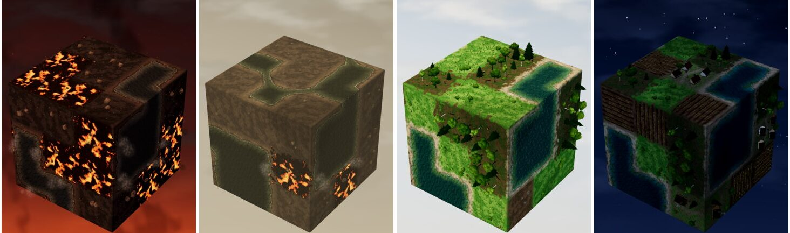
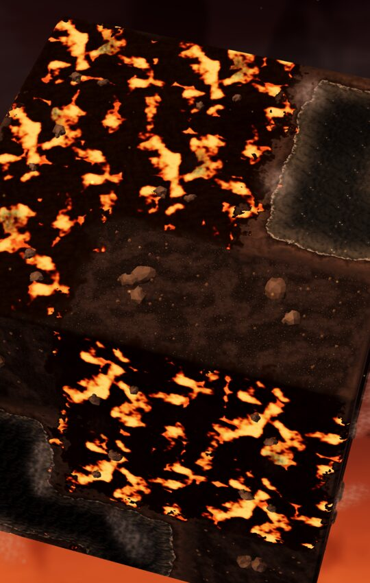
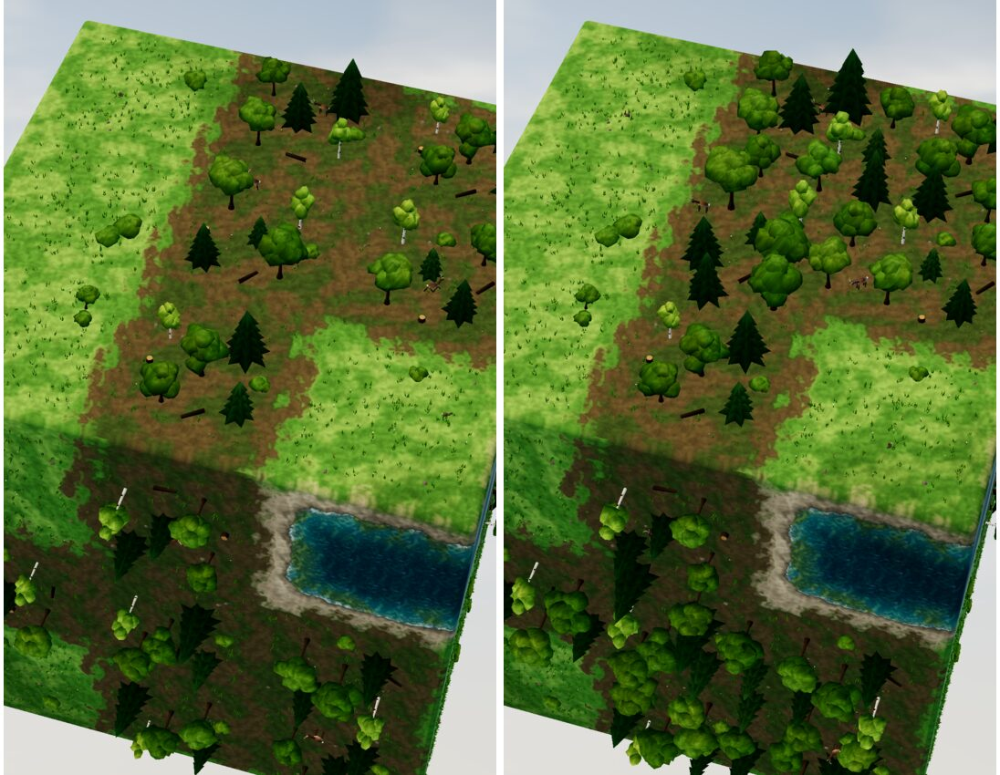
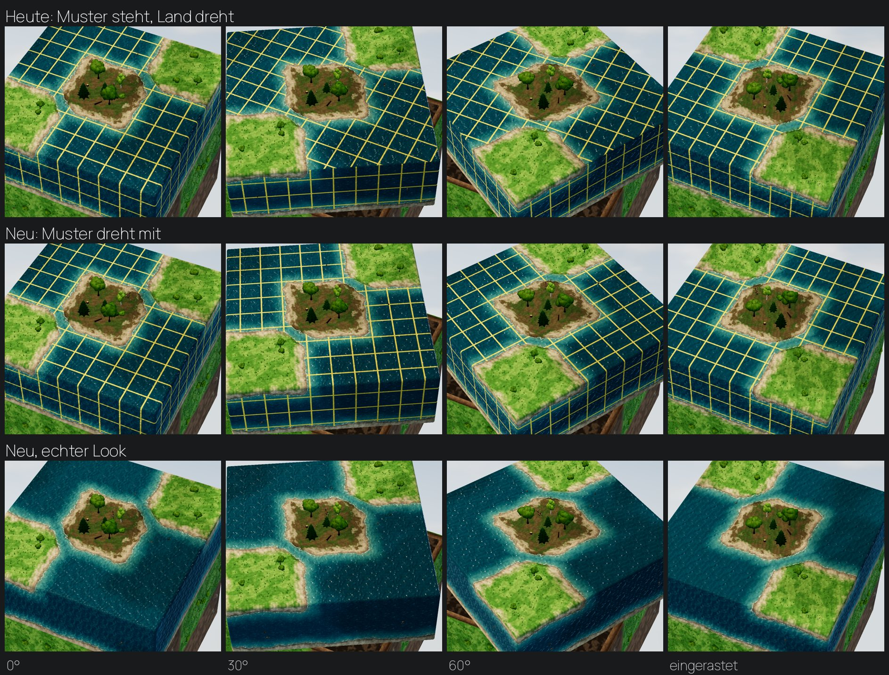

# gdpd – Grafik für „Die Schöpfung“: Zeitalter, neue Arten, Zusammenwachsen

Stand: 8. November 2026 (Rev. 2). Grundlage: die Entscheidung „Die Schöpfung“ in `NAECHSTE_SCHRITTE.md` (7 Akte,
30 Level nach der Erdgeschichte, ein Level pro echtem Tag), die Regel-Spec `GDPD_SCHOEPFUNG.md` (Arten-Ids, Gefahren,
Events, Level-Tabelle) und Philipps Rückmeldung vom 8. November. Dieses Dokument baut auf `GDPD_GRAFIK.md` auf und
ändert dessen Regeln nicht: **realistisches Miniatur-Diorama, Lesbarkeit zuerst, eine Würfelseite ist eine Landschaft
(nahtloser Boden-Shader mit 8 Nachbarn), Wasser ist ein zusammenhängender Körper, gesättigte Farbe ist ein Spielsignal.**

Neu ist eine Ebene über den Arten: das **Zeitalter**. Es färbt Himmel, Licht, Wasser und Boden der ganzen Welt und
zeigt, wie weit die Schöpfung ist. Dazu kommen 10 neue Arten (Ids 17–26), das sichtbare Zusammenwachsen gleicher
Felder, ein Verlust-Hinweis („−1“), eine einheitliche Sprache für Gefahren, die eine Runde vorher warnt, und
(Rückmeldung 8. November) **Wasser, das sich beim Drehen mit der Scheibe mitdreht**.

**Was sich in Rev. 2 geändert hat:** an die Regel-Spec angeglichen (Ids, Fels als eigene Art, Wasser-Familie,
Sonnenseite in Akt 4 statt Tag/Nacht-Takt, Vögel aus Wald, Landgang als Ereignis statt Amphibien-Art, Vulkan als
Ereignis statt Art, Event-Namen); neuer Prototyp 0.5 „Wasser dreht mit“; neue Abschnitte 5.7 (Verbindungen bleiben
sichtbar) und 9 (Sterne, Menü) zu Philipps Rückmeldung.

Inhalt: 0 Prototypen · 1 Leitlinien · 2 Zeitalter-System · 3 Looks je Akt · 4 Arten-Katalog · 5 Zusammenwachsen und
Verbinden · 6 Verlust-Hinweis · 7 Gefahren als Folgen · 8 Sonnenseite und Jahreszeiten (Akt 4) · 9 Oberfläche ·
10 Leistung · 11 Umsetzung (Dateien, Funktionen) · 12 Reihenfolge und Prüfungen · 13 Offene Fragen

---

## 0. Prototypen (Scratchpad, echtes Projekt als Kopie, lokales Godot 4.3, `opengl3`, 1080×2340)

Die riskantesten Looks sind in einer Kopie des Projekts gebaut und mit den echten Bausteinen `World`, `FieldView`,
`Models`, `Look` und `ground.gdshader` gerendert (echtes Licht, Post-Ebene, Hintergrund). Im Spiel selbst ist nichts
geändert. Quellen in `docs/grafik/schoepfung/prototyp/`:

- `schoepfung_look.diff` (Zeitalter, Lava, Urozean, Zusammenwachsen), `era.gd`/`era.tscn`, `render.sh`;
- `wasser_mitdrehen.diff` (Wasser dreht mit), `wasser.gd`/`wasser.tscn`, `render_wasser.sh`.

Beide Diffs gelten gegen den heutigen Stand und lassen sich zusammen anwenden (`patch --dry-run` geprüft).
**Achtung Ids:** Im ersten Prototyp steht Art 16 (heute „Stein“) für Lava und Art 0 (Erde) im Basalt-Look. Nach der
Spec ist 16 = **Fels** (Basalt-Look gehört dorthin) und Lava die neue Art 17; Erde wird in Akt 1–3 zu „Urboden“ (4.1).

### 0.1 Zeitalter-Himmel: Akt 1 Glut · Akt 2 Dunst · Akt 3 blau (nach Sauerstoff) · Nacht (Akt 4, Nachtseite)



- **Glut:** Der Himmel ist oben fast schwarz und unten rot-orange. Wolkenunterseiten glühen von der Lava
  (`low_glow`), Asche-Schlieren steigen, 60 Funken steigen um den Würfel. Fels ist schwarzgrauer Basalt, Lava hat
  glühende Risse, das Urmeer ist grau und tot.
- **Dunst:** Die Uratmosphäre ist ein ockergrauer, flacher Himmel mit dichtem Dunst (`haze`) und kaum Schatten.
  Das Wasser ist oliv-trüb mit kaum sichtbaren Einzeller-Pünktchen. Lava gibt es nur noch als Rest.
- **Blau:** Das ist der heutige `tag`-Himmel. Er ist hier verdient, denn Algen haben ihn gemacht. Im Wasser
  liegen grüne Algenmatten im Flachen, an Land Moos (im Bild Wiese als Platzhalter) und Wald.
- **Nacht:** tiefblau mit Sternen, die im Backdrop-Shader funkeln (ohne Textur). Mondlicht als kühles Füll-Licht.
  Felder und Dorf bleiben lesbar. In Akt 4 ist das der Look der **Nachtseite** (unten), nicht der ganzen Welt (8.1).

### 0.2 Lava und Urozean (Nahaufnahme, Zoom 0,62)



Die Lava ist **kein eigenes Mesh**. Sie läuft als Zweig im Boden-Shader: Krustenplatten aus Zellrauschen, glühende
Risse und in der Mitte großer Lava-Flächen fließende Becken. Alles liegt in Würfel-Koordinaten, deshalb laufen Risse
und Fluss lückenlos über Fugen und Würfelkanten. Die Glut kommt aus der Emission (über 1,0, mit Glühen), nicht aus
Lampen. Grenzt Lava an Fels, kühlt sie zum Rand hin ab, denn ihr Anteil (`lav`) wird wie die Bodenfarben mit den
Nachbarn gemischt. Am Ufer zum Urmeer spiegelt das Wasser die Glut, und Dampf steigt auf. Das passt genau zur Regel
„Lava zwischen zwei Wasser kühlt zu Fels“ (Level 2): Man sieht das Abkühlen, bevor es passiert.

### 0.3 Zusammenwachsen: Wald vorher / nachher (gleiche Belegung)



Links der heutige Stand: jedes Waldfeld ist ein eigener Hain, an jeder Fuge eine Lichtung. Rechts teilen gleiche
Waldfelder ein Kronendach: Bäume stehen **auf** den gemeinsamen Fugen, die Bäume innen sind 18 % größer, es wirkt
wie ein durchgehender Wald. Die Besitz-Regel verhindert Doppelte: Jede Fuge gehört dem Feld südlich bzw. westlich
davon, also setzt jedes Feld nur an seiner N- und O-Fuge und an der Ecke NO.

### 0.4 Gemessen und gelernt (Zeitalter, Lava, Wald)

| Szene (ganzer Würfel belegt) | Draw-Calls | Primitive |
|---|---|---|
| Akt 1 Glut (Lava, Fels, Urmeer, Funken, Dampf) | 224 | 37 k |
| Akt 2 Dunst | 156 | 34 k |
| Akt 3 blau (Wald, Moos, Algen) | 217 | 115 k |
| Nacht (Äcker, Dorf, Wald) | 221 | 143 k |
| Wald vorher / **nachher** (Zusammenwachsen) | 219 / **219** | 121 k / **140 k (+15 %)** |

- Die Lava kostet keine Draw-Calls und kaum Ecken. Der Shader-Zweig läuft nur, wo `lav > 0` ist (2 triplanare
  Abfragen mehr, also 6 Textur-Zugriffe). Der Fugen-Wald wird mitgebacken: gleiche Draw-Calls, +15 % Primitive.
- **Fehler im ersten Versuch:** Die Lava war mit Emission 2,4 und feinem Zellraster (Maßstab 3,4) zu einem weißen
  Rauschteppich ausgebrannt. Richtig sind Emission 1,25, grobe Platten (Maßstab 0,55), schmale Risse und gelbe
  Becken nur in der Mitte großer Flächen. Regel für alle Glut-Arten: **Kern gelb, Rand rot, Fläche dunkel**.
- Totes Wasser darf nicht zu dunkel werden, sonst liest es sich als Loch (erster Versuch `#1d2427`). Mit `#2a3438` /
  `#5a625c`, Fresnel zum Himmel und Glitzern bleibt es Wasser.
- In der Nahaufnahme glitzert totes Wasser zu stark. Im Zeitalter Glut ist das Glitzern halb so stark
  (`glint` × 0,5), denn die Sonne steht hinter Asche.
- Dampf-Billboards mit 0,11 sahen wie Schneeflocken aus. Sie brauchen ≥ 0,22, Alpha ≤ 0,35 und steigen langsam.
- Bei Nacht gehen die heutigen `warm`-Fenster (Emission 1,25) unter. Nachts ×2,5, mit Laternen und Glühwürmchen.
- Ein heller Strich über eine ganze Scheibe in frühen Renderings war der Onboarding-Tipp, kein Grafikfehler
  (`era.gd` setzt deshalb `Game.onboarding = false`).

### 0.5 Wasser dreht mit der Scheibe mit (Rückmeldung 8. November)



**Ursache heute:** Die Wellen liegen in Koordinaten der Würfelseite (`w_m`, `w_o`), damit alle Wasserfelder einer
Seite ein Muster teilen (ein See). Während einer Drehung setzt `World._twist_waves()` das Muster der Deckseite in jedem
Bild neu auf die Würfel-Koordinaten. Das Land dreht, das Wellenmuster steht still (obere Reihe: das gelbe Prüfraster
liegt in Wellen-Koordinaten und bleibt im Bild stehen, während Insel und Wiesen drehen). Genau das sieht Philipp.

**Lösung (Prototyp, `wasser_mitdrehen.diff`):**

1. **Deckseite:** Während der Drehung behält jede Kachel ihr Wellen-Muster (kein `_twist_waves()` mehr), es dreht also
   mit (mittlere Reihe). Damit es beim Einrasten nicht springt, merkt sich `World` je Würfelseite, wie oft ihr Muster
   gedreht wurde (`_face_q[normale]`, Vierteldrehungen; beim Einrasten `−= turns` für die Deckseite der Scheibe).
   `_set_wave` dreht die Wellen-Koordinaten der Seite um diese Vierteldrehungen. Ergebnis: nach dem Einrasten genau
   dasselbe Muster wie im letzten Bild der Drehung, und weiterhin ein Muster für alle Wasserfelder der Seite.
2. **Seitenstreifen** (Felder, die die Würfelseite wechseln): Sie trugen ihr Muster schon heute mit, sprangen aber
   beim Einrasten auf das Muster der neuen Seite. Neu blendet `FieldView.set_wave_frame(m, o, fade)` vom alten zum
   neuen Muster in 0,45 s über (`w_m_old`, `w_o_old`, `w_fade` im Boden-Shader; zweiter Satz Abtastungen nur, solange
   `w_fade > 0` ist und nur auf Wasser).
3. Wolkenschatten bleiben absichtlich in Weltkoordinaten (sie gehören zum Himmel, nicht zum Würfel).

**Gemessen** (Zeit im Shader für Standbilder eingefroren, nur Wasserpixel der Deckseite bzw. der Seitenstreifen):

| | heute | neu |
|---|---|---|
| Wellen-Detail an festen Bildpunkten, 0° gegen 30° (Korrelation; hoch = steht still) | 0,48 | **0,01** |
| Sprung Deckseite beim Einrasten (mittlere Abweichung, 0–255) | 1,5 | 1,3 (Rauschen, kein Sprung) |
| Sprung Seitenstreifen im ersten Bild nach dem Einrasten | 9,8 | **4,1** (Überblendung beginnt beim alten Muster) |
| Draw-Calls / Primitive | 180 / 65 k | 180 / 65 k |

- Was am Seitenstreifen noch nachzieht, ist das schon heute vorhandene Wieder-Öffnen der Ufer an der laufenden Fuge
  (während der Drehung gilt sie als neutral). Optional später: auch das über 0,25 s blenden (11, `nb_neutral`).
- Für die Schöpfung gilt das für die ganze Wasser-Familie (Wasser, Ursuppe, Einzeller, Algen, Fische):
  `is_water_like()` prüft dann `FieldData.WATERS`. Leben im Wasser (`w_life`, Fische) liegt in denselben
  Wellen-Koordinaten und dreht dadurch automatisch mit.

---

## 1. Leitlinien für die Schöpfung

1. **Das Zeitalter ist eine Welt-Größe, keine Art.** Himmel, Licht, Wasserfarbe und Bodenpaletten hängen am
   Zeitalter. Die Art eines Felds sagt nur, *was* darauf ist. So sieht Erde in Akt 1 wie junger, staubiger Urboden aus
   und in Akt 6 wie Ackerboden, mit derselben Lesbarkeits-Regel (Boden, Silhouette, Merkmal; `GDPD_GRAFIK.md` 2.3).
2. **Leben entsteht sichtbar durch Spielen.** Das Wasser ist am Anfang tot: kein Grün, kein Glitzern von Leben, keine
   Fische, keine Enten. Jede Lebens-Stufe (Ursuppe → Einzeller → Algen → Fische) erscheint erst, wenn der Spieler sie
   schafft, zuerst leise und dann deutlicher. Auch der **blaue Himmel ist eine Folge**: Er kommt in Akt 3 mit den Algen
   (2.3).
3. **Wenige Arten zugleich, jede sofort erkennbar.** Ein Level hat höchstens 3 wachsende und höchstens 6 sichtbare
   Arten neben Wasser. Jede Art braucht **ein** klares Merkmal, das bei 120 px Kachelbreite in unter einer halben
   Sekunde wirkt, auch in Graustufen.
4. **Gleiche Arten wachsen zusammen.** Wald wird ein Wald, Acker ein großes Feld, Wasser ein See, Tiere eine Herde,
   Häuser eine Stadt. Gruppen sehen größer und wertvoller aus, nicht nur bunter (5).
5. **Gefahren sind sichtbare Folgen.** Jede Gefahr hat eine Ursache, die man auf dem Würfel sieht (trockener Wald
   ohne Wasser, ein Lava-Klumpen, ein Rudel, zu viel Stadt auf einer Seite). Eine Runde vorher warnt ein Vorzeichen (7).
6. **Was verbunden ist, bleibt sichtbar verbunden.** Ein versorgtes Feld zeigt das, solange es versorgt ist, und
   verliert es nie durch bloßes Weiterdrehen ohne Grund (5.7, Rückmeldung 8. November).
7. **Der Würfel ist ein Ding.** Alles, was auf einer Kachel liegt (Boden, Wasser, Wellen, Leben, Figuren), dreht mit
   ihr. Nur Himmel, Wolkenschatten und Licht bleiben stehen (0.5).
8. **Nicht spoilern.** Kein Bild, Himmel, Symbol oder Modell eines späteren Levels taucht vorher auf: nicht in der
   Übersicht, nicht im Laden, nicht in Benachrichtigungen. Gesperrte Kacheln zeigen nur Schloss bzw. „?“.

---

## 2. Zeitalter-System

### 2.1 Datensatz `Eras` (neu: `scripts/eras.gd`, nur Konstanten)

Ein Eintrag je Zeitalter-Stufe (mehrere je Akt). `World` und `Look` lesen nur diesen Datensatz:

```
"glut": {
  "mood": "glut",                     # Licht, Himmel, Post (World.MOODS, neue Einträge)
  "sky": {"lowglow": 0.55, "haze": 0.2, "stars": 0.0, "ash": 0.5},   # Backdrop-Zusätze
  "water": {"deep": "#2a3438", "shallow": "#5a625c", "glint": 0.5},  # Wasserfarbe dieses Zeitalters
  "ground": {16: {...Basalt...}, 17: {...Kruste...}, 0: {...Urboden...}},  # überschreibt Look.GROUND je Art
  "ambient": {"pollen": false, "birds": false, "embers": 60, "fireflies": 0},
}
```

- Die Regeln liefern das Zeitalter als Event `era` {act, level, sky_blue, life} (Spec 11) bzw. über
  `Campaign.era(level)` (Spec 10). Die Grafik übersetzt `act`/`level` in einen `Eras`-Eintrag (`Eras.of(act, level)`).
- `Look.set_era(e)` setzt die Bodenpaletten (`ground_params` sieht zuerst in `e.ground` nach), die Wasserfarben
  (`w_deep`, `w_shallow`) und `glint` auf alle Boden-Materialien. Ein Zeitalterwechsel rechnet nur Uniforms um und
  baut keine Meshes neu, außer Inhalten, deren Modell vom Zeitalter abhängt (Basalt-Brocken, Urwald, Enten).
- `World.set_era(era, blend_s)` blendet über `set_mood` (2 s beim Level-Start, 0 s beim Laden) und setzt Funken,
  Glühwürmchen, Vögel. Ereignis-Stimmungen (`regen`, `krieg`, `smog`) haben Vorrang (`hold_mood`), danach kehrt die
  Welt zur Zeitalter-Stimmung zurück statt zu `tag`. `_day_mood()` wird zu „Ereignis > Smog > Sieg > Zeitalter“.
- Der Back-Cache-Schlüssel (`FieldView._bake_key`) bekommt das Zeitalter, aber nur für Modelle, die sich ändern.

### 2.2 Stufen je Akt

| Akt (Level) | Stufen (`Eras`) | Himmel | Licht |
|---|---|---|---|
| 1 Licht (1–4) | `glut` → `glut_kuehl` (Level 4) | schwarz-rot, glühende Wolkenunterseiten, Asche; in Level 4 weniger Glut, erste graue Wolken | Sonne orange 0,95, Füll-Licht rötlich, Glühen 0,9 |
| 2 Himmel (5–8) | `dunst` | ocker-grauer Dunst; **Wolken = Regen-Ladungen** (jeder Dampf-Regen setzt sichtbar eine Wolke dazu), Blitze in der Ferne | weich, kaum Schatten, Sättigung 0,85 |
| 3 Land und Pflanzen (9–12) | Mischung `dunst` → `blau` (2.3) | Dunst lichtet sich zu blau, erste weiße Haufenwolken | wird zum heutigen `tag` |
| 4 Sonne, Mond, Sterne (13–15) | `tag` + **Sonnenseite** (8.1); Jahreszeit je Level (8.2) | Sonnenscheibe über der Sonnenseite, Sterne und Mond unter der Nachtseite | 8 |
| 5 Wasser und Luft (16–19) | `tag` (klar) | klar, Möwen über Wasser | heute |
| 6 Tiere und Menschen (20–28) | `tag`; Level 27–28 Richtung `abend`; `smog` nach Zahl der Industrie (0,15 je Feld, Spec 10) | heute, Krieg (`krieg`) | heute |
| 7 Ruhe (29–30) | `vollendet` | goldene Stunde; in Level 30 wird das Licht je gehaltener Runde wärmer | heute `vollendet` |

### 2.3 Der Himmel wird blau – als Folge (Akt 3)

`World.set_era_mix(a, b, t)` mischt zwei Zeitalter mit `t` = 0…1 (alle Werte der Stimmung, Wasser und Boden).
In Akt 3 ist `t = sky_blue = clamp(Algen-Felder / 8, 0, 1)` (Spec 10), Level 9 beginnt bei 0,25. Jede neue Alge lässt
den Himmel sichtbar ein Stück blauer werden (0,8 s Überblendung, dazu ein kurzer heller Puls am Horizont). Die Grafik
nimmt dabei den **höchsten bisher erreichten Wert** (`max`): Sauerstoff bleibt in der Luft, auch wenn Algen später zu
Fischen werden. Level 10 heißt „Blauer Himmel“: Spätestens dort ist der Himmel ganz blau. So ist der Fortschritt ohne
Text sichtbar.

### 2.4 Die Welt bleibt innerhalb eines Akts (Spec 5)

Die Regeln führen die Welt von gestern weiter (Spec 0, Entscheidung 7). Für die Grafik heißt das: Das Zeitalter
(Himmel, Wasser, `sky_blue`) wird mit dem Akt gespeichert. Ein neues Level beginnt mit „Neuer Morgen“
(`World.overnight_wave`): Felder, die über Nacht gewachsen sind (z. B. Level 27 Hütte → Dorf), wachsen herauf, Himmel
und Wasser sind wie gestern am Ende. Zwischen den Akten gibt es einen **Akt-Übergang** von 3–4 s ohne Text: Die Kamera
zieht etwas zurück, das Zeitalter blendet über, ein Lichtstrahl fällt auf den Würfel, die neue Welt (frisches
Pool-Brett) legt sich mit der Welle. Erst danach erscheint die Ziel-Karte.

---

## 3. Looks je Akt

Kurzform. Die Arten stehen in Abschnitt 4, die Gefahren in 7.

### Akt 1 – Licht (Level 1–4: Glut, Abkühlen, Vulkan, Urkontinent)

- **Himmel:** `glut` (Prototyp). Zuerst fast schwarz mit roter Unterseite. In Level 4 reißt die Decke etwas auf
  (`glut_kuehl`: weniger `lowglow`, mehr grau).
- **Land:** Fels ist schwarzgrauer Basalt mit hellen, scharfkantigen Brocken und ohne Gras. Lava hat Kruste und
  glühende Risse. Erde (ab Level 4, „Land entsteht“) ist graubrauner Urboden: flach, staubig, feine Trockenrisse.
- **Wasser:** Das Urmeer ist grau, tot und trüb. Neben Lava wird der Rand orange und dampft. Keine Enten, keine Algen,
  keine Pünktchen.
- **Leben (Umgebung):** keins. Statt Pollen steigen Funken, statt Vögeln gibt es Asche.
- **Werkzeug:** In Akt 1 heißt Regen „Wunder“ (es gibt noch keinen Himmel). Grafik: ein goldener Lichtstrahl von oben
  statt Regen-Striche, auf Lava zischt es, und die Kruste wird grau.

### Akt 2 – Himmel (Level 5–8: Atmosphäre, Urmeer, Erstes Leben, Leben teilt sich)

- **Himmel:** `dunst`. Level 5 „Dampf wird Himmel“: Jede Lava, die am Wasser abkühlt, schickt eine Dampfsäule nach
  oben, und am Himmel kommt eine Wolke dazu (Event `steam`, „+1 Regen“). Der erste Regen bekommt einen ockrigen Ton,
  Blitze leuchten nur in der Ferne (Bildblitz 0,05, ohne Einschlag).
- **Land:** Fels wird heller und grauer, nach Regen nass glänzend (`wet`). Erde dunkelt nach Regen nach.
- **Wasser:** Die **Ursuppe** ist bräunlich-oliv und trüb mit Schaum-Schlieren. **Einzeller** sind feine, treibende,
  schwach leuchtende Pünktchen (4.2).
- **Leben (Umgebung):** keine Vögel, keine Pollen. Bei Regen Spritzer.

### Akt 3 – Land und Pflanzen (Level 9–12: Algen, Blauer Himmel, Farne, Wälder)

- **Himmel:** Mischung `dunst` → `blau` nach den Algen (2.3).
- **Wasser:** Algen bilden grüne Matten im Flachen am Ufer, das Tiefe wird von oliv zu klarem Blaugrün.
- **Land:** Moos ist ein niedriger, samtiger Teppich auf Urboden (Level 10: „Algen machen das Land grün“: Moos wächst
  sichtbar vom Ufer her). Farne sind kniehoch und gefiedert. Wald in Akt 3 ist **Urwald** (Baumfarne,
  Schachtelhalme, wenige Nadelbäume; kein Laub), ab Akt 4 heutiger Mischwald.
- **Leben (Umgebung):** Pollen erst ab Farnen. Noch keine Vögel und keine Tiere.

### Akt 4 – Sonne, Mond und Sterne (Level 13–15: Tag und Nacht, Saat, Ernte)

- Die **Sonnenseite** (oben, Seite 0) ist das Thema (8.1): Dort scheint die Sonne, dort wächst Wald aus Wiese und reift
  Saat. Jahreszeit je Level: Frühling, Sommer, Herbst (8.2).

### Akt 5 – Leben in Wasser und Luft (Level 16–19: Fische, Schwärme, Vögel, Landgang)

- **Wasser:** Fische sind Schwärme aus dunklen Rücken knapp unter der Oberfläche, mit Silberblitzen beim Wenden und
  Ringen an der Oberfläche. Eine Fisch-Gruppe ist **ein** Schwarm, der über die Fugen zieht (5.4).
- **Luft:** Vögel nisten in Wäldern neben Fischwasser und kreisen über ihrem Feld; Möwen tauchen ins Fischwasser.
- **Landgang (Level 19):** Ereignis `spawn`: Ein kleines Urtier (Molch-Form) kriecht aus dem Fischwasser auf die
  Wiese, die Wiese wird zum Tierfeld, das Wasser bleibt Algen (4.4).

### Akt 6 – Tiere und Menschen (Level 20–28)

- Der Look ist heute schon fast da (`GDPD_GRAFIK.md` 13–16). Neu sind Wildtiere vor den Menschen (Herden,
  Raubtiere), sichtbares Futter, das Rudel, der Meteor mit Staubwinter (7.4), Saat und Acker, Dörfer mit Hunger-Zustand
  und die Stadt, die zusammenwächst.
- **Himmel:** `tag`. Bei Städten Richtung `abend`, bei Industrie `smog`.

### Akt 7 – Ruhe (Level 29–30: Gleichgewicht, Der siebte Tag)

- `vollendet`: goldene Stunde, alles lebt leise. Level 30 „Halte 3 Runden Ruhe“: Ein Ruhe-Ring um den Ziel-Chip füllt
  sich, und das Licht wird je gehaltener Runde wärmer (Event `hold`). Ein Schaden lässt den Ring kurz rot zucken und
  leert ihn. Beim Sieg ein langer Sonnenuntergang.
- Danach kommt die „Welt des Tages“ im Zeitalter ihres Vorlage-Levels und später neue Welten (Insel, Wüste, Winter)
  als eigene Paletten im selben `Eras`-System.

---

## 4. Arten-Katalog (nach Spec `GDPD_SCHOEPFUNG.md` 2)

Jede Zeile erfüllt die drei Kennzeichen der Lesbarkeits-Regel (Boden, Silhouette, Merkmal). „Basis“ ist der Builder
bzw. das Modell (`field_view.gd::_b_*`, `models.gd::get_model`). Die Ids stehen in Klammern.

### 4.1 Urzeit (Akt 1–2)

| Art | Boden (Ton / Helligkeit / Muster) | Silhouette | Merkmal (eines!) | Bewegung | Basis |
|---|---|---|---|---|---|
| **Lava** (17) | Kruste `#231d1a`, dunkelst | flach | glühende Risse, gelbe Becken in großen Flächen | Fluss im Shader, Flackern, 1 Rauchfaden | `ground.gdshader` Lava-Zweig, `_b_lava`: 2 erstarrte Brocken + Rauch |
| **Fels** (16, war „Stein“) | Basalt `#2c2c2d`/`#3c3b3a` mit hellen Körnern (Akt 1–2), später grau wie heute | niedrig, kantig | 2–3 große, scharfkantige Brocken | – | `_b_stone` mit Zeitalter-Palette, `rock`/`boulder` dunkle Vertexfarbe |
| **Erde** (0) als Urboden (Akt 1–3) | graubraun `#5b4e42`/`#6e6152`, feine Trockenrisse | ganz flach | **leer**: nur Risse und Kiesel, nichts steht darauf | – | `_b_earth` Zeitalter-Zweig |
| **Wasser** (15) als Urozean | grau `#2a3438`/`#5a625c` | flach | tot: Spiegel ohne Leben; an Lava orange Rand + Dampf | Wellen wie heute, Glitzern ×0,5 | `is_water`, Farben aus `Eras` |
| **Ursuppe** (18) | Wasser oliv-braun `#26302a`/`#55604c` | flach | trüb, Schaum-Schlieren | träge Wellen (×0,6) | Wasser-Familie, `w_life` 0,1 |
| **Einzeller** (19) | wie Ursuppe, etwas grünlicher | flach | **feine, schwach leuchtende Pünktchen**, die langsam treiben | Treiben, Pulsieren | `w_life` 0,35, Leuchten ≤ 0,12 |

- **Fels gegen Erde** (Level 4–8 nebeneinander): Fels ist dunkel mit hohen Brocken, Erde ist heller und leer. In
  Graustufen trennt sie die Helligkeit (Fels ≈ 22 %, Urboden ≈ 38 %).
- Dampf über Wasser neben Lava: 3 Billboards je Ufer, Durchmesser ≥ 0,22, Alpha ≤ 0,35, langsam
  (`FieldView._update_steam`). Höchstens 12 Dampf-Billboards gleichzeitig im ganzen Würfel. Lava mit 2 Wasser-Nachbarn
  (kühlt in 2 Runden) dampft stärker und zeigt Kühl-Punkte 1/2 (Spec 10: `steam`).
- Einzeller sind bewusst leise (Philipp: „Einzeller dezent“). Damit man sie findet, zeigt **das Entstehen** sie
  deutlich: Beim `thrive` leuchtet der See einmal türkis auf (0,6 s) und die Pünktchen ziehen sich kurz zusammen.
- **Vulkan ist keine Art**, sondern ein Ereignis auf einer Lava-Gruppe (7.1).

### 4.2 Leben im Wasser (Akt 2–5): eine Wasserfläche, mehrere Lebens-Stufen

**Grundregel: Leben im Wasser ist ein Zustand der Wasserfläche, kein eigenes Becken.** Die Spec führt Ursuppe,
Einzeller, Algen und Fische als Wasser-Familie (`WATERS`): Sie zählen als Wasser für Nässe, Flut, Feuer und den
Wasser-Look. Für den Boden-Shader sind sie alle `is_water = 1` und verbinden sich nahtlos zu einem See. Was darin lebt,
kommt als Stärke `w_life` je Feld und wird an der Fuge weich gemischt (`nb_life[8]`), wie Nässe und Smog.

| Art | `w_life` | Aussehen | Merkmal |
|---|---|---|---|
| Wasser (tot) | 0 | grau/trüb (Zeitalter) | nichts |
| Ursuppe | 0,1 | oliv-braun, Schlieren | trüb |
| Einzeller | 0,35 | Pünktchen, kaum sichtbar | Leuchtpuls beim Entstehen |
| **Algen** (20) | 1,0 | grüne Matten im Flachen (Ufer), Tiefe olivgrün | grüner Uferring |
| **Fische** (21) | 1,0 + Schwarm | klares Blaugrün, dunkle Rücken, Silberblitze, Ringe | Schwarm (MultiMesh je Feld, 6–9 Fische) |

- Die Wasserfarbe ist eine Mischung aus Zeitalter-Farbe und Lebens-Farbe: totes Wasser in Akt 5 ist klar und blau,
  aber leer (keine Ringe, keine Matten). So bleibt „hier lebt etwas“ auch später lesbar.
- Fische schwimmen nur auf zugewandten Seiten (LOD wie Agenten). Ein MultiMesh je Wasserfeld, Bewegung im
  Vertex-Shader in **Wellen-Koordinaten** (dreht dadurch mit, 0.5): 1 Draw-Call je Feld, auf „niedrig“ nur Ringe.

### 4.3 Pflanzen (Akt 3–4)

| Art | Boden | Silhouette | Merkmal | Basis |
|---|---|---|---|---|
| **Moos** (22) | samtig-grün `#4f6a2a`/`#6b7f36`, Urboden schaut durch | ganz flach (niedriger als Wiese) | Polster: runde, dichte Buckel, keine Blumen | `GROUND` „Polster“, `cover()` mit kurzen, dicken Halmen |
| **Farn** (23) | dunkler Humus `#3d3a24` | **kniehoch, buschig** | gefiederte Wedel in Rosetten (5–7 Wedel je Pflanze) | neues Modell `fern` (Wind über `COLOR.a`) |
| **Wald** (2) in Akt 3 (Urwald) | sehr dunkler Waldboden | hoch, schmal | Baumfarne (Schopf auf dünnem Stamm), Schachtelhalm-Säulen | Modelle `tree_fern`, `horsetail` |
| **Wald** (2) ab Akt 4 | wie heute | mittel | gemischte Kronen | heute |
| **Wiese** (1) ab Akt 4 | wie heute | flach | Blumen | heute |
| **Saat** (26) | dunkle, frische Furchen | flach | **hellgrüne Saatreihen** in den Furchen | `Models.crops(stage 0–1)` |
| **Acker** (3, „reif“) | Furchen | knie-hoch | **goldenes Korn** – das einzige gesättigte Gold auf dem Land | `Models.crops(stage 2)` |

- Moos gegen Wiese: Moos ist dunkler, hat keine Blumen, ist ein Polster statt Halmen. Moos gibt es nur in Akt 3,
  Wiese erst ab Akt 4 (Level-Tabelle der Spec): Sie kommen nie im selben Level vor.
- Farn gegen Wald: Farne sind halb so hoch und haben keine Stämme; auf 360 px Graustufen trennt sie die Schattenhöhe.
- Saat gegen Wiese (Level 14–15, 25–30): Saat hat Furchen und Reihen, Wiese ungeordnetes Gras mit Blumen.
- Acker-Zustände für die Grafik: Saat (26), reif (3), dazu **dürr** (heute `dry`: braun, rissig) als Bedürfnis-
  Anzeige, wenn ☀ oder 💧 fehlt, und **nass** nach Regen. Ein Ernte-Zustand ist in den Regeln nicht vorgesehen; die Ernte
  zeigt sich als Ereignis (Menschen tragen Garben, 4.5).

### 4.4 Tiere (Akt 5–6)

| Art | Boden | Silhouette | Merkmal | Bewegung | Basis |
|---|---|---|---|---|---|
| **Vögel** (24) | Wald (Kronen etwas heller), weiße Tupfer | mittel | **Vögel kreisen über dem Feld**, 2–3 Nester in den Kronen | Kreisen (MultiMesh, Flügelschlag im Shader), Landen | `_b_forest` + Modell `nest` + Vogel-MultiMesh je Feld |
| **Tiere** (5) wild (Level 19–23) | Gras abgegrast, Trittpfade | flach mit Tieren | **Herde aus 4–6 braunen Tieren** (Hirsche/Wisente) | grasen, ziehen gemeinsam | `creature_mesh("deer"/"bison")`, Herden-Agenten (5.4) |
| **Tiere** (5) als Haustiere (ab Level 24, mit Menschen) | wie heute | wie heute | Zaun, Schafe, Kühe | heute | `_b_animals` |
| **Raubtiere** (25) | Fels mit dunklem Gras, Knochen als helle Punkte | flach mit 1–2 Tieren | **graue Wölfe** (niedrig, lang, dunkel), Höhle/Felsspalt | schleichen, sitzen, heulen | Figur `wolf`, Modell `den` |

- **Vögel gegen Wald:** Der Vogel-Wald hat kreisende Vögel (Bewegung über dem Feld ist das Merkmal) und weiße Nester.
  Im Standbild (Übersicht, Graustufen) helfen die hellen Tupfer und das Bedürfnis-Symbol 🐟.
- **Tiere gegen Raubtiere** ist die schwierigste Unterscheidung bei 120 px. Lösung über drei Kennzeichen:
  Raubtiere **dunkelgrau auf dunklem Boden mit Felsen**, wenige (1–2); Tiere **braun auf hellem Gras**, viele (4–6),
  oft mit Kopf unten. Dazu das Bedürfnis-Symbol: Raubtiere zeigen 🍖 (`prey`, Pfote), Tiere 🌾 (`plants`).
- **Wild → Haustier** ist ein Zeitalter-Zweig derselben Art (5): Ab Level 24 (Menschen) baut `_b_animals` Zaun und
  Schafe, vorher die wilde Herde. Kein Wechsel innerhalb eines Levels.
- **„Gib den Tieren Futter“** (Verbinden): Ein versorgtes Tierfeld zeigt das Futter: Die Tiere stehen am Rand zum
  Pflanzen-Nachbarn und grasen in seine Richtung (Agenten-Ziel = Fuge zum Futterfeld). Fehlt Futter, sind sie mager
  und grau (`_sad`) und laufen suchend hin und her (5.7).
- **Rudel** (Level 23): kein Blut. Die Wölfe ducken sich zur Herde, rote Augen zur Fuge; die Herde drängt sich
  zusammen. Bei `pack_hunt` jagt ein Wolf über die Fuge, die Herde flieht, das Feld wird Wiese (Staubwölkchen, 6).
- **Landgang** (Level 19, Event `spawn`): Aus dem Fischwasser kriecht ein kleines Urtier (Figur `newt`, 4 Beine,
  Schwanz, 0,7 s) über das Ufer auf die Wiese; dort erscheint die Herde mit `_grow_in`. Amphibien sind keine eigene Art.

### 4.5 Menschen, Nahrung, Glaube, Städte (Akt 6–7)

| Art | Änderung gegenüber heute | Basis |
|---|---|---|
| **Hütte** (6) | heute (`_b_hut`, Blockhütte, Feuerstelle). Level 24 „Die ersten Menschen“: das Lager entsteht aus 3 Tieren (consume), die anderen zwei werden Wiese | `_b_hut` |
| **Dorf** (8) | heute. Satt (🍞🔨): Rauch aus allen Kaminen, Menschen tragen Garben vom Acker heim. Hungrig: kein Rauch, Menschen sitzen | `_b_village`, Agenten-Ziel Acker-Fuge |
| **Stadt** (9) | heute. Neu: zusammenwachsend (5.5) | `_b_town` |
| **Kirche** (10) | heute. Glaube als violettes Fensterlicht. Kirche an Kirche: rote Front (heute) | `_b_church` |
| **Industrie** (12) | heute (Hallen, Schlote, Rauch) | `_b_industry` |
| **Smog** (Gefahr) | heute (gelbgrauer Dunst, `smog`). Neu: Dunst **zieht sichtbar vom Schlot zum gewarnten Feld** | `world.gd` Smog-FX |
| **Flut** (Gefahr) | heute (blauer Rand, steigender Wasserspiegel). Ursache: Stadt-Gewicht ≥ 5 auf einer Seite | `_set_flood_risk`, `flood()` |

- **„Wächst bald“** (Spec 3.2: Menschen wachsen nur, wenn die nächste Stufe satt wäre): Das Feld zeigt den Wachs-Puls
  angehalten (Ring voll, aber gedimmt) und das fehlende Symbol der nächsten Stufe in Grau.

### 4.6 Graustufen- und Größen-Prüfung (Sheet je Zeitalter)

`test_models.gd --sheet=` baut heute alle Arten nebeneinander. Neu: `--era=<name>` baut das Sheet mit den Arten und
Paletten dieses Zeitalters, angesehen auf 360 px Breite und in Graustufen. Pflichtpaare:

- Akt 1–2: Lava / Fels / Erde (Urboden) / Urozean; Ursuppe / Einzeller (leise erlaubt, Symbol hilft).
- Akt 3: Moos / Farn / Urwald; Algen / Wasser.
- Akt 4: Wiese / Saat / Acker / Wald; Sonnenseite gegen Nachtseite (8.1).
- Akt 5–6: Tiere / Raubtiere / Vögel / Wald; Fische / Algen.

---

## 5. Zusammenwachsen und Verbinden

### 5.1 Regel für alle Arten

- **Wer ist „gleich“?** Dieselbe Art (beim Acker zusätzlich dieselbe Furchenrichtung, `World._furrows_match`), auf
  derselben Seite **und über Würfelkanten** (wie die Gruppen der Regeln, Spec 3.3). Die Wasser-Familie ist für den
  Boden-Shader immer ein See; als Gruppe zählt sie nur je Art (ein Algen-Teppich, ein Fisch-Schwarm).
- **Der Boden ist schon zusammen.** Gleiche Art zählt im Boden-Shader als „selbst“ (`nb_b.a = 2`). Pflaster,
  Furchen, Kiesel, Moos und Wasser laufen heute schon durch. Neu ist der **Inhalt**: Teile auf der Fuge.
- **Besitz-Regel:** Jede Fuge gehört dem Feld südlich bzw. westlich davon. Ein Feld setzt Fugen-Teile nur an seiner
  N- und O-Fuge und an der Ecke NO, wenn N, O und NO gleich sind (`FieldView._merge_mask`, Prototyp).
- **Würfelkanten:** Auf der gebogenen Kante steht nie ein Teil. Dort zeigt nur der Boden die Verbindung, und die
  Teile rücken auf beiden Seiten bis an die Kante heran (statt `INSIDE`-Abstand nur 0,02 nach innen).
- **Bauen:** Der Fugen-Inhalt hängt an den Nachbarn. `FieldView.set_neighbors` rechnet die Maske; ändert sie sich,
  wird nur dieses Feld neu gelegt und gebacken (Cache-Schlüssel enthält die Maske).
- **Animation:** Wird eine Gruppe verbunden, läuft ein Lichtpuls entlang der neuen Fuge (Markierung `merge`,
  0,4 s), die Fugen-Teile wachsen gestaffelt (`_grow_in`). Wird sie getrennt, schrumpfen sie in 0,25 s. Beim Drehen
  gilt die laufende Fuge als neutral (wie heute), nach dem Einrasten wird neu gerechnet. Die Vorschau beim Drehen
  (`preview.merge`) zeigt schon vor dem Loslassen einen dünnen goldenen Faden über Fugen, die sich verbinden würden.
- **Gruppen-Stärke** (Spec 3.3: Stärke = min(Größe, 3)): Liefert eine Gruppe ein Bedürfnis an ein Feld, zeigt sie
  **eine** Plakette „×2“/„×3“ über ihrem größten Feld (golden, 0,8 s beim Entstehen, danach klein, solange die
  Verbindung besteht), nicht eine je Feld. Bedürfnis-Symbole mit Menge zeigen „🍞 1/2“.

### 5.2 Wald → ein Wald (Prototyp)

Fugen-Bäume, Bäume innen 18 % größer, kein Totholz und keine Stümpfe am Rand zur gleichen Art; der Hirsch darf bis an
die Fuge laufen. Ab 4 Feldern stehen in der Mitte 1–2 Großbäume (Eiche 1,5×). Im Urwald (Akt 3) sind die Fugen-Teile
Baumfarne. **Trockener Wald** (Gefahr Blitz, 7.2) ist eine Gruppe: Sie wird als Ganzes leicht gelblich.

### 5.3 Acker → ein großes Feld (Level 15 „Mach ein Feld aus 6“)

Furchen laufen durch (heute schon). Neu: Die Saatreihen laufen bis an die Fuge, der Zaun steht nur am **Außenrand der
Gruppe**, **eine** Vogelscheuche je Gruppe (Feld mit der kleinsten Id), ab 3 Feldern ein Feldweg mit Karren über die
Fuge. Reifen mehrere Felder einer Gruppe, liegen sie als eine goldene Fläche da.

### 5.4 Tiere → eine Herde, Fische → ein Schwarm

Herden-Agenten dürfen über gleiche Fugen laufen. Jeder Agent bleibt in seiner `FieldView`, sein Raum (`_free`-Punkte)
reicht aber über die N- und O-Fuge ins gleiche Nachbarfeld; beim Wechsel übergibt das Feld den Agenten mit Position
(`FieldView.hand_over`, nur auf derselben Seite). Ziel-Punkte werden zum Schwerpunkt der Gruppe gezogen; ab 3 Feldern
führt ein Leittier. Fische (Level 17 „Mach einen Schwarm aus 5“): Die Kreisbahnen benachbarter Fischfelder werden zu
**einer** Bahn um den Schwerpunkt der Gruppe (Bahn in Wellen-Koordinaten der Seite, Phase aus der Gruppen-Id).

### 5.5 Häuser → eine Stadt; Wasser → ein See; Moos/Wiese → ein Teppich

- **Stadt:** Die Straßen verbinden sich (Pflaster läuft schon durch). Neu: Häuserzeile über die Fuge (Giebel an
  Giebel), ein Marktplatz an der Ecke NO bei 4 Stadtfeldern, ab 3 Feldern ein Turm in der Mitte. Dorf: ein gemeinsamer
  Brunnen und Wege von Tür zu Tür über die Fuge.
- **See:** ist schon da (`Look.water_boxes/segs`). Neu: Leben (4.2) mischt an den Fugen weich; Wellen drehen mit (0.5).
- **Moos/Wiese:** keine Büsche am Rand zur gleichen Art, die Blumen laufen durch.

### 5.6 Kosten

Im Prototyp gleiche Draw-Calls und +15 % Primitive bei einer 7er-Waldgruppe. Ziel: höchstens +20 % Primitive bei voll
verbundenem Würfel; Fugen-Teile werden mitgebacken.

### 5.7 Verbindungen bleiben sichtbar (Rückmeldung 8. November)

Philipp: „Kombination sollte doch wirksam bleiben … wenn man Menschen einmal füttert, soll es nicht wieder
verschwinden, wenn man weiter dreht.“ Die Regel dazu gehört in `GDPD_SCHOEPFUNG.md` (Spec v1 rechnet „satt“ noch jede
Runde neu; `NAECHSTE_SCHRITTE.md` hält fest: einmal versorgt bleibt versorgt, nur Gefahren nehmen es weg, wächst das
Haus, kommen nur die neuen Bedürfnisse dazu). Die Grafik macht das sichtbar:

- **Versorgt-Zeichen:** Ein erfülltes Bedürfnis wird zu einem kleinen goldenen Häkchen am Symbol und bleibt am Feld,
  auch wenn der Nachbar weggedreht wird. Das Symbol wandert nicht weg, es gehört zum Feld und dreht mit.
- **Satt-Ring:** Ein Feld, das satt ist, trägt einen dünnen goldenen Ring im Boden (`set_mark("satt")`, ohne Puls).
  Er geht nur durch eine Gefahr weg (Hunger-Warnung, Feuer, Flut, Krieg, Smog, Rudel); dann zeigt das Feld den Grund
  (7) und den Verlust (6).
- **Neues Bedürfnis nach dem Wachsen:** Wächst die Hütte zum Dorf, bleibt 🍞 abgehakt stehen, 🔨 kommt grau dazu und
  pulsiert einmal. So sieht man, dass nur das Neue fehlt.
- **Vorschau beim Drehen:** Wegdrehen eines Nachbarn färbt ein gehaltenes Bedürfnis nicht mehr rot. Rot zeigt nur
  noch, was wirklich verloren ginge (Gefahr, Verlust).
- Solange die Regel nicht entschieden ist, gilt die heutige Anzeige (`supply_up` / `supply_down`).

---

## 6. Verlust-Hinweis („−1“)

Der Ziel-Fortschritt fällt, wenn ein Ziel-Feld durch eine Gefahr verloren geht (Event `goal_loss` {field, kind,
cause, progress}: verbrannt, überflutet, gejagt, verhungert, im Krieg zerstört, Ausbruch, Meteor). Weiterentwickeln
(Fels → Erde, Dorf → Stadt), Verbrauch in einer Reihe oder ein Fisch, der an Land geht, sind **kein** Verlust.

1. **Am Feld (0,5 s):** Der Grund ist sichtbar: Feuer ist Asche (`burn`), Flut deckt das Feld zu (`flood`), Hunger
   macht es grau und die Figuren sinken (`_dust`), ein Wolf lässt ein Tier mit Staubwölkchen verschwinden, Krieg
   hinterlässt Rauch (`war_fx`), Lava überfließt das Feld (`erupt`).
2. **Plakette (0,8 s):** Aus dem Feld steigt eine kleine rote Plakette mit dem Art-Symbol und „−1“
   (`icons/<kind>.svg` + Zahl, roter Rand `#e5483c`) und fliegt zum Ziel-Chip (wie die Glaubens-Herzen heute).
   Ist das Feld nicht im Bild, startet sie am Bildrand in Richtung des Felds.
3. **Chip:** Die Zahl zählt sichtbar herunter (6 → 5), blinkt einmal rot (`Style.FIRE_DEEP`), der Chip zittert kurz
   (±3 px, 0,2 s). Die Pille der Runde sagt „−1 Tier“ bzw. den Art-Namen (Spec 11).
4. Das Gegenstück beim Gewinn bleibt wie heute (goldene Plakette „+1“). Plus und Minus sehen gleich aus, nur Farbe
   und Vorzeichen unterscheiden sich. Die Vorschau beim Drehen zeigt Verluste als rote Geister-Zahl („6→5/11“).

Schnittstelle: `World` spielt 1, `day_ui.gd` spielt 2–3 (`_on_goal_loss`, neben `_on_preview_chip`).

---

## 7. Gefahren als Folgen: Vorzeichen eine Runde vorher

Einheitliche Sprache für alle Gefahren, damit man sie ohne Text lernt:

- **Ursache sichtbar:** Das Feld bzw. die Gruppe, die die Gefahr *auslöst*, trägt das Vorzeichen in der Welt (Wolke,
  Glut, Dunst, Wasserspiegel).
- **Ziel markiert:** Was etwas *verliert*, bekommt den roten Gefahren-Rand im Boden (`set_mark("danger")`,
  pulsierend) und ein Symbol darüber.
- **Verbindung:** Wo Ursache und Ziel verschiedene Felder sind (Smog, Rudel, Vulkan), verbindet sie ein zarter
  Streifen über die Fuge (Rauchband, Spur, Glutlinie), damit man sieht, *was* man wegdrehen muss.
- **Vorschau beim Drehen:** Vorzeichen erscheinen und verschwinden schon beim Ziehen (`preview` liefert
  `volcano_risk`, `bolt_risk`, `pack_risk`, `smog_risk`, `hunger`, Spec 11). Wer die Ursache wegdreht, sieht das
  Vorzeichen verblassen, bevor er loslässt.

| Gefahr (Levels) | Ursache (Spec 3.6) | Vorzeichen (Event) | Ereignis | Kamera |
|---|---|---|---|---|
| **Vulkan** (3–8) | Lava-Gruppe ≥ 5 | ganze Gruppe glüht heller (+40 %), Risse pulsieren im Gleichtakt, Rauchsäule über dem Krater-Feld, leichtes Beben (`volcano_warn`) | `erupt`: Kegel wächst kurz aus dem Krater, Glutbrocken fliegen, bis zu 3 Nachbarn werden Lava; 2 Runden Ruhe (`volcano_calm`: Rauch hört auf) | dreht hin, schüttelt |
| **Blitz** (12–19, 29–30) | trockene Wald-Gruppe ≥ 3 ohne Wasser daneben | dunkle Wolke **nur** über dem gewarnten Wald, trockenes Laub gelblich (`scorch` 0,2), Knistern (`bolt_warn`) | Blitz + Feuer (heute) | dreht hin (heute `_focus_round8`) |
| **Hunger** (20–30) | Bedürfnis fehlt H − 1 = 3 Runden | fehlendes Symbol grau und pulsierend, Figuren grau und langsam (`hunger_warn`) | `starve`: Feld sinkt eine Stufe, Staub | dreht hin |
| **Rudel** (23) | Raubtier-Gruppe ≥ 3 neben Tieren | Wölfe geduckt, rote Augen zur Herde, Spur über die Fuge, Herde drängt sich (`pack_warn`) | `pack_hunt`: Tiere → Wiese | dreht hin |
| **Krieg** (27–30) | Kirche an Kirche | gekreuzte Schwerter, rote Front (heute, `war_start`) | Front fällt (heute) | – |
| **Smog** (28–30) | Industrie neben Natur | Dunstband vom Schlot zum gewarnten Feld, das leicht vergilbt (`smog_warn`) | Feld welkt (heute) | – |
| **Flut** (28–30) | Stadt-Gewicht ≥ 5 auf einer Seite | blauer Rand, Wasserspiegel steigt an den Kanten (heute, `flood_warn`) | Wasser über tiefe Felder (heute) | dreht hin |
| **Meteor** (Werkzeug, 23 und 27–30) | Antwort auf Rudel, Krieg, Industrie | Zielkreuz am Boden, Glutpunkt am Himmel wächst | Einschlag, Krater (Erde), Staubwinter (7.4) | schüttelt |

### 7.1 Vulkan (Akt 1–2)

- Das Vorzeichen liegt auf der ganzen Lava-Gruppe (Glut heller, gemeinsamer Puls im Shader-Takt `TIME`, damit alle
  Felder gleich pulsieren). Das Krater-Feld (meiste Lava-Nachbarn) bekommt die Rauchsäule.
- Ausbruch: Auf dem Krater wächst ein flacher Kegel (Modell `volcano`, 0,6 s mit `_grow_in`), 4–6 Glutbrocken fliegen
  in Bögen auf die Nachbarn (CPUParticles3D, 12 Teilchen), die Stimmung hält 2 s `glut` mit Asche ×2. Nach den 2
  Ruhe-Runden sinkt der Kegel zurück in die Lava (kein Dauer-Modell: Vulkan ist keine Art).

### 7.2 Blitz nur bei Trockenheit

Wasser in der Nähe zeigt sich als Schutz: Wald neben Wasser hat sattes, dunkles Grün und am Rand zum Wasser nassen
Boden (`wet` 0,3 als Ufer-Feuchte). Eine trockene Gruppe hat einen leichten Gelbstich. So sieht man die Gefahr, bevor
die Wolke kommt. Regen auf das gewarnte Feld vertreibt die Wolke (`bolt_cancel`, „Regen schützt“).

### 7.3 Warnungen und Ziel-Chip

Wie `GDPD_GRAFIK.md` 7.4: Kein Vorzeichen, kein Rauch und keine Wolke verdeckt den Ziel-Chip. Vorzeichen leben in der
3D-Welt unter der Oberfläche.

### 7.4 Meteor-Folge

Nach dem Einschlag 1 Runde **Staubwinter**: Stimmung `dunst` mit 50 %, Sonne schwach. Danach blendet die Stimmung
zurück. Rein optisch.

### 7.5 Gnade („Hilfe von oben“)

Event `mercy` (Spec 3.5): ein weicher Lichtkegel von oben auf den Würfel, das Werkzeug bekommt „+1“. Kein Rot, keine
Strafe: Es soll sich wie Hilfe anfühlen.

---

## 8. Sonnenseite und Jahreszeiten (Akt 4)

### 8.1 Sonnenseite: oben ist Tag (Level 13 „Oben ist Tag“)

Die Regel: Bedürfnis ☀ hat ein Feld, das auf der **Sonnenseite** liegt (Seite 0, +y im Würfel, oben in der
Startansicht; Spec 3.2, 4.4). Die Grafik zeigt das als **Ort, nicht als Uhrzeit**:

- **Sonne am Würfel:** Eine Sonnenscheibe (Billboard mit Glühen) hängt an `cube_root` über der Sonnenseite und dreht
  mit, wenn man die Ansicht schwenkt. Darunter, an der Unterseite, stehen ein Mond und ein paar Sterne (nur sichtbar,
  wenn man den Würfel kippt).
- **Licht je Seite** (Boden- und Laub-Shader, kein zweites Licht): `day = dot(cn, sun_n)` aus der Würfel-Normalen
  (`cn` gibt es schon). Sonnenseite: warm, +10 % Helligkeit, Glitzern nur hier. Seiten: Morgen/Abend (leicht
  orange-violett). Unterseite: Nacht (blau getönt, −20 % Helligkeit, nie dunkler, Fenster und Lagerfeuer leuchten
  ×2,5, Glühwürmchen). Die Lesbarkeits-Grenzen der Nacht aus dem Prototyp (Füll-Licht ≥ 0,6, Umgebung ≥ 0,85) gelten.
- **Ein Feld wechselt die Seite:** Die Tönung hängt an einem Feld-Uniform `day`, das `World` nach dem Einrasten in
  0,4 s auf den neuen Wert blendet. Während der Drehung behält jedes Feld seine Tönung (dreht mit, Leitlinie 7).
- Das Kamera-Licht bleibt wie heute (jede Seite bleibt lesbar). Die von der Spec vorgeschlagene wandernde Sonne
  (15° je Drehung) lassen wir weg: Sie würde die feste Regel „oben ist Tag“ verwischen.
- Bedürfnis-Symbol ☀ (`sun`): gelb auf der Sonnenseite, grau woanders (Tour-Check `sun_face`, Spec 15).

### 8.2 Jahreszeiten je Level (reiner Look)

Die Regeln haben keine Jahreszeiten; sie erzählen sie über die Level: 13 „Die Sonne geht auf“ (Frühling),
14 „Korn reift im Sommer“, 15 „Zeit der Ernte“ (Herbst). Ein globaler Wert `season` (0 Frühling, 1 Sommer, 2 Herbst,
3 Winter) in `Look.set_season(s)`, gesetzt aus `Eras` je Level:

| | Boden (`ground.gdshader`) | Laub (`foliage.gdshader`) | Acker | Himmel |
|---|---|---|---|---|
| Frühling | frisches Grün, Blütentupfer +50 % | hellgrün, Blütenbäume blühen | Saat | klar |
| Sommer | wie heute | wie heute | grün → reif | warm |
| Herbst | Wiese gelblicher, Laubstreu | **Laubbäume gelb-orange** (Ton je Baum aus `UV2.x`-Zufall), Nadelbäume bleiben | reif; Menschen-loses Ernte-Bild: Garben am Rand | goldener |
| Winter (nur Paket „Winter“, Spec 8) | **leichte Schneedecke** (≤ 45 %, nur Oberseiten), Wasser mit Eisrand | Laubbäume kahl (Krone über `COLOR.b`-Maske aus), Fichten mit Schnee | Stoppeln mit Schnee | grau-blau, Schneeflocken |

- Lesbarkeits-Grenze: Schnee nie über 45 % und nie auf Wasser, Lava oder Pflaster.
- Kosten: nur Uniforms, kein Neubau. Laub und Stamm sind getrennt markiert (`COLOR.b`), der Baker behält Vertexfarben.
- Ab Akt 5 bleibt Sommer; die Welt des Tages nimmt die Jahreszeit ihres Vorlage-Levels.

---

## 9. Oberfläche (Grafik-Anteil der Backlog-Wünsche und der Rückmeldung)

- **Übersicht der Schöpfung:** 7 Akte als Kacheln, ein Akt öffnet seine Level als Punkte-Reihe (Spec 4.1). Erreichte
  Akte zeigen ein kleines Bild der eigenen Welt (Schnappschuss am Ende des letzten Levels, 256² JPG in `user://`).
  Gesperrte Akte und Level zeigen nur Schloss bzw. „?“ und keinen Himmel ihres Zeitalters.
- **Gott in der Übersicht antippen** öffnet ihn (Tour-Check `god_tap_opens`). Grafisch: weicher Lichtrand um den Gott
  beim Berühren (`CharacterView`), danach der Editor.
- **HUD zentrierter und etwas größer** (+15 %, Spec 12): Ziel-Chip, Schritte und Punkte in **einer** Leiste in der
  Mitte. Schritte: Zahl mit Fuß-Symbol, ohne Countdown-Ring (kein Limit). Daneben die nächste Stern-Schwelle als kleiner
  Ring, der sich leert („★★★ bis 5“).
- **Sterne gut erreichbar** (Rückmeldung 8. November; die Schwellen legt die Regel-Spec fest): Die Anzeige soll das
  Gefühl unterstützen. Erreichte Sterne leuchten golden und bleiben stehen; ist ★★★ vorbei, zeigt der Ring ruhig
  „★★ bis 9“ statt eines roten Verlust-Signals. Ein verpasster Stern ist nie rot und nie ein Verlust-Hinweis (6 ist
  nur für Ziel-Felder).
- **Menü übersichtlicher** (Rückmeldung): oben groß die drei wichtigen Punkte (Weiterspielen, eigener Gott, Laden),
  darunter eine Zeile „Einstellungen“ als Untermenü mit Ton, Erinnerungen, Grafik-Qualität und den Test-Knöpfen. Die
  Grafik-Qualität (`World.apply_quality`) gehört ins Untermenü.
- **Punkte als einzige Währung, Laden:** Münz-Symbol wird Punkte-Symbol (`points.svg`). Der Laden zeigt Wunder (Regen,
  Meteor), Serien-Schutz und Gott-Teile als Karten mit 3D-Vorschau. Nichts aus späteren Akten.
- **100-Sekunden-Challenge:** großer Ring-Timer um den Punkte-Zähler, rot in den letzten 10 s. Feuer kostet 5 s:
  „−5 s“-Plakette fliegt vom Feuer zum Ring. Pausiert die Wahl-Karte, wird der Ring grau.
- **Abbrechen-Streifen** unten bleibt wie gebaut.

---

## 10. Leistungsbudget

Es gilt `GDPD_GRAFIK.md` 10 (Mittelklasse-Handy: ≤ 350 Draw-Calls, ≤ 250 k Primitive, 60 fps ruhig).
Zusätze der Schöpfung:

| Baustein | Kosten | Grenze / Qualitätsstufe |
|---|---|---|
| Zeitalter (Stimmung, Paletten) | nur Uniforms, Tween 2 s | – |
| Backdrop: Glut, Dunst, Asche, Sterne | +1 Textur-Abfrage (Asche), Sterne ohne Textur | niedrig: kein Funkeln, keine Asche |
| Lava im Boden-Shader | +2 triplanare Abfragen (6 Zugriffe), nur wo `lav > 0` | niedrig: kein Fluss (`TIME` aus), nur Risse |
| Leben im Wasser (Einzeller, Algen) | +1 Abfrage, nur bei `w_life > 0` | niedrig: Algen ja, Pünktchen aus |
| **Wasser dreht mit** | 0 im Ruhezustand; beim Seitenwechsel +4 Abfragen auf Wasserfeldern für 0,45 s | – (immer an) |
| Sonnenseite (Akt 4) | 1 Billboard + 1 Skalarprodukt im Shader | – |
| Funken (Akt 1), Glühwürmchen (Nachtseite) | 1 CPUParticles3D je, 60 / 20 Teilchen | mittel: halb, niedrig: aus |
| Dampf an Lava-Ufern | Billboards, ≤ 12 im Würfel | niedrig: ≤ 4 |
| Fische | 1 MultiMesh je Wasserfeld, Bewegung im Shader | niedrig: nur Ringe |
| Vögel je Vogel-Feld | 1 MultiMesh je Feld (5 Vögel) | niedrig: 2 |
| Zusammenwachsen (Fugen-Teile) | mitgebacken, gleiche Draw-Calls, ≤ +20 % Primitive | – |
| Herden über Fugen | Agenten wie heute, ≤ 40 aktive | niedrig ≤ 15 |
| Jahreszeiten | Uniforms im Boden- und Laub-Shader | – |

Prototyp-Messung (llvmpipe, voller Würfel): 156–224 Draw-Calls, 34–143 k Primitive; Wasser-Prototyp 180 Draw-Calls,
65 k Primitive in beiden Varianten. Alle Zeitalter liegen unter dem Ziel. Die Tour bekommt `CHECK perf` je Akt (12).

---

## 11. Umsetzung: was wohin gehört

| Thema | Datei | Funktion / Stelle | Prototyp |
|---|---|---|---|
| **Wasser dreht mit** | `scripts/world.gd` | `_face_q`, `_set_wave(v, t, n, fade)` dreht um `_face_q[n]`; `_unparent_pivot`: `_face_q[cap] -= turns`; `_process`: kein `_twist_waves()` mehr (Funktion entfällt) | ja (`wasser_mitdrehen.diff`) |
| Wasser dreht mit | `scripts/field_view.gd` | `set_wave_frame(m, o, fade)` mit Überblendung, `is_water_like()` → `FieldData.WATERS` | ja |
| Wasser dreht mit | `shaders/ground.gdshader` | `w_m_old`, `w_o_old`, `w_fade` im Wasser-Block | ja |
| Ufer an der laufenden Fuge weich öffnen (optional) | `field_view.gd` | `set_neighbors`: Wechsel neutral → echt über 0,25 s | – |
| Zeitalter-Tabelle | neu `scripts/eras.gd` (`class_name Eras`) | `ERAS`, `of(act, level)`, `mix(a, b, t)` | `Look.ERA_GROUND`, `ERA_WATER` |
| Zeitalter setzen | `scripts/world.gd` | `set_era(era, blend_s)`, `set_era_mix(a, b, t)` (mit `max` für `sky_blue`), `_day_mood()` | `World.MOODS` „glut“, „dunst“, „nacht“ |
| Stimmungen | `scripts/world.gd` | `MOODS` + `lowglow`, `haze`, `stars`, `ash`, `moon` in `_apply_mood` | ja |
| Himmel | `shaders/backdrop.gdshader` | `glow_c`, `low_glow`, `haze`, `stars`, `ash`; Wolken-Zahl = Regen-Ladungen (Akt 2) | ja (ohne Wolken-Zahl) |
| Bodenpaletten je Zeitalter | `scripts/look.gd` | `set_era()`, `ground_params()` mit Überschreibung, `_nb_b` (Lava-Flag), `apply_ground` (`lava`, `w_deep`, `w_shallow`, `w_life`, `glint`) | ja (Lava noch auf Id 16) |
| Lava, Wasser-Leben | `shaders/ground.gdshader` | Lava-Zweig nach dem Nachbar-Mischen (`lav`), `w_life`-Block im Wasser | ja |
| Leben mischt an Fugen | `ground.gdshader`, `field_view.gd` | `nb_life[8]` neben `nb_fx`, `_push_fx` | – |
| Neue Arten (Inhalt) | `scripts/field_view.gd` | `_build_content`: `_b_lava` (17), `_b_stone` Basalt (16), Urboden in `_b_earth`, `_b_moss` (22), `_b_fern` (23), `_b_seed` (26), `_b_birds` (24), `_b_pred` (25); Wasser-Familie 18–21 über `_b_water` + `w_life`; `_b_forest` Urwald-Zweig; `_b_animals` wild/Haustier-Zweig; Enten erst ab Akt 5 | Lava, Basalt, Enten-Sperre |
| Neue Modelle | `scripts/models.gd` | `get_model`: `volcano`, `fern`, `tree_fern`, `horsetail`, `nest`, `den`, `bones`, `sheaf`; Figuren `creature_mesh`: `wolf`, `bison`, `newt`, `fish` | – |
| Wasser-Dampf | `field_view.gd` | `_update_steam(kinds)` aus `set_neighbors` | ja |
| Fische | `field_view.gd` + neu `shaders/fish.gdshader` | MultiMesh je Wasserfeld, Bahn in Wellen-Koordinaten | – |
| Zusammenwachsen | `field_view.gd` | `_merge_mask` in `set_neighbors`, Fugen-Teile je Builder, `_bake_key` + Maske; Herden `hand_over()` | Wald |
| Gruppen | `world.gd` | `_groups()` (auch über Kanten), Gruppen-Mitte, `merge`-Lichtpuls, „×2“-Plakette | – |
| Versorgt bleibt sichtbar | `field_view.gd`, `world.gd` | `set_mark("satt")`, Häkchen in `_set_needs`; liest `need_state()` (Spec 11) | – |
| Verlust-Hinweis | `world.gd` (Feld-FX), `day_ui.gd` (`_on_goal_loss`, Chip) | Event `goal_loss` | – |
| Vorzeichen | `field_view.gd`, `world.gd` | `apply_state8`: `volc`, `bolt` (trockene Gruppe), `pack_warn`, `smog_warn`, `hunger`; `_on_round_resolved` für `erupt`, `pack_hunt`, `spawn`, `steam`, `mercy` | – |
| Sonnenseite | `world.gd`, `ground.gdshader`, `foliage.gdshader` | Sonne/Mond an `cube_root`, Uniform `sun_n` + Feld-Uniform `day` | – |
| Jahreszeiten | `look.gd`, `ground.gdshader`, `foliage.gdshader`, `models.gd` (`COLOR.b`) | `Look.set_season(s)` | – |
| Nacht-Lichter | `models.gd::material("warm")`, `world.gd::_add_life` | Emission nach `day`, Glühwürmchen | – |
| Akt-Übergang | `world.gd`, `day_ui.gd` | `act_transition()` vor der Ziel-Karte, mit `overnight_wave` | – |
| Graustufen-Sheet je Zeitalter | `tests/test_models.gd` | `--era=`; neue Arten in `specs` | – |

---

## 12. Reihenfolge und Prüfungen

1. **Wasser dreht mit** (klein, sofort spürbar, unabhängig vom Umbau): `wasser_mitdrehen.diff` übernehmen.
   Prüfung: neuer Tour-Check `CHECK water_turns`: Während einer Drehung der Deckseite bleibt `w_m` eines Wasserfelds
   der Scheibe unverändert (dreht mit), und nach dem Einrasten stimmt die Abbildung Kachel → Wellen-Koordinaten mit
   dem letzten Bild der Drehung überein (kein Sprung, Toleranz 1e-4). Dazu ein Tour-Bild mitten in der Drehung.
2. **Zeitalter-Grundlage** (`eras.gd`, `Look.set_era`, `World.set_era`, Backdrop, Moods): Akt 1–3 sehen schon anders
   aus, auch mit heutigen Arten. Prüfung: Tour-Bilder `s1_glut`, `s2_dunst`, `s3_blau`; `CHECK era <name>`.
3. **Urzeit-Arten** (Lava 17, Fels-Basalt 16, Urboden, Urozean, Dampf, Vulkan-Ereignis) mit den Werten aus 0.4.
   Prüfung: Graustufen-Sheet Akt 1; `CHECK lava_glow` (Emission > 0 an Lava, = 0 an Fels ohne Lava-Nachbarn).
4. **Leben im Wasser** (`w_life`, `nb_life`, Ursuppe, Einzeller-Puls, Algen, Himmel wird blau).
   Prüfung: `CHECK water_life` (totes Wasser in Akt 1: `w_life == 0`, keine Enten, keine Fische).
5. **Zusammenwachsen** Wald, Acker, Stadt; danach Herde und Schwarm. Prüfung: `test_models` „Fugen-Teile: keine
   Doppelten“; `CHECK merge_seam`.
6. **Verlust-Hinweis, Versorgt-Zeichen und Vorzeichen** (Vulkan, trockener Wald, Rudel, Hunger). Prüfung:
   `CHECK loss_cue` (Chip zählt herunter, Plakette erscheint), Tour-Bild `s6_verlust`; `CHECK satt_stays` sobald die
   Regel „bleibt versorgt“ entschieden ist.
7. **Pflanzen und Tiere** (Moos, Farn, Urwald, Saat, Vögel, wilde Herde, Raubtiere, Fische, Landgang).
8. **Sonnenseite und Jahreszeiten.** Prüfung: `CHECK sun_face`, Graustufen-Sheet Nachtseite.
9. **Leistung:** `CHECK perf act=<n> draw=<n> prims=<n>` je Akt in der Tour; Messung am Handy.

Jeder Schritt einzeln: `test_rules` „ 0 Fehler“, `test_models` „OK test_models“, Smoke, Tour, und die Bilder ansehen.
Neue `CHECK`-Namen müssen in die Liste in `.github/workflows/gdpd.yml`, sobald es sie im Code gibt.

---

## 13. Offene Fragen und Risiken

- **„Versorgt bleibt versorgt“** ist eine Regel-Änderung gegenüber Spec v1 (satt wird jede Runde neu gerechnet). Die
  Grafik in 5.7 passt zu beiden; die Entscheidung gehört in `GDPD_SCHOEPFUNG.md`.
- **Tiere gegen Raubtiere** und **Vögel gegen Wald** sind die riskantesten Paare. Trennt das Graustufen-Sheet sie
  nicht, gilt die Reihenfolge Boden-Helligkeit → Silhouette → Anzahl (`GDPD_GRAFIK.md` 2.3).
- **Glühen am Handy:** Die Lava lebt vom Environment-Glühen (Emission > 1). Ist es am Gerät schwach, braucht sie eine
  hellere Albedo in den Rissen (Rückfall: Risse `#ff7a2a` als Albedo, Emission 0,8).
- **Sonnenseite und Kamera-Licht:** Das Licht hängt an der Kamera (jede Seite lesbar). Die Sonnenseite wirkt deshalb
  nur über Tönung und die Sonnenscheibe. Am Handy prüfen, ob „oben ist Tag“ ohne Text verstanden wird; Rückfall: die
  Sonnenseite bekommt zusätzlich einen goldenen Lichtrand an den Würfelkanten.
- **Wasser dreht mit:** Die Wellen einer Seite bleiben nach vielen Drehungen in einer gedrehten Lage; das ist gewollt
  und unsichtbar (Rauschen hat keine Richtung außer der langsamen Drift). Ein neues Level setzt `_face_q` nicht
  zurück; nötig ist es nicht.
- Am echten Handy zu prüfen: Lava-Glühen, Nachtseite, Fisch-MultiMesh, Bildrate mit Funken, Wasser-Überblendung.
